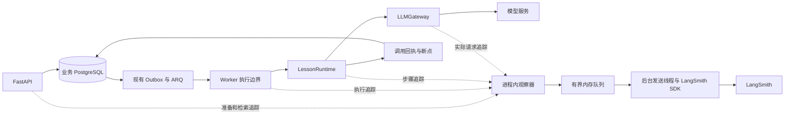

# 教案助手 LangSmith 接入方案

日期：2026-10-20。版本：v1。状态：历史方案，已被用户要求的开源免费 Langfuse 自托管方案替代。

当前实施依据：[Langfuse 接入方案](2026-10-20-langfuse-observability.md)。本文件保留用于说明先前决策，不再作为依赖、配置或部署依据。

平台按本次用户选择采用 **LangSmith**。接入现有 FastAPI、ARQ、LessonRuntime 和 HTTPX 模型网关，通过独立监控模块发送追踪数据；保留现有工作流、模型协议、数据库事务、SSE、租约和调用回执机制。无需引入 LangChain 或 LangGraph。

第一阶段交付任务执行、生成步骤、真实模型请求、质量校验、断点与回执重放的追踪，以及基础监控视图。第二阶段补充 API 准备与知识检索追踪、管理端跳转和评测反馈。默认只上传受控元数据；查看 Prompt 和正文的模式单独启用。

## 1 当前实现和接入依据

以下是对当前工作区的代码核对结果，不代表本次已运行功能验收。

| 位置 | 已有实现 | 接入含义 |
| --- | --- | --- |
| `app/tasks/queue.py` 的 `Dispatcher._execute` | 检查 epoch、领取执行租约、计算累计超时，并处理超时和取消 | 执行 trace 的外层边界必须覆盖这里，仅装饰 Service 会遗漏外层超时处理 |
| `app/services/lessons.py` 的 `WorkflowExecutor` | 工作流路由、事务、断点、版本、终态、后台审查 | 创建业务步骤 span，明确区分执行结果与正式提交结果 |
| `app/ai/runtime.py` | 蓝图、一键流、格式回退、结构化生成、活动、润色、审查和质量重试 | 按逻辑步骤及质量尝试建立层级，不对每个 token 建 span |
| `app/ai/gateway.py` | 自有 HTTPX SSE/JSON 协议，主备尝试、用量和受控错误 | 手动追踪每次实际请求，保留现有 Provider 行为 |
| `app/services/invocations.py` | 唯一调用意图、完整响应、结果未知和原始回执重放 | 区分实际请求与回执复用，避免重放重复计费统计 |
| `record_calls` 与 `CallLog.metadata_json` | 模型、耗时、token、主备、质量结果，span 字段主要在入库时补生成 | 复用业务字段，新增实际执行链的关联信息 |
| `app/api/lessons.py` 与 `app/services/knowledge.py` | 新建教案时先检索，再冻结知识快照，之后交给 Worker | API 检索与 Worker 中读取快照属于不同阶段 |
| `app/factory.py`、`app/tasks/workers.py` | API lifespan 与 ARQ startup/shutdown 分别管理进程资源 | 两条生命周期都要初始化和关闭监控，不能只修改 FastAPI lifespan |
| `docs/埋点指标字典.md` | 产品事件、模型调用、业务事实已有不同统计口径 | LangSmith 追踪作为新增排障视角，不替换原有分母和审计事实 |

工作区已有调用回执及恢复相关的未提交改动。实施前要确认这些接口的最终形态，并保留所有既有改动。本方案只新增该文档，不修改这些实现。

LangSmith 官方支持普通 Python 函数的自定义追踪、手动层级与自定义 UUID，无需先迁移框架。[自定义追踪文档](https://docs.langchain.com/langsmith/annotate-code)

<!-- design-authority:start -->
## 2 设计决策和验收契约

### 问题与用户价值

将一次生成慢在哪里、哪些步骤重试、模型是否实际再次请求、用量来自哪次传输、质量失败发生在哪个模块变成可查询的调用链。监控失效时，教师仍可完成原有生成与编辑流程。

### 范围

- 第一阶段：LangSmith SDK、进程生命周期、执行与步骤追踪、真实模型请求、流式首字时间、质量和回执语义、采样、故障隔离、脱敏、基础监控视图及验证记录。
- 第二阶段：API 准备与真实知识检索、管理端关联、评测与反馈。
- 本次不迁移 LangGraph/LangChain，不改 Provider 协议、业务状态机和正式版本语义；不自动迁移 Prompt 到远端，不补传历史正文，不引入新的监控数据库和投递 Outbox。

### 备选方案与选择

| 方案 | 收益 | 代价 | 决策 |
| --- | --- | --- | --- |
| 现有架构直接接 LangSmith SDK | 保留运行语义，可明确标注业务步骤 | 需要手动埋点和跨执行关联 | 采用 |
| 先迁移 LangChain/LangGraph | 框架节点可获得部分自动追踪 | 要重新验证恢复、预算、流式和事务边界 | 本次不采用 |
| 同时接 LangSmith 与 Langfuse | 两个平台并行分析 | 双倍配置、上报和口径维护 | 本次不采用 |
| 全站 HTTPX 自动追踪 | 快速获得 HTTP 请求信息 | 难以表达回执与质量语义，并可能采集非模型流量 | 本次不采用 |

### 组件和错误路径

业务层调用进程内观察器，观察器建立上下文并把已脱敏的数据交给有界发送队列，后台发送线程调用 LangSmith SDK。数据库继续拥有执行权、调用回执、预算、版本与终态。队列满、云端不可达或 SDK 异常只影响追踪记录，原始业务异常、取消与租约检查继续按原路径处理。

### 验收条件

- **AC-01**：WHEN 开关关闭或改为启用监控，THE SYSTEM SHALL 保持相同业务输入下的模型请求数量、质量重试预算、SSE 契约、版本与唯一终态规则。
- **AC-02**：WHEN 被采样的执行领取租约并开始工作且导出链路未丢报，THE SYSTEM SHALL 建立执行 trace，并按实际发生的步骤记录子 span；每个真实 Provider 请求对应一个 `llm` span。
- **AC-03**：WHEN Worker 恢复导致 epoch 变化，THE SYSTEM SHALL 建立新的执行 trace，使用相同 `business_run_id` 与教案 thread 关联，各子 span 显式携带 thread 元数据。
- **AC-04**：WHEN 复用完整调用回执或有效内容断点，THE SYSTEM SHALL 将其记录为复用步骤，不创建新的真实请求 span，不再次上报该请求的 token 和费用。
- **AC-05**：WHEN 发生传输失败、质量失败、结果未知、取消、租约丢失或业务提交失败，THE SYSTEM SHALL 保留各自受控的结果维度，按已提交事实标记业务结果，且不因追踪改变恢复行为。
- **AC-06**：WHEN 使用默认采集模式，THE SYSTEM SHALL 只上传白名单元数据，不上传 Prompt、正文、选区、反思、知识原文、文件名、教师姓名、密钥和未经处理的异常消息或堆栈。
- **AC-07**：WHEN 发送队列满、LangSmith 超时、返回 401/429/5xx 或 SDK 抛错，THE SYSTEM SHALL 在定义的内存和等待上限内退化、记录本地诊断，并保持原业务执行及取消语义。
- **AC-08**：WHEN 启动或关闭任一 API/Worker 进程，THE SYSTEM SHALL 使用该进程自己的客户端和发送器；关闭有界等待，关闭监控时不产生 LangSmith 网络请求。
- **AC-09**：WHEN 展示用量和费用，THE SYSTEM SHALL 仅汇总实际请求的已知用量，区分未知、估算和 mock，并为自定义模型使用明确匹配的 Provider、模型与价格配置。
- **AC-10**：WHEN 完成第一阶段，THE SYSTEM SHALL 提供覆盖正常与故障场景的测试证据、监控视图说明和开关对照性能测量；远端读取不到的数据不得宣称上传成功。
- **AC-11**：WHEN 第二阶段启用 API 检索追踪，THE SYSTEM SHALL 追踪真实检索阶段，保持业务幂等哈希和队列任务签名兼容，并拒绝把公网入站头直接用作可信 trace parent。
- **AC-12**：WHEN 启用管理端关联，THE SYSTEM SHALL 通过既有管理员权限输出安全追踪引用，不公开 trace、不暴露凭证，且不依赖远端可用性完成管理 GET。
- **AC-13**：WHEN 需要真实远端验收或正文采集，THE SYSTEM SHALL 使用已确定的项目、区域和采集配置；本次方案阶段不发送项目数据，首次验收使用合成内容，生产正文采集需明确启用范围和保留策略。

此区块是验收条件的唯一语义来源。任务和测试表引用 AC 编号；范围发生变化时更新版本与该区块，再检查依赖。
<!-- design-authority:end -->

## 3 接入结构



新增 `app/observability/`，只封装当前需要的 LangSmith 与关闭模式，不建设多平台插件系统：

| 文件 | 责任 |
| --- | --- |
| `context.py` | `ContextVar`、执行身份、父子关系、确定性根 UUID、采样决策和 thread 关联 |
| `tracer.py` | 观察器、无操作实现、开始/结束步骤、显式结果标注、字段白名单和大小限制 |
| `langsmith.py` | SDK 转换、有界队列、后台发送、受控重试、熔断、flush/close |
| `__init__.py` | 工厂和最小公共接口 |

观察器的业务接口包括“开始执行、开始步骤、标注已提交结果、记录复用和结束”。这些是本项目接口，不是宣称存在的 SDK 方法。Runtime 和 Gateway 通过可选注入获取观察器，默认使用无操作实现；现有独立 Runtime 测试与 Gateway mock 继续可运行。

SDK 对象、`self`、数据库 Session、HTTP Request、回调函数、原始异常和整个 Settings 都不能作为自动采集参数。主要使用显式埋点，不直接装饰整个 `execute(self, ...)` 或整个 HTTPX 客户端。保留现有 HTTPX 流式实现，不换成 OpenAI SDK wrapper。

### 生命周期

- API：在 `app/factory.py` 的 lifespan 中启动观察器；停止接收新任务后关闭 Dispatcher，再给监控发送器有限排空时间。
- Worker：在 `app/tasks/workers.py` 的 `startup/shutdown` 中执行相同的启动与关闭逻辑，因为这里不会自动进入 FastAPI lifespan。
- 构造 `create_app()` 只创建可注入的本地对象，不建立云端连接。不要在 import 时创建带线程和网络访问的全局 Client。
- 每个进程持有一个客户端与一个发送线程，跨进程只共享标识符。进程重启重新初始化；禁止把 SDK 对象塞进 Redis/ARQ。
- 配置缺失或 SDK 初始化失败时，监控转为无操作并输出受控错误码；`/live`、`/ready` 保持现有业务含义，监控状态另记本地诊断。

## 4 Trace 层级与跨 Worker 关联

### 身份规则

LangSmith 的一个 trace 包含多个 run/span，其根 run UUID 同时是 trace UUID。业务数据库中的 Run 始终称为 `business_run_id`，避免混淆。[Run 数据格式](https://docs.langchain.com/langsmith/run-data-format)

| 标识 | 规则 | 用途 |
| --- | --- | --- |
| `business_run_id` | 现有数据库 Run ID | 跨恢复和业务查询 |
| `execution_epoch` | 现有执行批次 | 区分恢复前后 |
| 根 `trace_id` | `uuid5(固定项目命名空间, deployment_id + business_run_id + epoch + trace_schema_version)` | 同一次执行的稳定远端身份 |
| 普通子 span UUID | 在本次实际步骤开始时生成，发送重试沿用原 UUID | 防止监控重传制造重复步骤 |
| LLM span UUID | 优先从 deployment、invocation ID 与传输尝试序号派生；无回执模式使用 Run ID、稳定 call ID 与传输序号 | 关联原实际请求；恢复时可以定位而不补造请求 |
| `thread_id` | 用固定命名空间对 deployment、tenant 和 draft 的内部 ID 派生 UUID；无 draft 时从 Run 派生 | 聚合同一教案的多次生成、润色、审查 |
| `invocation_id`、`call_id` | 现有调用账本身份，附带 step 与质量尝试编号 | 关联实际请求、质量结果和回执 |
| `previous_trace_id` | 当前 epoch 大于零时按上一 epoch 推导 | 快速定位上一执行；不保证上一 trace 已成功上传 |

`deployment_id` 在同一部署内稳定，不能用每次发布的 Git SHA 替代；否则重启会破坏追踪关联。发布版本另记 `release`。UUID 派生是关联标识处理，不作为匿名化保证；只有教师/租户分组确有需要且配置独立 HMAC 密钥时才导出其散列引用，否则省略。

`thread_id` 作为 **metadata 字段** 显式传到所有子 span；不要混用 LangSmith 顶层代表 tracing project 的 `session_id`。官方要求子记录也携带 thread 元数据，才能正确进行 thread 查询与用量汇总。[Thread 配置](https://docs.langchain.com/langsmith/threads)

### 第一阶段执行示例

```text
lesson.execute                         chain，当前 epoch 的根
  context.snapshot                     chain，读取已冻结上下文的摘要
  runtime.generate                     chain
    blueprint.attempt                  chain
      invocation.reserve               tool
      llm.request                      llm，真实请求
      receipt.save                     tool
      quality.validate                 chain
      checkpoint.save                  tool
    module.generate                    chain，带 module_id 与 stage
      generation.attempt               chain，带 quality_attempt
        llm.request                    llm，真实请求
        quality.validate               chain
      checkpoint.save                  tool
  business.commit                      tool
```

这只是可能的层级示例，按真实路径生成：一键正常路径只有一次模型请求时，就只创建一次 `llm.request`，多个模块的校验不伪装成多次模型调用。回退到 JSON/DAG 或发生质量修正时，再记录实际新增的步骤和请求。教学活动只记录实际生成的环节。

根观察器在领取租约后启动，覆盖 `_execute` 的剩余预算检查、`executor.execute`、外层超时处理及最终收口。只给 `WorkflowExecutor.execute` 加装饰器不足以覆盖这个边界。尚未领取租约就被拒绝的重复队列投递不创建新的生成 trace。

内部方法吞掉异常并正常返回时，根 span 仍需要显式标注结果。正式成功标记来自现有事务成功提交后的内存通知，不能从“Python 函数返回”或“模型传输完成”推断。观察器不增加数据库事务，也不在业务事务内等待监控网络。租约丢失记录本次执行已失去权限，不能替其他 epoch 宣布业务失败。

### 恢复与异步审查

同一 Run 的 epoch 0 与 epoch 1 分别创建 trace，通过 `business_run_id`、`thread_id` 和 `previous_trace_id` 关联。不把跨进程的 Python 上下文或原来未结束的根对象继续拿来使用。

后台审查本来是独立业务 Run，继续拥有自己的根 trace，与原教案共用 thread；需要时追加 `source_business_run_id`，保存在服务端内部元数据中。审查不延长生成 trace，不阻塞 ready/导出。

首期不修改 ARQ 的 `execute_run(ctx, run_id, expected_epoch)` 参数，不把 tracing context 放进业务幂等输入，也不接受浏览器指定的 parent。官方分布式追踪的 header 只应用于可信内部服务。[分布式追踪与可信边界](https://docs.langchain.com/langsmith/distributed-tracing)

## 5 模型请求与流式信息

`LLMGateway.complete` 表示逻辑调用，内部每次真正进入 Provider 请求的尝试各建一个 `run_type=llm` span。主备尝试挂在同一逻辑调用步骤下；备用尝试是否允许仍由现有 strict outcome 规则决定。

每个实际请求记录以下数据：

| 维度 | 字段和口径 |
| --- | --- |
| 路由 | `route`、`attempt_role=primary/backup`、模型名、Provider 标识 |
| 模型元数据 | `ls_provider`、`ls_model_name`、提示词版本与资产指纹 |
| 调用身份 | `business_run_id`、`invocation_id`、`call_id`、`step_key`、`quality_attempt` |
| 时间 | 请求开始、首个非空正文增量、传输结束；耗时使用 monotonic clock，展示时间用 UTC |
| 用量 | Provider 实际给出的 input/output/total token，及是否已知 |
| 结果 | `transport_outcome`、受控错误码、finish_reason、受控 Provider 请求编号 |

现有 Provider 标识可能只有 `openai_compatible`，这不能等同于 OpenAI 的模型定价。首期沿用受控 Provider 标识并建立同名自定义价格匹配；后续确有需要时增加显式供应商标签，不能按未知 base URL 猜测或上传完整地址。

项目自行消费 SSE，并不向 LangSmith 返回一个流式 generator，因此不能假设装饰器自动测得首字时间。在首次非空正文 delta 时记录一次不含正文的 `new_token` 事件，并附加 `first_token_ms`；HTTP keepalive、usage-only chunk、空 delta 不算首字。每个 token 不做远端更新，只在请求结束时提交一次用量和汇总。[自定义 LLM 用量与首字时间](https://docs.langchain.com/langsmith/log-llm-trace)

Gateway 层只标记传输事实；解析、Schema 与业务质量结果由 Runtime 的校验步骤标记。`Completion` 的公开返回契约保持兼容，用量和追踪映射通过观察器传递，不要求 Provider 返回 LangSmith 格式。

## 6 回执重放与费用规则

| 场景 | 追踪方式 | token 和费用 |
| --- | --- | --- |
| 首次实际发请求并成功 | 一个 `llm.request`，随后回执、校验和提交步骤 | 只在实际请求 span 上报一次已知用量 |
| 主请求明确失败，按原策略走备用 | 两个实际请求 span，各保留传输事实 | 分别记录各自已知用量；失败未知的用量不填零 |
| 传输成功但质量失败，再修正 | 首次 LLM 成功、quality 步骤失败；修正产生新请求 | 两次真实请求都计入已知用量 |
| 恢复时复用完整原始响应 | `receipt.replay`，带原调用身份、response hash 与 capture epoch | 不创建新 `llm` span，不重新上报原 token |
| 恢复时复用模块/活动断点 | `checkpoint.restore` | 不产生模型用量 |
| 意图存在但响应不确定 | `invocation.outcome_unknown`，维持现有停止自动重发规则 | `usage_known=false`、`cost_status=unknown` |
| 取消后旧 Worker 收到完整响应 | 原真实请求仍可报告其受控用量，业务结果标记取消/失去执行权 | 仅报告原请求，不能重新计入恢复请求 |
| mock | 同名步骤加 `is_demo=true`，使用独立开发项目或过滤 | 不配置付费模型价格，不纳入真实费用 |

不从 `result.calls`、恢复预算账本或 `CallLog` 循环补造 LLM span：这些地方可能重复出现同一次历史调用。调用开始时观察真实传输，恢复时观察复用，才有准确语义。

本地关联字段分为 `origin_trace_id`、`execution_trace_id` 和可确定时的 `llm_span_id`：原请求 trace 从回执的 capture epoch 推导，当前执行 trace 使用当前 epoch。重放时沿用原请求引用，并把重放步骤放在当前 trace，不能把两个 epoch 的身份混写。追踪引用不写入 Provider `response_log`，以免改变不可变响应归档的语义。

token 映射：`prompt_tokens → input_tokens`、`completion_tokens → output_tokens`；总量仅在 Provider 提供或分项齐全时确定。当前网关某些缺失用量默认值为 0，实施时需要额外记录 `usage_reported`，否则无法区分“真的 0”与“没有返回”。新增标志若进入回执，必须同时更新安全白名单并验证旧回执兼容；旧数据缺标志时不自动断言已知。

父级步骤不重复写入 child 的 token/cost，由平台聚合。价格在 LangSmith 中按 Provider、模型和生效时间配置；自定义模型、渠道折扣、缓存用量和币种需单独核对。平台价格调整不会自动回填既有 trace，因此先确定价格，再做费用验收。[费用跟踪](https://docs.langchain.com/langsmith/cost-tracking)

LangSmith 展示的是已知观测用量的费用估算。崩溃前未上传、未知结果、缺失 usage 或未采样请求均可能造成缺口；最终费用以 Provider 账单核对。回执已经可靠保存、但原追踪丢失时，首期只显示复用与缺口，不把恢复过程当作新付费请求补报。

## 7 采集内容与访问边界

### 默认 metadata 模式

允许的内容包括：内部随机业务 ID、受控 workflow/route/module_type/stage、epoch、尝试编号、状态和错误码、数量、时间、token、资产/响应指纹、版本、采样信息及已确认非敏感的 Provider 请求编号。用户自定义模块显示名、课题、requirements、查询文本和文件名不作为 tag 或元数据上传。

默认 inputs/outputs 为空或仅含受控结构摘要。`error` 只放受控代码；不自动记录 `str(exc)`、traceback 或原始 SDK/HTTP 异常。数据进入内存发送队列前完成白名单与大小检查；SDK 的输入输出隐藏作为第二层控制，metadata 与 error 同样需要应用层检查。[敏感数据采集控制](https://docs.langchain.com/langsmith/mask-inputs-outputs)

| 模式 | 输入输出策略 | 使用范围 |
| --- | --- | --- |
| `metadata` | 元数据和计数，默认不发自由文本 | 首期所有环境的默认值 |
| `redacted` | 对选定字段做允许清单、脱敏和截断，知识原文仍默认排除 | 第二阶段，合成样例或明确允许的诊断范围 |
| `full` | 保留选定模型请求/响应，仍移除凭证，限制单条大小 | 第二阶段，合成测试优先；生产真实内容需明确配置与保留策略 |

通过 LangSmith workspace/project 权限限制查看者。应用管理员权限与 LangSmith 账号权限独立，教师端不返回监控凭证或公开分享 URL。生产数据是否允许出站、区域、保留期限和删除流程在启用真实项目前确定；关闭追踪不等于删除已经上传的数据。

## 8 配置与进程部署

在现有 `Settings` 中显式定义配置，使用客户端参数传值。当前 `Settings` 从 `.env` 读取并不等同于把所有值写进进程环境，不能只依赖 SDK 自动读取环境变量。

| 配置 | 默认/建议值 | 说明 |
| --- | --- | --- |
| `LANGSMITH_TRACING` | `false` | 应用观察器统一开关，含手动 SDK 调用 |
| `LANGSMITH_API_KEY` | 空，SecretStr/等价敏感字段 | 从忽略的 `.env` 或 Secret 注入，不返回给前端 |
| `LANGSMITH_ENDPOINT` | 启用时显式确定 | 与用户 workspace 区域一致，不从通用示例猜测 |
| `LANGSMITH_PROJECT` | 按环境显式配置 | 建议 `lesson-assistant-dev/staging/prod`；实际 workspace 若按 agent/environment 组织，使用其官方对应定位 |
| `LANGSMITH_WORKSPACE_ID` | 按账号需要配置 | 多 workspace 或服务账号下显式固定目标 |
| `OBS_DEPLOYMENT_ID` | 同一部署稳定的非敏感标识 | 用于 UUID 派生与环境隔离 |
| `OBS_CAPTURE_MODE` | `metadata` | 首期只实现 metadata；其他值在支持前明确拒绝或退化并报警 |
| `OBS_TRACE_SAMPLE_RATE` | `1.0` | 应用层按 Run 确定性采样，环境内保持一致 |
| `OBS_EXPORT_QUEUE_SIZE` | `512` | 每进程最大待发送操作数量 |
| `OBS_MAX_EVENT_BYTES` | `16384` | 单条序列化追踪操作上限，不复制大正文 |
| `OBS_EXPORT_TIMEOUT_SECONDS` | `2` | 每个云端发送请求的受控超时目标 |
| `OBS_SHUTDOWN_TIMEOUT_SECONDS` | `5` | 停机排空总等待预算 |
| `OBS_ID_HASH_KEY` | 空 | 仅在需要教师/租户散列分组时配置；缺失则省略该类引用 |

不要再同时启用 SDK 自身的随机采样配置，避免父子记录或恢复执行被二次抽样。首期可直接把 LangSmith SDK 作为运行依赖加入 `pyproject.toml` 并锁定 `uv.lock`；实施 T0 核对 Python 3.11/3.13、HTTPX/Pydantic 兼容及具体版本，不在方案中猜测补丁版本。

本地 Python 进程继续由 `scripts/run_local.py` 从现有配置启动。容器模式通过 `compose.yaml` 的公共应用环境配置给 API 和所有 Worker 传递相同监控配置；迁移容器无需启用追踪。Dockerfile 已按锁文件安装运行依赖，新增依赖后重新构建镜像，不另加监控容器。密钥仅在运行时注入，不写入镜像层。

项目、区域、权限、配额及订阅能力以实际 LangSmith workspace 为准。普通追踪接入不要求部署 LangGraph Agent Server。

## 9 异步发送与故障隔离

为实现可测试的资源上限，应用自己维护一个有界发送队列。后台发送线程使用 LangSmith Client，关闭 SDK 自动批处理，避免再叠加一个未验证容量的后台队列。优先使用官方批量发送接口处理本队列中的 create/update 操作；具体序列化与调用参数在 T0 用选定 SDK 版本验证。[Client 参数参考](https://reference.langchain.com/python/langsmith/client/Client)

SDK 的 `RunTree` 可用于构造本地 UUID、父子关系与 `dotted_order`；业务线程不直接调用其网络 post/patch。所有操作先转换成受控、不可变的序列化快照再入队，不把完整对象、正文引用或业务可变 dict 留在队列里。每条上传重试沿用原 ID。

资源与失败策略如下，数值为初始设计值，性能验收后再调整：

- 业务线程只做本地记录和 `put_nowait`；不等待队列空位、云端响应或远端项目查询。
- 发送批次不超过 32 条操作，最长等待 1 秒；单操作不超过 16 KiB。队列 payload 理论上限约 8 MiB/进程，实际内存还包括对象和活动 span，需测量验证。
- 每个 trace 最多记录 256 个步骤。当前受控策略 `max_calls=32`，实施时从实际策略读取预算，为根及所有可能的真实请求预留记录额度；普通步骤达到剩余额度时记录一次 `span_limit_reached`，停止新增细节。策略调整时同时验证容量关系，不能因普通细节先占满额度而主动漏掉真实请求。
- 发送请求按明确 timeout 和有限重试配置；最多额外重试 1 次。不得叠加 SDK 默认多轮重试、urllib3 重试和应用重试。
- 连续 5 次发送失败进入 30 秒熔断；期间丢弃远端追踪并记录本地计数，之后有限探测。401 等确定配置错误本进程禁用远端发送，修复配置后重启。
- 队列满时丢弃追踪操作并计数。未能入队的创建操作所对应的后续更新也不继续排队；已创建但结束更新丢失的 span 可能显示不完整，不能伪装完成。
- 不捕获或替换业务的 `CancelledError`、超时和 `LeaseLost`。监控自身异常在监控模块内收口；SDK 网络只发生在发送线程。
- 关闭时停止接受新操作，最多等待 5 秒，再记录未发数量并释放资源。同步 `flush/close` 不在事件循环中无限等待；具体 API 的同步/异步形式以锁定版本为准。[有界 flush 参考](https://reference.langchain.com/python/langsmith/client/Client/flush)

本地结构化诊断包括 `observability_disabled`、`observability_export_failed`、`observability_queue_dropped`、`observability_circuit_open`、`observability_shutdown_timeout`，以及发送、丢弃和待发送数量。日志限频，例如同类错误每分钟汇总一次；不把监控失败写成模型 Provider 故障，不每次插入业务 Issue。

硬 kill 时无法承诺内存追踪可靠送达。下一 epoch 记录 `resumed=true` 和上一 trace 引用；管理员继续从现有恢复页面和数据库核对。首期不把监控导出提升为必须持久投递的业务事实；若未来确需无损追踪，另立持久化导出方案并评估额外存储与隐私成本。

## 10 监控视图与统计口径

### 第一阶段视图

| 视图 | 分组/过滤 | 回答的问题 |
| --- | --- | --- |
| 任务执行 | 根 `lesson.execute`、workflow、epoch、release、business outcome | 哪类任务慢、失败或经常恢复 |
| 模型请求 | 仅 `run_type=llm`，按 Provider、模型、路由、主备分组 | 响应速度、首字、传输故障和用量 |
| 质量修正 | quality 步骤与 retry 标签，按 module_type/stage 分组 | 哪些模块经常不合格、修正多少次 |
| 恢复与复用 | `receipt.replay`、`checkpoint.restore`、resumed、outcome_unknown | 恢复是否减少了真实调用，哪些结果待核对 |
| 用量与估算费用 | 实际 LLM 请求、usage_known、模型价格版本 | 花费集中在哪些路由和模型 |

根 trace 耗时是某一次执行耗时；排队等待从现有 queued/started 时间计算，跨恢复总耗时从业务 Run 第一次开始至终态计算。不要把它们混为一个延迟分布。

传输错误率的分母是实际 Provider 请求；模块质量失败率的分母是被校验的模块/活动尝试；业务失败率按终态 Run 去重，并把取消单列。LangSmith 中多个 epoch 的根 trace 不能直接作为业务 Run 总数。采样或丢报存在时，LangSmith 分布用于排障，精确业务分母继续来自现有业务指标。

首期使用 100% 元数据追踪，验收和数据量稳定后才降低采样率。确定性采样按 `business_run_id` 决定，使同一 Run 的恢复批次一致；失败后不临时补造此前未采样的完整调用链。每条 trace 带采样率，避免把采样费用当作全量费用。

### 告警

先配置视图，再基于实际流量建立阈值。初始建议：15 分钟内至少 20 次真实请求时，Provider 错误率超过 10% 关注；有首字数据的请求延迟对比发布前基线；未知结果出现 1 次即进入现有恢复告警处理；每日模型费用预算由用户确定后设置。前两个数值是待调优的建议，不是现有生产基线。

LangSmith 原生告警可针对错误、延迟和费用等指标；具体分位数、复合条件、最小样本量和去重要求若当前 UI 不支持，保留为查询视图或复用现有告警处理，不宣称已配置。告警渠道、收件人与 webhook 在实施时确定，本方案不发送测试消息。[LangSmith 告警能力](https://docs.langchain.com/langsmith/alerts)

LangSmith 不可用时，不能只依赖 LangSmith 告警发现自身丢报。发送器故障使用本地结构化日志和现有运维日志入口监控。

## 11 第二阶段扩展

### API 准备与知识检索

在 `app/api/lessons.py` 完成权限/幂等命中判断后，为新建操作预分配现有 draft UUID，再开始 `lesson.prepare` trace。这只是提前分配标识，不提前提交草稿。通过同一 draft 派生 thread，使真实 `knowledge.search` 和 `style.resolve` 与后续 Worker 关联。

知识检索记录方法 `lexical_bm25`、候选/命中/冻结数量、耗时与受控片段 ID/指纹。只有真正执行 search 才使用 `retriever` 类型；Worker 的 `context.snapshot` 只记录冻结快照摘要，不重复扮演检索器。检索失败但未创建 Run 时，保留准备 trace 与无业务 Run 的事实。

准备 trace ID 如需带入 Worker，写入服务端内部 `_observability` 元数据，放在业务幂等摘要计算完成之后；禁止把它加入用户逻辑 payload、快照指纹或 ARQ 参数。已有幂等命中沿用原业务对象，不因为 trace ID 变化发生冲突。提交失败时只能标记准备失败，不能宣称 Run 已建立。

### 管理端跳转

为 `GET /api/v1/admin/recovery-runs/{run_id}` 增加可选 `observability` 摘要：平台、项目、当前 epoch、派生 trace ID、采样状态及可用时的私有 trace URL。历史已发生调用的执行引用通过现有调用 metadata 补充，不承诺恢复出从未记录的历史 trace。

URL 使用选定 SDK 的官方生成方式，并在后台获得或缓存；管理 GET 不现场查询 LangSmith。若未生成 URL，只返回可复制的 trace ID 和项目。状态使用 `expected/unknown/disabled` 等准确语义，未远端确认不能写 `uploaded=true`。教师角色依旧 403；前端链接只在管理员页面显示，目标平台再次校验自己的权限。

### 评测与反馈

首期保留 `prompts/`、资产 manifest 和指纹作为运行时来源。后续可把合成教案样例建立为 LangSmith dataset，将 Schema、模块完整性和业务质量门结果映射为受控反馈；模型评审成本单列。教师确认/采用行为仍是产品事件，不自动解释为满意度或教学质量评分。线上自动模型评测和 Prompt 远端发布另行确定范围。

## 12 契约变化与消费者

| 契约 | 当前 | 接入后 | 消费者与一致性验证 |
| --- | --- | --- | --- |
| Runtime/Gateway 构造与方法 | 当前参数与 Completion | 兼容的可选观察器；关闭时无操作 | 独立 Runtime、Gateway 测试及业务 Service |
| 调用与回执日志 | 受控传输字段；缺失用量可能为 0 | 新增明确的 usage 是否已知；追踪关联走执行上下文/本地安全 metadata | `safe_response_log`、回执重放、预算、`record_calls`、管理员序列化和旧回执测试 |
| `CallLog.metadata_json` | span/父 span 等现有字段 | 可选 `observability` 对象，区分原请求 trace、当前执行 trace、LLM span 和 capture epoch | 管理 API、内部排障；保留旧字段与旧记录兼容 |
| `Run.payload` | 业务工作流参数 | 第一阶段无变化；第二阶段可增加服务端内部 origin 引用 | `create_run`、幂等哈希、恢复指纹、管理序列化、Worker；必须证明摘要未改变 |
| ARQ job 参数与 ID | Run ID、expected epoch、现有稳定 job ID | 保持现有契约 | 全部 Worker、Dispatcher 和恢复测试 |
| HTTP/SSE | 现有教师端与管理端契约 | 第一阶段不改；第二阶段管理响应新增可选字段 | API 测试、前端类型与管理员视图测试 |
| Prompt 与受控资产 | 仓库资产校验、实际消费指纹 | 同一来源，指纹作为监控元数据 | AssetBundle、资产验证脚本、Runtime |

第一阶段不需要数据库表或 Alembic 迁移。不把 LangSmith ID 混入现有业务输入/资产指纹，不为追踪操作消耗模型预算。回执原始响应也不因接入自动上传。

## 13 实施任务和依赖

风险等级：L0 文档；L1 局部可逆配置/界面；L2 运行路径改造；L3 真实数据外发或高影响运行操作。任务按序实施；此计划不授权创建并行 agent，也不启动新的 Sprint 或改写活动指针。

| 任务 | 目标与文件集合 | 依赖 | 风险 | 完成证据 |
| --- | --- | --- | --- | --- |
| T0 SDK 契约验证 | 先写本地假传输测试，验证自定义层级、批量 create/update、用量、首字事件、超时/关闭和关停开关；`tests/test_observability_sdk.py`，必要时更新依赖锁文件 | 无；先核对回执接口版本 | L2 | AC-02/07/08/09；记录选定 SDK 版本和公开 API 对应关系；不连接真实平台 |
| T1 观察器与配置 | 新增 `app/observability/*`；修改 `app/core/config.py`、`.env.example`、`pyproject.toml`、`uv.lock`；新增 `tests/test_observability.py`、`tests/test_observability_exporter.py` | T0 | L2 | AC-06/07/08；先失败测试覆盖 NoOp、白名单、采样、大小/队列上限、熔断和有界关闭 |
| T2 进程生命周期 | `app/factory.py`、`app/tasks/workers.py`、`tests/test_worker_entrypoints.py`、`tests/test_observability_lifecycle.py` | T1 | L2 | AC-08；API 与七类 Worker 均持有本进程对象，无 import 网络，重复关闭安全 |
| T3 执行根与业务结果 | `app/tasks/queue.py`、`app/services/lessons.py`、`tests/test_observability_workflows.py` | T2 | L2 | AC-01/02/03/05；覆盖外层超时、内部失败被捕获、取消、租约丢失和事务回滚 |
| T4 模型请求和用量 | `app/ai/gateway.py`、`app/services/invocations.py` 的受控日志白名单；`tests/test_observability_gateway.py`、`tests/test_gateway_receipts.py`、`tests/test_invocation_journal.py` | T3 | L2 | AC-02/05/09；每次真实请求唯一 span，主备独立，首字和未知 usage 正确，旧回执兼容 |
| T5 步骤与回执复用 | `app/ai/runtime.py`、`app/services/lessons.py`；`tests/test_observability_recovery.py`、现有 Runtime/回执回归 | T4 | L2 | AC-01/03/04/05；一键批量与质量循环准确，重放不新增 LLM span/预算/费用 |
| T6 部署配置与视图 | `compose.yaml`、`deploy/README.md`、`docs/LangSmith监控接入.md`、`docs/埋点指标字典.md`；新增配置/文档对应测试仅在必要时 | T5 | L1 | AC-08/09/10；容器配置验证、项目与视图清单、字段口径和开关/回滚说明 |
| T7 故障与性能验收 | 上述观测测试文件、必要的现有集成测试；新增 `scripts/check_langsmith_flow.py`；`docs/verification.md` | T6 | L2，本地 | AC-01/06/07/10；模拟云端失败、并发串线、队列满、开关对照和完整后端回归 |
| T8 合成远端验收 | `scripts/check_langsmith_flow.py`、`docs/verification.md`；通过配置选择隔离的测试项目，不改生产设置 | T7；项目/区域/凭证和合成出站范围确定 | L3，外部写入 | AC-10/13；读取远端确认 trace、父子、token、首字、重放和私有访问；记录证据 ID |
| T9 准备与检索追踪 | `app/api/lessons.py`、`app/services/knowledge.py`、`app/services/lessons.py`；`tests/test_observability_prepare.py`、现有知识/幂等回归 | T8 | L2 | AC-03/11；实际检索可关联，幂等命中不重复检索，内部元数据不改变逻辑哈希 |
| T10 管理端关联 | `app/api/admin.py`、`frontend/src/types.ts`、`frontend/src/Recovery.tsx`；相应前后端管理权限与界面测试 | T9 | L2 | AC-12；权限、离线管理 GET、空链接降级及旧记录兼容 |
| T11 评测与内容模式 | 独立计划明确样例、字段、数据保留和使用权限后再确定文件 | T8；明确需要该扩展 | L3 | AC-06/09/13；仅在授权范围内做内容与评测验收 |

第一阶段完成边界是 T0–T8；第二阶段是 T9–T10，T11 按需。预估第一阶段 3–5 个开发人日，第二阶段额外 1–2 个开发人日；这是单人串行工作的规划估计，取决于 SDK 验证、现有回执改动收敛和真实平台可达性，不是工期承诺。

## 14 测试策略和证据

遵循先失败测试再实现。低层使用假发送器与 HTTPX MockTransport 验证边界，默认测试不得联网；再逐步扩展到现有 SQLite/PG 与 ARQ 恢复回归。观测器自身安全与故障行为需要真实断言，避免只验证“某方法被调用”。

| 测试组 | 必须覆盖的可观察场景 | 对应契约 |
| --- | --- | --- |
| SDK 和配置 | 关闭时零外发、客户端不从错误项目兜底、超时/批量/同步关闭形式符合锁定版本 | AC-07/08 |
| 父子与并发 | 两个教师/Run 并行不串线；嵌套步骤归属正确；后台心跳/维护任务不误继承生成 parent；context 在 finally 复位 | AC-02/03/06 |
| 正常生成 | 一键、蓝图、单模块、活动、润色、审查；每种路径真实模型请求次数与 llm span 一致 | AC-01/02 |
| 流式 | SSE/JSON、空 delta、usage-only chunk、截断、格式回退；首字只有一次，正文 delta 数量不决定 span 数量 | AC-01/02/09 |
| 质量与回执 | 传输成功但质量失败；最后一次允许修正中断后重放；批量回执与部分模块断点并存 | AC-04/05/09 |
| 执行与提交 | epoch 恢复、租约失效、API 取消、外层超时、回执先提交但业务回滚、迟到完整响应 | AC-01/03/05 |
| 用量和价格 | Provider 未给 usage、明确给 0、部分字段、mock、主备各自用量、重放不再次计入 | AC-04/09 |
| 监控故障 | 401/429/5xx、DNS/连接异常、慢请求、满队列、序列化异常、关闭超时 | AC-07/08 |
| 数据采集 | 构造带密钥/私人正文/文件名/恶意异常的输入，检查实际发送 payload 全文无这些内容，含 metadata/error/events | AC-06 |
| 第二阶段 | origin 不改变幂等/恢复指纹、公网 parent 被忽略、管理员权限、远端不可用时管理页可读 | AC-11/12 |

建议回归范围按改动扩展：

1. 新增 `test_observability*` 与 `test_gateway_receipts.py`，快速验证发送和真实请求语义。
2. `test_invocation_runtime.py`、`test_invocation_journal.py`、`test_invocation_integration.py`、`test_runtime_recovery.py`、`test_execution_recovery.py`、`test_streaming_generation.py`、`test_worker_entrypoints.py`。
3. 全量后端 pytest、Ruff、资产校验、Docker Compose 配置验证。
4. 复用仓库现有独立可销毁 PostgreSQL 并发测试环境验证回执与恢复；不用真实用户数据库做破坏性测试。
5. 第二阶段修改前端时，再执行相关前端测试、全量 `npm test` 和构建。

性能测量使用固定合成输入、假模型、相同并发和相同发送故障条件，分别测量开关关闭、正常发送、云端阻塞三种情况。初始目标是正常并发下单次业务流程 P95 额外开销不超过 50ms、首字额外开销不超过 10ms；这些是待测目标。记录样本数量、负载、CPU/内存、发送/丢弃数量，不能以真实 LLM 网络抖动代替开关对照。

远端验收脚本默认只打印计划并检查本地配置；只有显式 live 模式才对隔离项目发送合成数据。真实测试需读取远端结果，保存 trace/项目/SDK 版本和字段断言；不把 API key、合成之外的用户正文或公共分享链接写入证据。硬崩溃测试应在独立验证进程中执行，不能为监控验收终止用户正在使用的 Worker。

## 15 上线与回滚

| 步骤 | 执行动作 | 放行依据 |
| --- | --- | --- |
| 方案收敛 | 确定项目/区域、默认元数据范围，核对回执基线 | 本文契约与 T0 结果一致 |
| 本地实现 | 全程假传输，保持关闭开关 | T0–T7 的测试和性能证据 |
| 合成远端验证 | 单独 dev/staging 项目、100% 采样、metadata 模式 | T8 读取远端证据 |
| 生产小范围 | 先选择一类 Worker；保持其他进程一致的配置定义 | 无新增模型请求、无业务语义回归、无凭证/正文外发 |
| 逐步覆盖 | 依次覆盖生成、结构化、润色、审查；控制总 span 量 | 队列内存、出口流量、丢报和业务耗时符合目标 |

紧急回滚：设置 `LANGSMITH_TRACING=false`，通过现有优雅停止与启动流程使 API/Worker 应用配置；必要时回滚镜像/依赖版本。观察器关闭时不构造发送客户端，业务数据不需要迁移或清理。新增 JSON 元数据兼容旧版本。已经上传的数据按平台保留/删除策略处理，应用开关不负责远端删除。

本方案阶段只写设计文档；安装依赖、修改真实 `.env`、创建远端项目、上传合成/真实数据、配置通知、重启本地服务和部署属于后续实施动作。本次不执行这些动作。

## 16 待确定事项

| 项目 | 当前状态 | 对应处理 |
| --- | --- | --- |
| 监控平台 | 已选择 LangSmith | 按本文推进 |
| Workspace、区域和项目定位 | 尚未提供 | 不影响本地实现；真实远端验收前确定 |
| 凭证与出口可达性 | 未检查，不读取现有 Secret | 通过运行配置注入，真实验收前验证 |
| 默认采集模式 | 本文建议 metadata | 可先实施；需要查看 Prompt/正文时再确定范围 |
| SDK 具体版本和公开 API 细节 | 以 T0 锁定验证为准 | 兼容 Python 3.11/3.13，并固定 uv.lock |
| 模型价格、渠道折扣、币种 | 未配置核对 | 用量可以先接入，费用标记未定价/未知 |
| 保留期、项目权限和通知渠道 | 需结合实际 workspace | 真实环境启用前完成配置说明，不自动发送通知 |
| 现有回执改动验收状态 | 工作区正在变化 | 实施前核对当前接口和已有测试，不覆盖其他任务的改动 |

下一可执行动作是 T0：用本地假传输验证选定 LangSmith SDK 的最小追踪、用量和关闭契约，再据此实施观察器。该步骤不需要生产凭证或远端写入。

## 17 官方参考

以下链接用于核对产品与 SDK 能力，核对日期为 2026-10-20；账号能力、区域和最终锁定版本需在实施时确认。

- [自定义追踪与层级](https://docs.langchain.com/langsmith/annotate-code)
- [Run 数据格式](https://docs.langchain.com/langsmith/run-data-format)
- [自定义 LLM 用量与首字时间](https://docs.langchain.com/langsmith/log-llm-trace)
- [Thread 聚合](https://docs.langchain.com/langsmith/threads)
- [敏感数据采集控制](https://docs.langchain.com/langsmith/mask-inputs-outputs)
- [费用跟踪与自定义价格](https://docs.langchain.com/langsmith/cost-tracking)
- [分布式追踪与可信上下文](https://docs.langchain.com/langsmith/distributed-tracing)
- [Client 参数](https://reference.langchain.com/python/langsmith/client/Client)
- [有界 flush](https://reference.langchain.com/python/langsmith/client/Client/flush)
- [告警能力](https://docs.langchain.com/langsmith/alerts)
