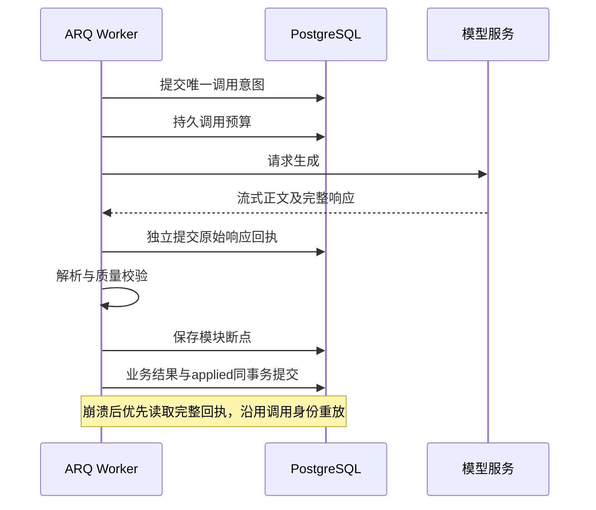

# 模型调用回执与恢复

适用于0005起的一键、结构化、蓝图、活动、润色和审查。目标是：模型完整响应已可靠保存后，Worker崩溃或教案事务回滚只需重放，避免再次调用模型。模型完成却没有任何可靠回执的窗口，当前选择停止自动生成，等待人工核对。

## 写入顺序

1. 以 `run_id + step_key + attempt` 创建唯一调用意图，独立事务提交。恢复时epoch会变化，逻辑调用身份保持不变。上下文指纹绑定原输入、依赖、资料快照及显式模型配置；不保存密钥。
2. 持久化调用预算，再发起模型请求。正文增量继续通过原SSE通道显示。
3. 收到完整响应后，以独立短事务将原文、SHA256和受控调用元数据写入 `llm_invocations`，状态为 `response_saved`。原文最多4MiB，不可由重复回执覆盖。
4. 解析、质量校验、保存模块/活动断点。明确质量失败仍按原有次数和时间预算修正；重放未完成的同一次尝试不额外领取质量额度。
5. 正式模块版本、调用日志、唯一终态及回执 `applied` 在同一个业务事务提交。ARQ确认丢失也不会再次提交版本或调用模型。



## 故障窗口

| 崩溃位置 | 恢复处理 | 是否再次调用 |
|---|---|---|
| 意图尚未提交 | 数据库没有调用意图，按正常流程领取 | 可以首次调用 |
| 意图已提交但无完整回执 | 不能分辨请求未发出、模型在执行或结果丢失，标记结果不确定 | 不自动调用 |
| 模型完成、回执Commit尚未成功 | 归入结果不确定；Provider当前没有已验证的查询/幂等能力 | 不自动调用 |
| 回执已提交、首个模块断点之前 | 校验hash及上下文，重放原始响应 | 否 |
| 部分模块断点已提交 | 复用已通过断点，重放原批量响应补齐剩余模块 | 否 |
| 正式结果Commit之前 | 回执仍在，重放并重新完成业务事务 | 否 |
| 正式结果Commit成功、确认丢失 | 终态与版本已提交，重复任务直接退出 | 否 |

无完整回执时生成任务以 `LLM_OUTCOME_UNKNOWN` 收口，并留下持久告警。关闭告警不恢复终态任务。教师明确创建新的Run会产生新的调用，这可能再次计费。当前不自动猜测上次模型结果，也不通过切备用模型掩盖不确定结果。

## 迟到响应与权限

原请求所属Worker即使已经失去Run租约，仍可为自己的那一次调用归档相同的不可变完整回执；新Worker不能冒用旧传输身份。归档不授予业务写权限，旧Worker仍不能写模块、事件和终态。取消后可能保存已经付费的迟到响应，但不会恢复任务；删除教案后拒绝保存。

管理页面只展示调用身份、阶段、状态、hash、时间、用量和Provider请求编号。Provider未上报的Token用量显示未知，实际上报的0保留。原始响应只供服务端恢复，不通过管理API泄露其他教师正文。现阶段使用PostgreSQL正文列，不引入对象存储双写。

## 可观测数据

在DBX连接 `lesson_assistant` 后，可以通过任务ID检查以下只读SQL。管理页面也显示这些安全元数据。

```sql
SELECT run_id, step_key, attempt, call_id, call_index, status,
       capture_epoch, response_hash, response_saved_at, applied_at, error_code
FROM llm_invocations
WHERE run_id = '替换为任务UUID'
ORDER BY call_index;
```

恢复后同一条记录的 `id`、`call_id`、`call_index`、`response_hash` 保持不变，Run的 `execution_epoch` 可以增加；`response_saved`最终变为`applied`。`capture_epoch`记录原始请求归属，不应被新执行者重写。预算与调用记录中的 `receipt_reused` 可确认发生重放；SSE阶段为 `llm_response_replayed`。

测试及本地数据库迁移结果见[验收记录](verification.md)。这些保证依赖回执事务已经持久成功。Redis锁、ARQ Job ID或本地事务都不能单独让外部模型执行与数据库提交原子化。
