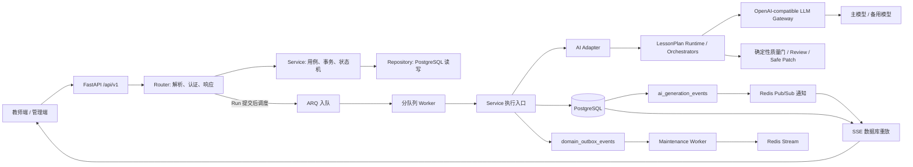
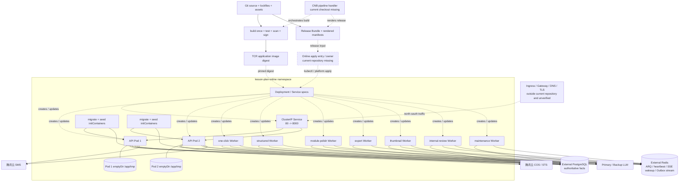
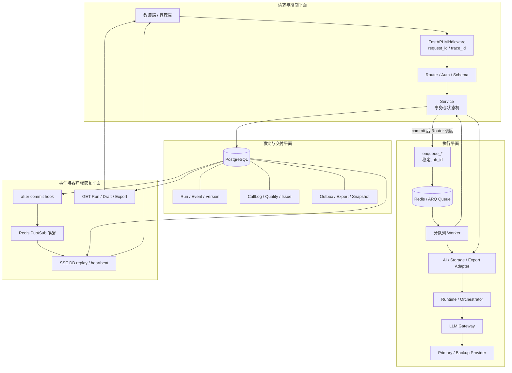
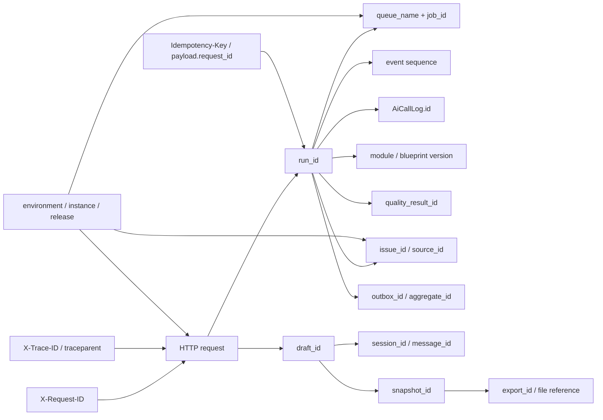
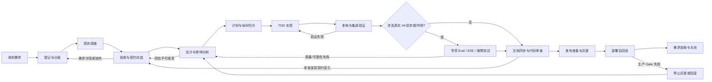

# 教案助手 AI Agent 项目开发指南

- 版本：v1.3.0
- 更新时间：2026-08-28
- 适用仓库：`lesson_plan_backend`
- 静态代码基线：`main@a549003` 与 2026-08-28 当前工作区
- 文档性质：项目级、实现导向、长期维护

> 本指南把《通用 AI Agent 应用架构规范》和《通用 AI Agent 开发指南》映射到当前教案助手后端。它描述本仓库今天真实存在的代码入口、状态、数据库表、任务队列、Prompt、测试与部署边界，不用通用伪代码替代项目事实。

## 0. 先读结论

当前项目不是一个开放式自主 Agent 平台，也没有采用 LangGraph、LangChain 或通用 Multi-Agent 框架。它是一个 FastAPI 模块化单体，使用自研同步 Python 编排运行时完成受控教案生成，再由 PostgreSQL、ARQ、Redis 和 SSE 构成持久化异步执行闭环。

当前最合适的能力定位是“有状态、受约束的 Workflow Agent”：

- 模型负责蓝图、模块正文、润色和语义审查等非确定性内容工作。
- service 层拥有业务状态、事务和终态决定权。
- Adapter 隔离业务模型与算法运行时。
- PostgreSQL 保存草稿、Run、版本、事件、质量结果、调用日志和 Outbox。
- ARQ 按任务类型隔离 Worker；Redis 同时承担队列、Worker 心跳和 SSE 通知加速。
- SSE 的事实源是数据库事件，Redis Pub/Sub 只是低延迟唤醒机制。
- 当前没有通用 Tool Calling、长期 Agent Memory、自主规划循环或真正的多 Agent 分布式协调。

### 0.1 当前必须先处理的 P0 安全项

静态检查已确认 `deploy/deploy-envs.yml` 被 Git 跟踪，且其中存在疑似非占位的部署、集群或应用配置值。这里不复制任何值。

事实、推断与行动必须分开：

| 层级 | 结论 |
| --- | --- |
| 已验证事实 | 文件被 Git 跟踪；文件中的部分敏感字段不是明显占位符；文件头的“仅模板”说明与 `deploy/README.md` 的提交策略存在冲突。 |
| 推断 | 这些值可能曾经或仍然可访问真实基础设施。仅凭仓库无法确认其当前有效性。 |
| 必须行动 | 按可能泄露处理：立即轮换相关凭证，撤销旧值，检查访问日志；将 Secret 改为 CI Secret、密钥管理系统或运行环境注入；从当前版本和 Git 历史中清理；增加 secret scanning。 |
| 禁止行动 | 不得把这些值复制到本文、Issue、聊天、日志、测试 fixture 或新的环境文件。不得仅删除当前文件后就宣称风险消除。 |

在完成轮换和历史处置前，不应把该仓库视为满足生产 Secret 治理要求。

### 0.2 开发时的权威顺序

发生冲突时按以下顺序判断：

1. Alembic、SQLModel、FastAPI router/service/repository 和自动化测试。
2. `schemas/`、`config/`、`prompts/`、`policies/` 及其实际加载代码。
3. 《前端接口对接文档》《就绪状态与流转规则》《AI 算法运行时接入说明》等现行专项文档。
4. 本指南和两份通用 Agent 文档。
5. 历史方案、旧接口样例和 Git 历史记录。

“文件存在”不等于“运行时生效”，“校验脚本通过”不等于“业务链路消费”，“本地生成成功”不等于“数据库、队列、客户端或生产完成”。

### 0.3 证据等级

后续开发报告统一使用以下等级：

| 等级 | 证据 | 可以声称什么 |
| --- | --- | --- |
| E0 | 设计文档或静态代码阅读 | 目标设计、静态实现、待验证推断 |
| E1 | 纯单元测试、Schema/资产校验、lint | 局部逻辑或静态契约通过 |
| E2 | 独立本地 PostgreSQL/Redis 上的 API 与迁移测试 | 本地持久化和接口行为通过 |
| E3 | 真实 ARQ Worker、Redis Pub/Sub、SSE 重连和并发测试 | 本地异步运行闭环通过 |
| E4 | 真实模型 Provider、质量评测、成本和时延数据 | 指定模型与 Prompt 的质量/性能通过 |
| E5 | 部署环境探针、队列心跳、数据库回读和客户端证据 | 指定环境的发布与业务闭环通过 |

E0-E5 是可组合的证据面，不是可互相替代的单调阶梯。E4 真实模型 Eval 不会自动证明 E2 数据持久化或 E3 队列/SSE；E5 部署探针也不能补偿缺失的单元和迁移验证。任何交付都必须列出实际取得的证据集合及未覆盖部分，不能只报告一个“最高等级”。

## 1. 项目架构总览



图中“Run 提交后调度”是当前实现的关键边界：Service 先提交 queued Run，Router 再调用 enqueue，并在抛出异常时调用补偿 service。数据库事务与 ARQ 投递之间因此存在失败窗口；第 11 章给出目标 dispatch Outbox 方案。

### 1.1 进程职责

| 进程 | 当前实现 | 主要职责 | 不应承担 |
| --- | --- | --- | --- |
| API | `main.py`、`app/factory.py` | HTTP/SSE、认证、参数校验、创建用例、查询状态 | 长时间直接执行生产 AI 任务 |
| one-click Worker | `OneClickWorkerSettings` | 整份教案一键生成 | 结构化步骤、导出 |
| structured Worker | `StructuredWorkerSettings` | 结构化单步骤生成 | 一键整份生成 |
| module-polish Worker | `ModulePolishWorkerSettings` | 模块与课后反思润色消息 | 正式保存教师版本 |
| export Worker | `ExportWorkerSettings` | DOCX/PDF 导出 | 修改教案模块事实 |
| thumbnail Worker | `PersonalLessonThumbnailWorkerSettings` | 个人教案缩略图 | AI 生成主链路 |
| internal-review Worker | `InternalReviewWorkerSettings` | 后台跨模块语义审查 | 阻塞教师预览或下载 |
| maintenance Worker | `app/tasks/maintenance_tasks.py` | Outbox、保留策略和健康巡检类后台任务 | 业务请求同步路径 |

生产 Compose 定义七类 Worker。当前 `docker-compose.local.yml` 和 `docker-compose.test.yml` 只定义前五类；而 `/health` 在拆分队列模式下会检查七类心跳。因此本地需要手工启动 internal-review 与 maintenance Worker，或者先修复 Compose，不能把 `/ready` 成功误当成所有 Worker 已就绪。

### 1.2 代码分层

| 层 | 目录/文件 | 规则 |
| --- | --- | --- |
| 启动与装配 | `main.py`、`app/factory.py`、`app/api/v1/router.py` | 只组装应用、中间件、异常处理、健康检查和 Router |
| 核心基础设施 | `app/core/`、`app/db/` | 配置、日志、错误、Redis、数据库 Session；不得含领域业务流程 |
| 业务模块 | `app/modules/<module>/` | 每个模块独立 router/schema/model/repository/service |
| 异步任务 | `app/tasks/` | 入队、Worker 入口、超时/中断收口；业务规则仍回到 service |
| 外部能力 | `app/integrations/` | AI、COS、短信、文档解析、DOCX/PDF 等 Adapter |
| AI 适配层 | `app/integrations/ai/lesson_plan_ai/adapter.py` | 将业务 Draft/Module 映射为运行时请求，再映射回业务内容 |
| AI 运行时 | `app/integrations/ai/lesson_plan_ai/runtime/` | Orchestrator、Gateway、Prompt 装配、规范化、质量门 |
| 受控资产 | `schemas/`、`prompts/`、`config/`、`policies/` | 必须同时证明语法有效、被正确加载、实际行为符合预期 |
| 迁移 | `migrations/versions/` | 唯一 DDL 来源；禁止应用启动时 `create_all()` |
| 测试 | `tests/` | 单元、API、持久化契约和失败场景 |
| 运维脚本 | `scripts/`、`deploy/` | Seed、资产校验、Smoke、审计、压测、部署 |

## 2. 当前能力地图

| 能力 | HTTP/任务入口 | 运行时 | 持久化结果 | 当前性质 |
| --- | --- | --- | --- | --- |
| 一键生成 | `POST /api/v1/lesson-drafts/generations/one-click` | `LessonPlanOrchestrator.run_full()` | Draft、Run、模块版本、事件、质量、调用日志、Outbox | 前台异步 Workflow |
| 结构化生成 | `POST .../interactive`、`POST .../interactive/step` | `ModularLessonOrchestrator.run_next()` | 单模块候选、确认状态、蓝图、事件 | Human Gate Workflow |
| 模块润色 | 同步 `operations`；异步 polish session/message | AI Adapter 的 module-operation 路径 | 同步候选或会话/消息/Run；采用后才形成正式版本 | Candidate Workflow |
| 课后反思润色 | 同步 reflection `operations`；异步 reflection polish | AI Adapter 的 module-operation 路径 | 同步候选或独立会话/消息/Run | 与教案模块隔离 |
| 跨模块审查 | internal-review Worker | `run_lesson_internal_review()` / reviewer | 质量结果、Draft 的 review 状态 | 后台建议性审查 |
| 安全修补 | Runtime 内 Safe Patch | 确定性受控修改 | 体现在最终模块和质量元数据 | 不能替代硬门 |
| 预览 | `POST .../preview` | 确定性装配 | assembly snapshot | 不调用模型 |
| DOCX/PDF 导出 | `POST .../exports` + export Worker | 文档 Adapter | export record、文件 | 外部副作用 |
| 个人教案库 | `/me/personal-lessons/**` | 解析、摘要、风格上下文 | 文档、chunk、style summary | 应用上下文，不是自主 RAG Tool |

不要因为运行时中存在多个带 `Agent` 名称的类，就宣称系统已经是 Multi-Agent。当前这些类主要是同进程中的确定步骤和角色分工，状态所有权仍集中在业务 service 与数据库。

## 3. 核心事实模型

### 3.1 主要数据库表

当前 Alembic 静态 head 是 `0031_issue_samples`。核心表与职责如下：

| 表 | ORM | 事实 |
| --- | --- | --- |
| `ai_lesson_drafts` | `AiLessonDraftTable` | 教案聚合根、当前状态、当前版本指针、模块状态图 |
| `ai_lesson_module_config_versions` | `AiLessonModuleConfigVersionTable` | 模块配置不可变版本 |
| `ai_generation_runs` | `AiGenerationRunTable` | 一次 Workflow 执行的状态、输入、结果、取消和错误 |
| `ai_lesson_module_versions` | `AiLessonModuleVersionTable` | 模块正文版本、来源、确认、依赖快照和硬门结果 |
| `ai_generation_events` | `AiGenerationEventTable` | 按 Run 单调序号的 SSE 事实 |
| `ai_call_logs` | `AiCallLogTable` | Provider、模型、Prompt 版本、token、时延、fallback 和成功语义 |
| `ai_lesson_blueprint_versions` | `AiLessonBlueprintVersionTable` | 蓝图不可变版本及 hash |
| `quality_check_results` | `QualityCheckResultTable` | 硬门、语义审查、finding、分数和内容 hash |
| `domain_outbox_events` | `DomainOutboxEventTable` | 与业务事务同写的待发布领域事件 |
| `ai_module_polish_sessions/messages` | 对应 polish ORM | 模块润色工作副本和对话 |
| `ai_reflection_polish_sessions/messages` | 对应 reflection ORM | 反思润色工作副本和对话 |
| `lesson_assembly_snapshots` | `LessonAssemblySnapshotTable` | 可追溯预览/导出输入快照 |
| `lesson_export_records` | `LessonExportRecordTable` | 导出生命周期与文件引用 |
| `system_issue_records` | `SystemIssueRecordTable` | AI、队列、依赖、容量与后台任务问题事实 |

### 3.2 状态维度必须分离

项目中至少同时存在以下状态，开发时不得用一个布尔值代替：

| 维度 | 当前常见值 | 所有者 |
| --- | --- | --- |
| Run `status` | `queued`、`running`、`completed`、`failed`、`cancelled` | generation/module/reflection service |
| Run `result_status` | `success`、`success_with_warnings`、`degraded`、`cancelled` 等 | 对应执行 service |
| Draft `status` | `creating`、`generating`、`ready`、`ready_partial`、`failed_retryable`、`cancelled` | Draft/Generation service |
| Draft `completion_status` | `writing`、`generating`、`completed`、`failed_retryable`、`cancelled` | Generation service |
| Module `generation_status` | `pending`、`disabled`、`generating`、`ready`、`failed_retryable`、`cancelled`，以及教学过程过渡状态 | Draft 的 `module_state_map` |
| Teaching Process 阶段 | `outline`、`activities`，兼容 outline 过渡状态 | `state_contract.py` 与 Generation service |
| Version `confirmation_status` | `unconfirmed`、`confirmed` | Module/Generation service |
| Hard Gate | `not_checked`、`passed`、`blocked` | Runtime + Generation service |
| Semantic Review | `not_enabled`、`queued`、`running`、`done`、`failed` | internal-review workflow |
| Export | `processing`、`success`、`failed` | ReflectionExportService |

API schema 中有一处描述仍举例 `succeeded`，但当前 service 的实际成功终态是 `completed`。新增客户端或测试应以真实实现、状态文档和既有测试为准，并在修改契约时同步消除描述漂移。

### 3.3 完成不变量

一键生成可以对外完成，至少要满足：

1. Run 已获得终态锁，不能被取消或另一完成者覆盖。
2. 所有目标模块已经产生持久化版本。
3. 阻断型 AI/质量结果不存在。
4. 当前启用模块已经确认到 `current_module_version_map`。
5. Draft 为 `ready`，`completion_status=completed`。
6. Run 为 `completed`，且写入业务正确的 `result_status`。
7. 蓝图、质量摘要、依赖元数据、Outbox 和唯一终态事件与业务终态在同一事务提交。
8. 读取 Draft/Run 能独立证明结果，不依赖内存变量或日志。

结构化生成的单步完成不等于整份教案完成。正式 finalize 会先校验所有启用模块已确认、教学过程不处于只有 outline 的半成品状态，再把 Draft 更新为 `ready/completed`，随后创建初始装配快照。独立预览入口比导出宽松，可对非生成中的当前版本创建带 warning 的快照；导出才强制 Draft `ready/completed` 且 Hard Gate 为 `passed`。

## 4. 真实执行链路

本章只给出当前实现的主要 Happy Path、同步/异步分支和事实边界。完整逐跳证明、关联 ID、只读查询与恢复流程见第 16 章；请求/SSE 字段、状态、错误和 timeout 的精确值仍以各专项契约与当前代码为准。

### 4.1 一键生成

```text
POST /api/v1/lesson-drafts/generations/one-click
  -> LessonGenerationService.create_draft_and_start_one_click_generation
  -> start_one_click_generation
  -> PostgreSQL: 创建 queued Run，Draft 改为 generating
  -> Service commit 并返回 Router
  -> Router 调用 enqueue_one_click_generation
  -> OneClickWorkerSettings
  -> execute_one_click_generation_job
  -> LessonGenerationService.execute_one_click_run
  -> _run_modules
  -> get_lesson_ai_client
      mock: 按模块生成测试内容
      lesson_plan_ai: LessonPlanAiRuntimeClient.stream_full_lesson_modules
  -> asyncio.to_thread(LessonPlanOrchestrator.run_full)
  -> LLM Gateway 主路由/备用路由
  -> Prompt 装配、规范化、质量门、Safe Patch
  -> 持久化模块版本、AI 调用日志、质量结果、事件、Outbox
  -> Draft ready/completed + Run completed + draft_ready/run_completed
```

关键规则：

- 创建 Run 的数据库提交与 ARQ 入队目前是两个阶段，不是一个原子事务。
- `Idempotency-Key` 或请求 `request_id` 用于复用既有 Run；同一 Draft 同时只允许一个活跃前台 Run，后台 internal-review Run 不受此前台唯一约束限制。
- 一键生成 Adapter 当前显式请求 `direct_one_call`，并显式允许 direct fallback。
- Runtime 是同步代码，Adapter 使用 `asyncio.to_thread()` 避免直接阻塞事件循环。
- 流式模型文本只是临时展示；最终模块内容必须以持久化版本和最终替换事件为准。

### 4.2 结构化生成

```text
POST /api/v1/lesson-drafts/generations/interactive
  -> 创建 interactive_step Draft
  -> 创建第一个 queued Run
  -> Service commit 并返回 Router
  -> Router 投递 structured 队列
  -> Structured Worker
  -> ModularLessonOrchestrator.run_next
  -> 保存当前模块候选、质量结果和 SSE 事件
  -> 教师调用 interactive/confirm
  -> confirmed_version_id 成为后续模块稳定上下文
  -> 下一次 interactive/step
  -> 所有模块确认后 interactive/finalize
  -> 创建完整 assembly snapshot
```

教学过程是两阶段 Human Gate：先生成/确认 outline，再生成/确认 activities。下游模块只能读取已确认版本，不能把临时流式文本、未确认候选或润色工作副本作为稳定依赖。

当前正式 finalize 由 `LessonGenerationService.finalize_interactive_generation()` 完成：它校验 Draft、更新完成状态、创建 Preview Snapshot，并按配置创建后台 Review Run。Runtime 中虽然另有 `finalize_structured_lesson()`，但当前后端主链路和测试没有调用它；开发时不得把这段未接线实现当作生产事实。应删除重复实现，或先统一两者契约后再接线。

结构化预算当前由 Settings 强制保持以下大小关系：

```text
module_quality_timeout
  < finalization_reserve
  < structured_deadline
  < structured_worker_timeout
```

实际数值以 Settings、任务代码、运行环境和《生产并发与队列隔离说明》为准，不能把文档中的历史默认值当成当前进程事实。

### 4.3 模块润色

模块润色有两条真实路径：

- 同步单次候选：`POST /lesson-drafts/{draft_id}/modules/{module_id}/operations` 在请求内等待 `_polish_content()`，返回候选并创建已完成的操作 Run；不经过 ARQ。
- 异步对话润色：创建 polish session 后发送 message，生成独立 Run 并进入 module-polish 队列。

异步路径顺序：

1. 创建 polish session，绑定 Draft、Module、目标版本和范围。
2. 发送消息后创建独立 `module_polish_message` Run。
3. Worker 读取稳定的工作正文，生成候选并流式发送。
4. AI 候选只属于会话工作副本。
5. 教师采用后，必须通过 `PATCH /lesson-drafts/{draft_id}/modules/{module_id}` 正式保存。
6. 只有该 PATCH 会创建正式模块版本并推进 Draft 内容版本。

不要让润色 Worker 直接覆盖当前正式模块版本。这条边界保证撤销、版本历史、并发校验和人工选择仍然成立。

### 4.4 课后反思润色

课后反思也有两条路径：同步 `POST .../post-lesson-reflection/operations` 直接等待 Adapter 并保存候选，不创建异步 Run；对话式 reflection polish 才创建 Run 并复用 module-polish 队列。两者的领域对象、session、message 和业务 service 都与教案模块隔离。反思候选：

- 不创建教案模块版本。
- 不改变任何模块确认状态。
- 不应阻断 Draft 的预览和导出。
- 教师采用后通过课后反思保存接口落库。

### 4.5 预览和导出

预览会按当前模块版本进行确定性装配并保存 `lesson_assembly_snapshots`。它拒绝生成中或仍有前台活跃 Run 的 Draft，但允许缺失、未 ready 或 stale 模块进入快照并记录 warning，因此预览不等于可导出。导出才要求 Draft `ready/completed`、Hard Gate `passed`，随后读取或创建快照生成 DOCX/PDF，并写 `lesson_export_records`。

导出成功必须同时具备：

- `export_status=success`。
- 文件引用可读。
- 下载接口权限校验成功。
- 生成文件能被实际打开；仅有数据库 success 或本地临时文件不够。

### 4.6 后台 Internal Review

一键生成完成后可由任务层调度 Review；结构化生成在正式 finalize 后创建 Review Run。只有 `LESSON_INTERNAL_REVIEW_ENABLED=true` 且使用真实 `lesson_plan_ai` Provider 时才启用。

Review 使用已装配的稳定教案事实，写独立 `lesson_internal_review` Run、质量结果和 Draft 的 `semantic_review_status`。它不调用 Safe Patch，不改写已确认模块，也不阻塞教师预览和下载。Review 失败必须被记录为非阻塞质量事实，不能反向把已完成前台 Run 改成失败。

## 5. HTTP 与 SSE 契约

### 5.1 通用 API 规则

- 路径前缀统一为 `/api/v1`。
- 成功响应：`{"code":"OK","message":"success","data":...}`。
- 错误响应：`{"code":"...","message":"...","details":{},"request_id":"..."}`。
- Router 主要做请求解析、依赖注入、调用 service 和响应映射。当前生成/润色入口还在 queued Run 提交后负责调用 enqueue、记录 queue info 和异常补偿；这是必须保留测试的现实边界，也是后续迁入可靠 Dispatcher 的目标。
- Service 使用 `AppError` 体系，不得散落 `HTTPException`。
- 所有资源读取和 SSE 订阅都必须校验当前教师所有权。
- 列表使用统一分页并限制 `page_size <= 100`。
- 时间为 timezone-aware，数据库存 UTC，响应 ISO 8601。

### 5.2 Agent 主链路接口

| 方法与路径 | 用途 | 开发时必须守住的契约 |
| --- | --- | --- |
| `POST /lesson-drafts/generations/one-click` | 创建 Draft 并启动一键生成 | 幂等；ARQ 模式快速返回 Run，inline 会阻塞到执行结束；入队失败必须终态收口 |
| `POST /lesson-drafts/{draft_id}/generations/one-click` | 旧兼容入口 | 已从 OpenAPI 隐藏，不得作为新客户端首选 |
| `POST /lesson-drafts/generations/interactive` | 创建 Draft 并启动结构化生成 | 第一个步骤立即创建，仍是异步 Run |
| `POST /lesson-drafts/{draft_id}/interactive/step` | 生成下一模块/阶段 | 只能基于确认上下文；校验预期状态 |
| `POST /lesson-drafts/{draft_id}/interactive/confirm` | 确认当前候选 | 处理版本竞争；教学过程 outline 不等于模块完成 |
| `POST /lesson-drafts/{draft_id}/interactive/finalize` | 完成并装配 | 所有启用模块确认后才允许 |
| `GET /generation-runs/{run_id}` | 查询 Run | SSE 断线和刷新后的权威兜底 |
| `POST /generation-runs/{run_id}/cancel` | 请求取消 | 先持久化唯一取消终态，再 best-effort abort ARQ；当前不能终止已运行的同步 Runtime/Provider 线程 |
| `GET /generation-runs/{run_id}/events` | SSE | 支持 token、`Last-Event-ID` 和数据库重放 |
| `PATCH /lesson-drafts/{draft_id}/modules/{module_id}` | 正式保存模块 | 手工编辑和采用 AI 候选的唯一正式提交入口 |
| `POST /lesson-drafts/{draft_id}/modules/{module_id}/operations` | 同步模块 AI 候选 | HTTP 请求直接等待模型；候选不自动提交，不是 ARQ Workflow |
| `POST /lesson-drafts/{draft_id}/modules/{module_id}/polish-sessions` | 创建润色会话 | 固定目标版本和范围 |
| `POST /module-polish-sessions/{session_id}/messages` | 启动润色 Run | 候选不自动提交 |
| `POST /lesson-drafts/{draft_id}/post-lesson-reflection/operations` | 同步反思 AI 候选 | 直接等待模型并保存候选；不创建异步 Run，不覆盖正式反思 |
| `POST /lesson-drafts/{draft_id}/preview` | 创建预览快照 | 拒绝生成中/活跃前台 Run；允许当前版本缺失、未 ready、stale 并返回 warning，不等于可导出 |
| `POST /lesson-drafts/{draft_id}/exports` | 创建异步导出 | 返回 export ID，不能假装文件已生成 |
| `GET /lesson-exports/{export_id}` | 查询导出 | 客户端轮询成功后再下载 |
| `GET /lesson-exports/{export_id}/download` | 下载文件 | success、权限和文件可用性三重校验 |

具体请求字段、错误码和示例以 `app/modules/**/schemas.py`、FastAPI `/docs` 和《前端接口对接文档》为准。本指南不复制容易漂移的完整请求体。

### 5.3 SSE 设计

当前 SSE 采用“PostgreSQL 事件事实 + Redis Pub/Sub 唤醒 + 数据库轮询回退”：

1. service 通过 repository 为 Run 分配递增 `sequence` 并写事件。
2. 事务提交后才发布 Redis `event_available` 通知。
3. SSE 首先按 `Last-Event-ID` 从数据库重放缺失事件。
4. Redis 可用时等待通知；Redis 失败时继续数据库轮询。
5. 每条事件使用数据库 sequence 作为 SSE id。
6. 已消费的终态不得再次合成；数据库缺终态但 Run 已终止时才允许恢复事件。

常见事件包括：

- `run_started`
- `style_context_resolved`
- `module_started`
- `module_progress`
- `content_delta`
- `module_done`
- `draft_ready`
- `run_completed`
- `run_failed`
- `run_cancelled`

前端必须把 `content_delta` 当临时展示，把 `module_done` 或最终替换内容当模块阶段结果，把 Run/Draft 查询当恢复事实。任何新事件都要同步：event schema、前端文档、断线重放测试、终态唯一性测试和埋点字典。

## 6. AI Provider、Adapter 与 Runtime

### 6.1 Provider 选择

`app/integrations/ai/factory.py` 当前只有两个业务模式：

| `AI_PROVIDER` | 行为 | 使用场景 |
| --- | --- | --- |
| `mock` | `get_lesson_ai_client()` 返回 `None`，service 使用本地 mock 内容 | 默认开发、API 测试、无需外网的确定性流程测试 |
| `lesson_plan_ai` | 创建 `LessonPlanAiRuntimeClient` | 真实算法运行时联调与生产 |

测试必须优先使用 `mock` 或显式 fake Adapter，不允许常规 pytest 调用真实模型。

### 6.2 Adapter 边界

`app/integrations/ai/lesson_plan_ai/adapter.py` 是业务层与算法层之间的防腐层，负责：

- 把 Draft、模块配置、已确认上下文、个人教案上下文映射成 Runtime request。
- 注入生成模式、模型路由所需的 `runtime_policy` 和流式 callback。
- 使用 `asyncio.to_thread()` 调用同步 Runtime。
- 将 Runtime 返回映射为 `AiGeneratedContent` 或 `AiPolishResult`。
- 把 Runtime 异常归一为业务可理解的 `AiProviderError`。
- 在真实生成前调用 `_assert_gateway_enabled()`，避免具体 Run 静默使用不完整 Gateway。

Adapter 不应：

- 提交数据库事务。
- 决定 Draft/Run 终态。
- 直接返回 ORM 对象。
- 记录或暴露 API Key、完整 Prompt、教师文档正文。
- 在一次调用中偷偷改变模块配置或确认版本。

### 6.3 Runtime 加载优先级

Runtime 加载逻辑当前是：

1. 同步后端 Settings 到 Runtime 所需环境变量。
2. 若环境中可 import 顶层包 `lesson_plan_ai`，优先使用外部包。
3. 否则若配置了 `LESSON_PLAN_AI_RUNTIME_PATH`，尝试从该路径加载。
4. 否则使用仓库内置 `app/integrations/ai/lesson_plan_ai/runtime/`。

这意味着“修改仓库内置 Runtime”不必然改变实际部署行为。每次部署必须记录：

- 实际加载来源：external package、external path 或 bundled。
- Runtime 版本、Git SHA 或制品 hash。
- Prompt/Schema/Config bundle 版本。
- Python 环境和 Provider route。

在没有这些证据时，只能说内置源码已修改，不能说线上 Runtime 已更新。

### 6.4 当前编排组件

内置 `agents.py` 中的主要角色包括：

- `BlueprintPlanner`：生成或整理教案蓝图。
- `ModuleGenerationAgent`：生成模块候选。
- `ModuleQualityGate`：只做确定性模块检查并给出通过、需重生成或低风险提示；它本身不改写正文。
- `CrossModuleReviewer`：跨模块语义审查。
- `SafePatchProcessor`：按受控范围实施安全修补。
- `LessonPlanOrchestrator`：一键完整编排。
- `ModularLessonOrchestrator`：结构化逐步编排。
- `OneClickLessonOrchestrator`：目前只是兼容性别名；业务 Adapter 实际使用 `LessonPlanOrchestrator`。

这些组件是一个进程内 Workflow，不具有独立持久化 lease、独立消息收件箱或跨进程 Agent 身份。新增角色前先判断它是否只是确定性函数、一个 Gateway 调用或一个真正需要独立生命周期的子任务。

### 6.5 Model Gateway

`runtime/llm_gateway.py` 统一负责：

- OpenAI-compatible Chat Completions URL。
- 主/备 Provider 与模型。
- 路由模型选择。
- timeout 与工作流剩余 deadline。
- 技术重试。
- 流式和非流式响应。
- JSON 文本的保守修复。
- fallback 元数据、token 和时延摘要。

当前路由大致分为：

| 路由 | 环境变量模型 | 默认用途 |
| --- | --- | --- |
| one_click | `LESSON_AI_LLM_ONE_CLICK_MODEL` | 整份教案快速生成 |
| structured | `LESSON_AI_LLM_STRUCTURED_MODEL` | 单模块、教学过程两阶段 |
| module_operation | `LESSON_AI_LLM_MODULE_OPERATION_MODEL` | 模块润色、修改和课后反思润色 |
| review | `LESSON_AI_LLM_REVIEW_MODEL` | CrossModuleReviewer / internal-review 语义审查 |
| blueprint | 默认回落 `LESSON_AI_LLM_MODEL` | BlueprintPlanner 的模型补充 |

Fallback 成功仍然是业务成功，只是带有降级事实。必须分别记录：

```text
call_outcome = success
fallback_used = true
primary_attempt_outcome = failed
final_provider = backup
```

不得因为 `primary_errors` 非空就把最终调用记为失败。当前 service 映射存在这项已知缺口，见第 17 章。

## 7. Prompt、Schema、Config 与 Policy

### 7.1 资产不是同一种真相

| 资产 | 当前可确认的运行关系 | 修改要求 |
| --- | --- | --- |
| `prompts/one_click_direct_generation.md` | direct one-click 由 `llm_generation.py` 直接读取 | 更新 Prompt 版本、单测、真实 Eval |
| `prompts/module_generation/` | `prompt_assets.py` 按 module type 选择 | 每种受影响模块做装配和内容回归 |
| `prompts/teacher_output_contract.md` | 教师可见生成前装配 | 必测格式、泄露、数学和可编辑性 |
| `prompts/subject_guides/` | 按学科和学段选择 | 必测路由命中、fallback 和跨学科污染 |
| `config/lesson_quality_patterns.json` | Prompt 装配按学科、学段、课型和课题选择；当前未发现确定性 ModuleQualityGate 直接读取 | 必测路由匹配；若要用于硬门需另行接线和测试 |
| `config/module_registry.json` | Runtime 与后端模块定义的重要输入 | 同步 Schema、Seed、前端契约和迁移影响 |
| `config/feature_flags.json` | Runtime 明确读取跨模块 Reviewer；部分行为还可被 request policy 覆盖 | 每个 flag 都要有消费点和开/关测试 |
| `config/agent_runtime_policy.json` | 有 loader 和静态校验测试；当前静态扫描未发现业务主链路加载其预算 | 在补齐消费前只能视为目标策略，不能宣称已强制执行 |
| `config/safe_patch_policy.json` | 资产脚本读取并与代码白名单交叉检查；实际 Gate 主要使用代码常量 | 修改时同步代码与 JSON，并验证真实 Gate 行为 |
| `policies/*.yaml` | 已登记，资产脚本只检查文件存在；当前不解析内容且未发现应用主链路加载 | 设计/治理资产，不是运行时事实 |
| `schemas/*.schema.json` | 受控契约与资产校验；API 仍由 Pydantic schema 执行 | 必须防止 JSON Schema 与 Pydantic 漂移 |
| `assets/manifest.json` | 检查必需文件、JSON 语法、状态和专项规则 | 通过只证明资产完整与静态规则，不证明行为生效 |

当前静态扫描还没有发现应用主链路按文件名读取 `prompts/system_prompt.md`、`blueprint_generation.md`、`one_click_generation.md`、`interactive_generation.md`、`module_operations.md` 和 `quality_review.md`。CrossModuleReviewer 的一段 Prompt 仍在 Python 中内联。修改这些文件前必须先证明消费路径；若它们只是设计参考，应在 Manifest 中显式标记，而不是让维护者误以为已上线。

### 7.2 Prompt 修改标准流程

1. 先用 `rg` 找到真实 loader 和调用点，确认改的是活跃 Prompt。
2. 明确影响的 workflow、module type、grade band、subject 和 route。
3. 先补失败测试：Prompt 装配、必需规则、禁用词、输出边界或快照语义。
4. 修改 Prompt；不要把业务状态机、Secret 或未经裁剪的用户隐私塞进 Prompt。
5. 更新 `prompt_version` 或生成 bundle 版本，确保 `ai_call_logs` 能定位版本。
6. 运行 `tests/test_prompt_assets.py` 及受影响 Runtime 测试。
7. 运行 `python -X utf8 scripts/validate_assets.py`。
8. 对 `evals/cases_v1.jsonl` 全量回归，按 `rubric_v1.json` 记录基线、候选和差异。
9. 真实模型评测必须记录 Provider、模型、参数、Prompt hash、case ID、token、时延和原始结果的受控引用。
10. 未达到质量阈值时回滚 Prompt bundle，不用线上热修文案掩盖失败。

### 7.3 禁止的 Prompt 做法

- 修改一个未被 loader 使用的 `.md` 后宣称线上 Prompt 已更新。
- 在日志中打印完整 system/user Prompt 或个人教案正文。
- 依赖模型自行遵守数据库状态和权限规则。
- 用 Prompt 代替 Pydantic、Schema、确定性校验或数据库约束。
- 无版本号、无 Eval、无回滚包地直接覆盖生产 Prompt。
- 把模型输出中的 URL、指令、文件名或工具参数直接当可信输入执行。

### 7.4 Runtime Policy 的正确演进

要让 `config/agent_runtime_policy.json` 成为真实控制面，必须完成：

1. API/Worker 启动时加载并校验 policy。
2. 将 workflow policy 解析为不可变 `ResolvedExecutionPlan`。
3. 把 deadline、最大调用数、并发数、token 上限、重试和降级路径传入 Runtime。
4. 每次模型调用前原子扣减预算，而不是只在文档中描述。
5. 在 Run 中持久化 policy version、resolved plan 和实际消耗。
6. 对预算耗尽、配置冲突、fallback 和恢复写集成测试。
7. 让 Settings、JSON policy 和 Worker timeout 只有一个解析优先级，避免三套真相。

在此改造完成前，开发者应以 `app/core/config.py`、Adapter 注入值和 Runtime 真实分支为执行事实。

## 8. 环境配置

### 8.1 环境文件

仓库根目录当前只跟踪 `.env.example`；部署目录还跟踪多个环境模板，并错误跟踪了第 0.1 节所述待处置配置文件。`.env.local`、`.env.test`、`.env.prod` 应由开发环境、CI 或部署系统创建，不得提交 Secret。

README 提到 `.env.prod`，但当前 checkout 没有 `.env.prod` 或 `.env.prod.example`；生产配置应由正式 Secret/配置管理流程生成，不能把 `.env.example` 直接当生产模板。

PowerShell 本地初始化：

```powershell
if (Test-Path -LiteralPath .env.local) {
    throw ".env.local 已存在；请人工合并 .env.example，禁止覆盖本地配置"
}
Copy-Item -LiteralPath .env.example -Destination .env.local
$env:ENV_FILE = ".env.local"
```

建议的环境职责：

| 文件 | 用途 | 数据库/Redis | AI | 队列 |
| --- | --- | --- | --- | --- |
| `.env.local` | 开发与手工联调 | 本机 Docker | 默认 mock，可显式真实 | inline 或本地 ARQ |
| `.env.test` | 自动 pytest | 仅独立可销毁本地实例 | mock/fake | 默认 inline |
| 联调环境 Secret | 共享 API 手工联调 | 受控远端实例 | 可真实 | ARQ |
| 生产 Secret | 生产 | 外部 PostgreSQL/Redis | 真实且完整 | ARQ |

README 中的 `.env.test` 还承担共享 dev 联调配置；而 pytest fixture 会逐 case `downgrade base -> upgrade head -> downgrade base`，并执行 Redis `flushdb()`。因此必须物理区分：

- 共享联调 `.env.test` 只能用于手工 API/Compose 联调。
- 自动 pytest 必须覆盖为独立本地 PostgreSQL 和独立 Redis DB/实例。
- 绝不能对共享或生产数据库运行默认 pytest。

### 8.2 AI 最小配置

默认确定性开发：

```dotenv
AI_PROVIDER=mock
TASK_QUEUE_MODE=inline
```

真实 Runtime：

```dotenv
AI_PROVIDER=lesson_plan_ai
LESSON_AI_LLM_ENABLED=true
LESSON_AI_LLM_PROVIDER=<provider>
LESSON_AI_LLM_BASE_URL=<openai-compatible-base-url>
LESSON_AI_LLM_API_KEY=<secret-from-runtime-injection>
LESSON_AI_LLM_MODEL=<model>
TASK_QUEUE_MODE=arq
```

不要在文档、Git 或命令行历史中写真实 Key。`.env.example` 目前只是变量清单；备用 Provider、工作流路由模型、timeout 和 token 上限必须再通过第 10.4 节所述的 `ENV_FILE -> Settings -> Adapter -> Runtime` 测试证明生效。

### 8.3 当前生产校验缺口

`Settings.validate_production_safety()` 已拒绝：默认 JWT、默认管理员密码、通配 CORS、inline 队列、短信调试、mock AI、本机数据库/Redis、错误存储配置。

但当前它没有在 `AI_PROVIDER=lesson_plan_ai` 时强制验证：

- `LESSON_AI_LLM_ENABLED=true`
- API Key 非空
- 模型非空
- Base URL 合法
- 每个必需 route 可解析

API startup 和 `/ready` 只检查 PostgreSQL 与 Redis；`/health` 增加 ARQ 心跳，但三者都不检查 LLM Gateway 能力。因此发布前必须另做 Provider capability probe，后续应将“配置完整性”纳入启动校验，将“非破坏能力探针”纳入运维检查。

### 8.4 队列配置

默认拆分队列：

| kind | 默认 queue | max jobs | job timeout | 估算时长 |
| --- | --- | ---: | ---: | ---: |
| one-click | `lesson_plan:one_click` | 8 | 300s | 45s |
| structured | `lesson_plan:structured` | 3 | 300s | 120s |
| module-polish | `lesson_plan:module_polish` | 6 | 300s | 25s |
| export | `lesson_plan:export` | 4 | 180s | 10s |
| thumbnail | `lesson_plan:personal_lesson_thumbnail` | 4 | 90s | 10s |
| internal-review | `lesson_plan:internal_review` | 2 | 300s | 60s |
| maintenance | `lesson_plan:maintenance` | 2 | 300s | 项目配置 |

这些是配置默认值，不是生产容量结论。调参必须基于 Provider 配额、数据库连接池、CPU/内存、P95 时延、队列等待和错误率压测。

## 9. 本地启动

### 9.1 前置条件

- Python 3.11+；镜像默认可使用 Python 3.12。
- `uv`。
- Docker Desktop 与可用的 Linux container daemon。
- Node.js 20.9+ 只用于离线 MathJax/DOCX 公式渲染链路，不是 FastAPI 主服务运行依赖。
- 可用端口：PostgreSQL `54321`、Redis `63791`、API `8000`。

### 9.2 推荐：宿主机 API + Docker 依赖

```powershell
if (Test-Path -LiteralPath .env.local) {
    throw ".env.local 已存在；请人工合并 .env.example，禁止覆盖本地配置"
}
Copy-Item -LiteralPath .env.example -Destination .env.local
$env:ENV_FILE = ".env.local"
uv sync
docker compose -f docker-compose.local.yml up -d postgres redis
uv run alembic upgrade head
uv run python scripts/seed_lesson_config.py
uv run uvicorn main:app --host 127.0.0.1 --port 8000 --reload
```

默认 `.env.example` 的数据库与 Redis 地址已经对应宿主机端口。字典 Seed 是幂等入口；新增字典时仍需验证重复运行不产生重复数据或漂移。

这组命令只完成依赖、迁移、Seed 和 API。`TASK_QUEUE_MODE=auto` 在 `local` 环境会解析为 `arq`，因此要实际生成教案，还必须按 9.4 启动 Worker；若只做单进程调试，则显式切换 9.3 的 inline 模式。

### 9.3 inline 调试

```powershell
$env:ENV_FILE = ".env.local"
$env:TASK_QUEUE_MODE = "inline"
$env:AI_PROVIDER = "mock"
uv run uvicorn main:app --host 127.0.0.1 --port 8000 --reload
```

inline 适合断点和快速 API 测试，但不能证明 ARQ、排队、Worker 重启、中断收口、Redis Pub/Sub 或跨进程并发正确。

当前 enqueue 函数在 inline 模式会直接 `await execute_*`，所以启动生成的 HTTP 请求会等整个任务执行完才返回，不具备生产异步响应语义。涉及前端等待体验、timeout 或 SSE 建连顺序时必须切到 ARQ。

### 9.4 ARQ 分进程调试

每个 Worker 和 API 都是前台阻塞进程，必须各开一个独立 PowerShell 终端。环境变量不会在终端之间传播，所以每个终端都先重复执行：

```powershell
$env:ENV_FILE = ".env.local"
$env:TASK_QUEUE_MODE = "arq"
```

然后每个终端只选择下面一条命令运行，不能把整段作为顺序脚本执行：

```powershell
uv run arq app.tasks.generation_tasks.OneClickWorkerSettings
uv run arq app.tasks.generation_tasks.StructuredWorkerSettings
uv run arq app.tasks.generation_tasks.ModulePolishWorkerSettings
uv run arq app.tasks.generation_tasks.ExportWorkerSettings
uv run arq app.tasks.generation_tasks.PersonalLessonThumbnailWorkerSettings
uv run arq app.tasks.generation_tasks.InternalReviewWorkerSettings
uv run arq app.tasks.maintenance_tasks.MaintenanceWorkerSettings
uv run uvicorn main:app --host 127.0.0.1 --port 8000 --reload
```

### 9.5 全容器启动

```powershell
docker compose -f docker-compose.local.yml up -d --build
docker compose -f docker-compose.local.yml exec api uv run --no-sync alembic upgrade head
docker compose -f docker-compose.local.yml exec api uv run --no-sync python scripts/seed_lesson_config.py
```

当前 local Compose 不包含 internal-review 和 maintenance 服务。若要用 `/health` 验证完整拆分队列，应补齐这两个服务或手工启动；不要为了让探针变绿而删掉健康检查。

### 9.6 健康检查语义

| 端点 | 检查 | 能证明 | 不能证明 |
| --- | --- | --- | --- |
| `/live` | 进程响应 | API 进程活着 | DB、Redis、Worker、LLM 可用 |
| `/ready` | PostgreSQL + Redis | API 基础依赖可用 | Worker、LLM、队列消费正常 |
| `/health` | PostgreSQL + Redis + ARQ 心跳/队列信息 | 当前配置期望的 Worker 可见 | 真实 LLM 成功、业务 Run 可完成 |
| 业务 Smoke | 创建/查询/流式/产物回读 | 指定业务链路闭环 | 生产容量和长期稳定性 |

## 10. 日常开发方法

### 10.1 标准 TDD 循环

每个变更按以下顺序：

1. 写清用例、输入、输出、状态变化、失败和权限边界。
2. 找到当前事实源和唯一状态所有者。
3. 先写最小失败测试。
4. 实现最小代码，不顺手重构无关模块。
5. 运行受影响单元测试。
6. 使用独立本地 PostgreSQL/Redis 运行 API 与持久化测试。
7. 涉及异步时运行真实 ARQ/SSE 集成测试。
8. 涉及真实模型时运行固定 Eval slice，再运行全量 Eval。
9. 更新所有受影响文档和资产清单。
10. 输出已取得的证据集合、已验证事实、未知项和阻塞项。

### 10.2 新增业务模块

新增 `app/modules/<name>/` 时使用：

```text
<name>/
  __init__.py
  router.py
  schemas.py
  models.py
  repository.py
  service.py
  dependencies.py   # 仅需要时
  events.py         # 仅需要时
  tasks.py          # 仅需要时
```

规则：

- Router 不写业务规则和事务。
- Service 管理用例、事务、状态机和 Adapter。
- Repository 只做查询/写入，不提交事务，不返回 API schema。
- Table model 以 `Table` 结尾；API schema 不继承 Table。
- 外部能力必须经 Adapter；测试提供 fake。
- 先做模块内边界；不要创建全局 `crud.py`。

### 10.3 修改现有 Agent Workflow

先回答以下问题：

1. 变更属于 API 准入、持久化编排、Runtime、Gateway、Prompt、质量门还是产物层？
2. 哪个 service 是状态唯一写入者？
3. 是否新增 Run、事件、版本、质量记录或 Outbox？
4. 失败发生在入队前、排队中、执行中、提交中还是提交后？
5. 重试是复用 Run、创建新 Run，还是只重试 Provider attempt？
6. 取消如何传播，唯一终态如何保证？
7. 客户端如何断线恢复？
8. 现有 mock/fake 是否能覆盖新分支？
9. 真实模型质量、成本和时延阈值是什么？
10. 需要同步哪些接口、状态、错误、运行时和部署文档？

若这些问题没有答案，不要直接在 `agents.py` 中增加一个新类来“解决”。

### 10.4 新增或修改模型路由

修改 route 时必须同时处理：

- `app/core/config.py` 的 Settings 字段。
- `.env.example` 和部署环境模板。
- Adapter 的环境变量转发 `_sync_runtime_env_from_backend_settings()`。
- `llm_gateway_for_route()` 的解析、主/备选择和 timeout。
- `ai_call_logs` 的 provider/model/fallback 事实。
- `tests/test_llm_gateway_streaming.py` 的路由、超时、流式和 fallback 用例。
- 《AI 算法运行时接入说明》和生产配置。

当前存在一个容易被忽略的配置断点：`.env.example` 定义了 Blueprint、一键、结构化、润色等独立 token 上限，但对应字段没有完整进入 `Settings` 和 Adapter 的环境转发列表。本地仅通过 `ENV_FILE=.env.local` 加载时，这些额外值可能被 Pydantic 忽略，Runtime 读不到；容器直接把变量注入进程环境时行为又可能不同。新增配置必须写一条端到端测试：环境文件 -> Settings -> Adapter -> Runtime Gateway，而不是只测 `os.getenv()`。

备用 Provider 也必须做真实配置测试。当前实现只有独立 backup key 存在时才构造完整备用 Provider；“backup key 留空自动复用主 key”的模板描述不应未经验证直接当作事实。

### 10.5 新增模块类型

新增标准或自定义模块类型至少检查：

1. `config/module_registry.json` 中的稳定 `module_type`、显示名、顺序、依赖和是否必需。
2. lesson config Seed/数据库字典与前端选项契约。
3. `schemas/` 中输入、输出、模块状态和依赖契约。
4. `prompt_assets.py` 的 module prompt 路由与 fallback。
5. `prompts/module_generation/<module>.md`。
6. Runtime normalizer、teacher-view sanitizer 和质量门。
7. Draft `module_state_map`、版本 map、确认与 finalize 逻辑。
8. 预览、DOCX/PDF 和历史恢复。
9. 一键、结构化、手工编辑、润色、重试和取消测试。
10. 模块注册、接口、数据库和 AI 文档同步。

稳定 ID 一旦进入持久化、事件、前端状态或 Prompt，就不得因为修改中文展示名而改变。

### 10.6 新增外部 Tool 或 RAG

当前项目没有通用 Tool Gateway。若未来接入教材检索、搜索、题库、文件转换或外部业务写入，不得直接在 `agents.py` 内调用 SDK。先建立：

```text
Runtime
  -> ToolPort
  -> ToolGateway
      -> allowlist / schema validation
      -> tenant and user authorization
      -> timeout / retry / circuit breaker
      -> idempotency key
      -> side-effect level and human gate
      -> audit receipt
  -> Adapter / external service
```

RAG 最小契约应包含：`tenant_id`、`user_id`、数据来源、文档版本、chunk ID、权限过滤、检索参数、命中文本 hash 和引用。个人教案库上下文不能绕过教师所有权，也不能把解析文档中的指令当作系统指令。

涉及写外部系统、发送消息、删除文件或消费额度的 Tool 默认需要幂等和执行回执；高风险操作需要人工确认。模型只能提出 Tool Request，不能自行绕过授权执行。

### 10.7 新增异步任务

新增 ARQ 任务时：

1. 定义稳定 job name 和 `job_id`。
2. 决定复用队列还是新增隔离队列；不要随意增加进程。
3. 在 Settings 中定义 queue、max jobs、timeout、估算时长和健康 key。
4. `enqueue_job()` 返回 `None` 必须视为未入队，而不是成功。
5. Worker 入口只加载 ID，再从数据库读取最新业务事实。
6. 对 Worker timeout、redeploy cancellation、重复投递和终态竞争做收口。
7. 增加 `/health` 期望心跳、Compose/K8s 服务和运维告警。
8. 测试入队失败、重复 job ID、Worker 未消费、中断恢复和幂等。

### 10.8 新增迁移

1. 先修改 ORM 和领域契约测试。
2. 创建单一线性的 Alembic revision；当前 head 为 `0031_issue_samples`。
3. 新表包含项目规定的 ID、`created_at`、`updated_at`；需要时增加 `tenant_id`、软删除和 `version`。
4. 对唯一键、外键、索引、默认值和 UTC 时间语义显式设计。
5. 迁移必须在空库 `upgrade head` 成功。
6. 数据回填需要生产量级的分批、锁时长、失败恢复和可观测性验证。
7. 验证从真实上一版本升级，不只验证空库。
8. 明确 downgrade 能力；不可逆迁移必须设置发布和回滚 Gate。
9. 更新数据库契约文档和部署顺序。

当前 `0030_system_issue_records.py` 的历史回填会先在内存累积完整 rows，再分批 insert。大历史库上线前必须做规模验证或改为游标/分页处理。

## 11. 事务、幂等与可靠投递

### 11.1 事务所有权

- Repository 不调用 `commit()`。
- Service 决定一个业务用例的提交和回滚。
- Worker 复用 service 执行入口，不另写一套状态机。
- Runtime 不操作业务数据库。
- 终态 Run、Draft、模块版本、质量记录、Outbox 和终态事件尽量同事务提交。
- Redis 通知必须发生在数据库 commit 之后。

### 11.2 当前幂等层

| 层 | 当前机制 | 仍需加强 |
| --- | --- | --- |
| HTTP | `Idempotency-Key` / `request_id` 查询既有 Run | 同 key 不同 payload 校验、真实并发请求 |
| Draft | 锁定 Draft，查询活跃 Run | 高并发竞争测试 |
| 数据库 | 依赖唯一约束并捕获 `IntegrityError` | 明确所有 workflow 的唯一约束 |
| ARQ | 稳定 `_job_id` | 所有 enqueue 检查返回值、重复投递集成测试 |
| Worker | 按 Run ID 读取状态，终态时跳过 | lease/fencing 与失联恢复仍不完整 |
| SSE | Run 内递增 sequence、Last-Event-ID | 真实 PostgreSQL 并发 append 测试 |
| Outbox | 业务事务内 pending event、维护任务重试 | 真实 Redis Stream、consumer/ack/replay |

### 11.3 正确的准入闭环

当前实现先提交 Run，再入 ARQ。改进目标应是：

```text
事务 A：
  校验请求与权限
  锁聚合根
  解析幂等
  创建 Run
  写 dispatch-intent Outbox
  commit

Dispatcher：
  锁 pending dispatch-intent
  enqueue with stable job_id
  检查返回值
  写 dispatch receipt / retry

Worker：
  读取 Run
  原子 claim
  执行
  写终态与业务 Outbox
```

在引入 dispatch Outbox 前，Router 对 `job_enqueued=false` 必须立即调用 `mark_*_enqueue_failed()`，不能保留永久 `queued`。

### 11.4 当前假入队缺口

`enqueue_one_click_generation()` 已记录 `job is not None`；但 structured、module polish 和 reflection polish 当前忽略 `enqueue_job()` 返回值并固定 `job_enqueued=true`。即使 one-click 返回 false，路由也只记录 queue info，没有将 Run 收口为失败。

修复验收必须包含：

- `enqueue_job()` 返回 `None`。
- 稳定 job ID 已存在。
- Redis 接收后客户端超时。
- 入队成功但 Worker 长时间无心跳。
- Dispatcher/Router 重试不产生第二个业务 Run。
- Run 最终为可解释的失败、重试等待或已调度状态，不能永远 queued。

### 11.5 取消与终态竞争

取消不是只改一个状态字段。当前实现与目标边界如下：

1. 用行锁重新读取活跃 Run，保证只有一个参与者赢得终态。
2. 当前实现先持久化 `status=cancelled`、`cancel_requested_at`、Draft/会话状态和唯一 `run_cancelled` 事件并提交；这是权威取消事实。
3. 提交后再 best-effort 请求 ARQ abort；队列中止失败不能撤销数据库取消终态。
4. Worker 启动和最终提交前会根据持久化状态跳过或放弃写入；晚到完成者获取终态锁后必须输给已提交的 cancelled。
5. 当前一键 Runtime 运行在 `asyncio.to_thread()` 的同步线程中，ARQ/coroutine 取消不能终止底层线程或正在进行的 Provider HTTP；service 通常要等 Runtime 返回后才再次看到取消。这是成本和资源泄漏风险，不得描述为已传播到 Provider。
6. 目标实现应让 Worker 在每个阶段、模型流式循环和外部调用边界检查持久化 cancellation token，并让 Gateway/HTTP 客户端合作取消或将不可控调用隔离到可终止进程。
7. 还需收口相关 pending issue、队列事实和会话状态。

当前 issue 收口主要覆盖完成/失败，取消后的 pending issue 仍是已知缺口。

### 11.6 Outbox

`domain_outbox_events` 是领域事件可靠发布入口，维护 Worker 将其发布到 Redis Stream。新增 Outbox 事件时必须定义：

- `aggregate_type`、`aggregate_id`。
- 稳定 `event_type` 和 schema version。
- 去重键或消费者幂等策略。
- `publish_status`、重试次数、下次尝试时间。
- 最大重试后 dead-letter/人工处理方式。
- 发布成功与数据库更新之间的崩溃恢复。
- 消费者 read、ack、重放和保留策略。

当前测试使用 fake Redis，不能代表完整 Stream 集成已验证。

### 11.7 当前恢复能力边界

项目已有持久化 Run、模块版本、事件序列和 ARQ 重投基础，但目前没有通用的 Run lease、fencing token、独立 StepRun/CallAttempt 状态账本或 durable checkpoint 实体。恢复主要是按数据库终态和现有版本继续，而不是任意步骤精确恢复。

因此文档和产品不得宣称“支持任意节点断点续跑”。新增长时间、多步骤或有外部副作用的 Workflow 时，应先补 claim/lease、checkpoint、attempt 和 reconciliation 契约。

## 12. 质量门与人工确认

### 12.1 质量分层

| 层 | 当前组件 | 失败策略 |
| --- | --- | --- |
| 输入约束 | Pydantic + input constraints | 拒绝非法请求 |
| 结构/格式规范化 | normalizer、sanitizer | 保守修复或失败 |
| 模块硬门 | `ModuleQualityGate` 等确定性检查 | 通过、阻断或向编排器发出重生成信号；Gate 本身不改正文 |
| 跨模块语义审查 | `CrossModuleReviewer` | 默认后台，记录 warning/finding，不阻塞可用性 |
| Safe Patch | `SafePatchProcessor` | 仅允许白名单范围的确定性改动 |
| Human Gate | 结构化确认、采用润色候选 | 人工选择后才正式提交 |
| 离线 Eval | `evals/` rubric | 当前人工评分，尚未形成自动发布门 |

### 12.2 Candidate 与 Commit

任何模型输出先是 Candidate，不是业务事实。成为正式内容需要：

```text
Candidate
  -> parse / normalize
  -> schema validation
  -> hard quality gate
  -> safe patch if allowed
  -> persist immutable version
  -> human confirm or workflow auto-confirm policy
  -> update current version pointer
```

润色 Candidate 只有通过模块保存接口后才 Commit；结构化 Candidate 只有 confirm 后才成为下游稳定上下文；一键生成采用后端受控 auto-confirm，必须在同一终态事务中留下版本和审计证据。

### 12.3 超时不等于执行停止

结构化模块质量检查目前在线程池中运行，超时后调用 `future.cancel()`。Python 已经开始运行的线程不会因此被强制停止；长期卡住的 Gate 可能继续占用全局线程池。one-click direct 的部分质量检查还是同步无 timeout。

后续改造优先级：

1. 让 Gate 可合作取消并定期检查 deadline。
2. 将不可控计算隔离到可终止子进程或独立 Worker。
3. 为线程池饱和、永久挂起和后续请求健康度增加测试。
4. timeout 后持久化 `review_required` 或明确失败，不得只吞异常。
5. 确保后台残留执行不能晚到覆盖已提交终态。

### 12.4 评测基线

`evals/cases_v1.jsonl` 当前有 8 个案例，`rubric_v1.json` 定义 100 分量表、平均分和单案例阈值及阻断标签。现状是人工流程，没有自动 runner 或 CI Gate。

真实模型变更至少保存：

- case ID 与输入版本。
- Runtime/Prompt/Config/Policy 版本。
- Provider、模型和参数。
- 输出 artifact 引用与内容 hash。
- 每维得分、问题标签、总分。
- token、时延、fallback、错误。
- 与当前生产基线的差异。

不能只展示一两个“看起来不错”的样例。

## 13. 可观测性与审计

本章定义观测字段、成功分层、指标和审计语义，不给生产写操作或恢复授权。具体如何沿调用链查询、判断和恢复见第 16 章。

### 13.1 关联标识

每条关键日志、事件、调用和 Issue 尽可能携带：

- `request_id`
- `tenant_id`
- `user_id` 的安全引用
- `draft_id`
- `run_id`
- `module_id`
- `session_id`
- `event_sequence`
- `component_name`
- `provider` / `model`
- `prompt_version`
- `release_version`
- trace/span ID（若已接入）

不要记录验证码、token、Secret、完整 Prompt、用户上传正文或完整模型响应。

### 13.2 业务成功与调用成功

至少区分：

| 指标 | 含义 |
| --- | --- |
| Provider attempt success | 某一次 HTTP 调用是否成功 |
| Logical call success | 主/备尝试后是否得到有效结果 |
| Component success | 某个 Planner/Generator/Reviewer 是否完成 |
| Run success | Workflow 是否达到有效终态 |
| Draft ready | 教案是否可编辑/预览 |
| Export success | 文件是否已生成并可读 |
| Client observed success | 客户端是否收到终态或恢复查询成功 |

主 Provider 失败、备用成功时，attempt 有失败，logical call 和 Run 可以成功。当前 `primary_errors` 被映射为 `AiCallLog.success=false` 的问题会污染错误率与 Issue，必须修复后再用相关指标做 SLO。

### 13.3 最低指标

- Run：创建数、完成数、失败数、取消数、卡住数、按 workflow 的 P50/P95/P99。
- Queue：深度、等待时长、入队失败、重复 job、Worker 心跳、超时、中断。
- Provider：请求数、状态码、timeout、rate limit、token、成本、fallback。
- SSE：连接数、重连、数据库重放数量、Pub/Sub fallback、唯一终态缺失。
- Quality：硬门阻断、修复、warning、review timeout、safe patch。
- Outbox：pending、retry、dead-letter、最大滞留时间。
- Database：连接池、锁等待、事务时长、迁移时长。
- Export：生成成功、文件缺失、下载失败、公式降级。

### 13.4 Issue Tracking

`system_issue_records` 用于问题事实和可靠性样本。去重键必须考虑环境、租户、workflow、component、error class 和时间窗口。当前去重/新 ID 以及取消收口存在待改进点，任何告警面板都要避免把不同环境或租户的故障错误合并。

## 14. 测试指南

### 14.1 当前测试画像

静态扫描发现 40 个 `test_*.py` 文件、505 个测试函数定义；参数化后的实际 case 更多。本轮没有执行 collection，因此这些数字只代表源码静态规模。

当前优势：

- LLM Gateway、流式、Prompt、质量、数学和格式规则有较多纯单测。
- M01-M09 有 API 测试。
- Run 幂等、SSE replay、权限隔离、取消终态有测试。
- 配置安全、Outbox 维护、Issue 和健康检查有专项测试。

当前边界：

- 测试默认 `AI_PROVIDER=mock`、`TASK_QUEUE_MODE=inline`。
- ARQ、Redis Pub/Sub、真实并发事务多数由 mock 代替。
- 没有 unit/integration/e2e/fault/eval 分层 marker。
- 没有 coverage 阈值。
- 仓库中未发现已跟踪的完整 CI 流水线定义。

### 14.2 测试数据库安全

`tests/conftest.py` 对非 `no_db_reset` case 会：

1. 检查 PostgreSQL host 必须是 localhost/127.0.0.1/::1。
2. 清空 Redis DB。
3. Alembic downgrade 到 base。
4. upgrade 到 head。
5. 测试结束后再 downgrade base 并清空 Redis。

必须注意：两类保护都不充分。PostgreSQL 只校验 host 是本机，任何本机日常开发库都会通过，随后会被降到 base；Redis 连 host 和 DB index 都不校验，直接 `flushdb()`。运行 pytest 前必须使用独立测试端口、专用数据库名、独立 Redis 实例/DB，并人工确认可销毁。后续应增加数据库名/端口、Redis host/index 和显式 `ALLOW_DESTRUCTIVE_TEST_RESET=true` 一类 opt-in 护栏。

### 14.3 推荐命令

无需数据库的快速回归：

```powershell
$env:ENV_FILE = ".env.test"
uv run pytest -m no_db_reset
uv run ruff check .
python -X utf8 scripts/validate_assets.py
```

`uv run ruff check .` 当前按 `pyproject.toml` 排除了核心 AI Runtime 目录和 `scripts/validate_assets.py`。它只能证明被纳入 Ruff 的路径通过，不能证明这两个排除区域通过静态检查。应逐步修复并移除排除，或建立单独的 Runtime/validator lint profile；在此之前，验证报告必须明确列出未 lint 的路径。

完整测试前先准备独立、可销毁的 PostgreSQL 与 Redis，并确认 `.env.test` 不指向共享环境或日常开发数据：

```powershell
$env:ENV_FILE = ".env.test"
$env:DATABASE_URL = "postgresql+psycopg://<test-user>:<test-password>@127.0.0.1:<test-port>/<disposable-test-db>"
$env:REDIS_URL = "redis://127.0.0.1:<test-redis-port>/<dedicated-db-index>"
uv run pytest
uv run ruff check .
```

当前仓库没有一个与日常开发 volume 完全隔离的 pytest Compose profile。不要直接把默认 `docker-compose.local.yml` 的持久化开发库当测试库，除非已明确接受其中数据会被降到 base 并清空。建议为 CI/pytest 新增专用 Compose 文件、独立端口、独立 volume 和显式 disposable 标识。

迁移快速检查至少在同一个独立测试库执行：

```powershell
$env:ENV_FILE = ".env.test"
uv run alembic upgrade head
uv run alembic current
```

发布级迁移验证还必须有专用 harness：断言只有一个 head；验证空库到 head；加载上一 revision 的历史 fixture 后升级到 head并做业务读回；在支持时执行 downgrade/再 upgrade；记录锁时长、峰值内存和中断恢复。对 `0030` 另做生产量级回填测试。仅执行上述两条命令不等于迁移已完成验证。

不要为了运行测试临时把 PostgreSQL 换成 SQLite。

### 14.4 变更到测试的映射

| 变更 | 最低测试 |
| --- | --- |
| LLM Gateway/流式/fallback | `tests/test_llm_gateway_streaming.py`、`test_generation_issue_tracking.py` |
| Prompt/学科/模块规则 | `test_prompt_assets.py`、数学/teacher-view 测试、固定 Eval |
| 一键生成 | `tests/api/test_m05_generation.py`、generation lifecycle/confirmation/issue tests |
| 结构化生成 | `tests/api/test_m06_interactive_generation.py`、quality resilience、teaching process tests |
| 模块编辑/润色 | `tests/api/test_m04_lesson_modules.py`、SSE lifecycle |
| 反思/预览/导出 | `tests/api/test_m07_reflections_exports.py`、DOCX/PDF/公式测试 |
| SSE | generation events、event broker、SSE invariants、M05 replay |
| 队列/Worker | generation task lifecycle、真实 ARQ 集成 |
| Outbox/维护 | maintenance tasks、真实 Redis Stream 集成 |
| 配置/部署 | config safety、Compose config、环境解析端到端测试 |
| 迁移 | 空库、上一版本升级、数据回填、并发/锁和回滚演练 |
| 个人教案上下文 | M08、metadata inference、style context、权限隔离 |

### 14.5 异步链路必测场景

- `enqueue_job()` 返回 `None`。
- 重复 job ID 和 ARQ 重复投递。
- API 已提交 Run，但入队网络超时。
- Worker 在 queued -> running 前退出。
- Provider 流式中断、deadline、主失败备成功。
- Worker redeploy、job timeout 和外部取消。
- 完成与取消同时竞争。
- Redis 通知丢失，SSE 依靠数据库恢复。
- 多客户端使用不同 `Last-Event-ID` 重连。
- 两个连接并发追加事件仍保持唯一递增 sequence。
- 业务事务回滚后不得发出可见通知。
- Outbox 重复发布和消费者重复消费。

### 14.6 质量与性能测试

- `scripts/run_english_lower_primary_junior_math_generation_audit.py` 可用于受控真实生成审计，支持 resume 和 JSON/HTML 输出；执行前审查其目标环境、授权、成本上限和 Secret 来源。
- `scripts/load_generation_queue.py` 只测 HTTP 接收/入队延迟，不等待终态，也不证明 SSE、产物或 Issue 正确。
- `scripts/smoke_ui_business_flow.py` 不清空数据库，但会写入合成用户、Draft、Run、润色、预览和导出等状态；只能在专用租户/环境运行，并设置幂等、成本与清理策略。其默认 inline 模式不构成 ARQ/SSE 的 E3 证据。
- 性能结论必须同时观察提交延迟、排队、执行、终态、错误率、Provider 限流、数据库池和客户端恢复。
- Eval、压测和 Smoke 产生的内容/文件不得提交包含用户隐私或 Secret 的原始样本。

## 15. 发布与部署架构

本章是当前项目部署设计的统一入口，负责描述环境拓扑、制品、配置、迁移、工作负载、灰度、回滚和灾备边界。第 8 章负责环境变量与 Settings，第 13 章负责观测语义，第 16 章负责部署后的现场排障，第 19 章负责从需求到 E5 发布验收；队列并发和 timeout 数值仍以《生产并发与队列隔离说明》及实际进程配置为准。

本章严格区分三种结论：

- **当前已实现**：当前 checkout 中存在并可静态定位的代码、Compose、K8s 清单或脚本。
- **目标设计**：生产应满足但当前尚未完全实现的控制面和 Gate。
- **运行态未知**：需要 TKE、数据库、Redis、Provider、COS 或客户端读回才能确认的外部状态。

### 15.1 部署 Profile、支持级别与事实源

| Profile | 当前拓扑 | 迁移/Seed | 当前用途与支持边界 |
| --- | --- | --- | --- |
| Local Compose | PostgreSQL + Redis + API + 5 类前台 Worker；PG/Redis 使用 named volume | 无 migrate/seed service，按 README 手工执行 | 本地开发；不是完整七 Worker 或生产等价环境 |
| Test Compose | 外部 PostgreSQL + 容器 Redis + migrate + API + 5 类 Worker；Redis 易失 | 自动 migrate，Seed 仍需手工 | 共享前端联调；不得与 pytest 的可销毁数据库/Redis 混用 |
| Dev K8s | 1 个 API、集群内单副本 PostgreSQL/Redis、7 个单副本 Worker；API 通过 LoadBalancer 暴露 | API Pod initContainer 执行 migrate + seed | 非生产集群联调；存在手工部署入口，但不代表滚动/灰度已经安全 |
| Prod Compose | 外部 PostgreSQL、单实例容器 Redis、migrate、API、7 个 Worker | 自动 migrate，无 seed service | 仓库提供的宿主机部署参考；`.env.prod` 模板当前并不存在，生产支持级别/owner 未冻结 |
| Online K8s | 2 个 API、外部 PostgreSQL/Redis、7 个单副本 Worker；Service 为 ClusterIP | 每个 API Pod 都执行 migrate + seed | 当前生产目标清单；缺少可执行 pipeline/online apply 入口，不能据此声明线上已部署 |

部署事实的优先级为：Dockerfile、Compose/K8s 资源、实际存在的发布脚本或流水线、Settings/迁移代码 > `deploy/` README > 本章 > 历史方案。`.cnb/web_trigger.yml` 只定义按钮，不等于发布流水线；带 `__BACKEND_IMAGE__` 的清单只是一份待渲染模板，不等于可部署产物。

Local/Test 只启动 5 类 Worker 是当前明确的联调 profile，但 `/health` 在拆分队列模式下固定期望 7 类心跳。因此这些环境可以 `/ready` 为绿而 `/health` 为红；应配置期望 Worker 集合或提供完整 profile，不能删除健康检查来掩盖差异。

### 15.2 当前仓库 Online 清单拓扑（非运行态）



当前仓库只提供 ClusterIP，没有 Online Ingress、Gateway、DNS、证书或 SSE 代理配置。这可能是刻意由上游网关承担，但 owner、超时、缓冲、TLS 和发布顺序没有在本仓库形成可验证契约。外部 PostgreSQL/Redis 的 HA、备份、PITR、容量、TLS 和故障切换同样属于运行态未知项。

PostgreSQL 是业务事实源；Redis 同时承载队列和通知，不能仅视为无状态缓存。Redis 丢失可能导致已提交 Run 没有对应 job，而当前又缺少 stale Run reconciliation，因此 Redis 恢复必须同时执行数据库/队列对账。

### 15.3 Workload、副本、探针与生命周期

| Workload | Online 当前配置 | K8s 探针/终止 | 关键边界 |
| --- | --- | --- | --- |
| API | 2 副本，RollingUpdate，`maxSurge=1/maxUnavailable=0` | startup `/live`、readiness `/ready`、liveness `/live`；未显式设置 termination grace/preStop | `/ready` 只证明 DB/Redis；活跃 SSE 在 Pod 终止时依赖客户端重连恢复 |
| migrate/seed | 每个 API Pod 的 initContainer | API Pod 启动前执行 | 多 Pod/滚动时可并发；“命令幂等”不等于并发安全 |
| one-click/module/export/thumbnail/internal-review Worker | 各 1 副本，RollingUpdate | 无 startup/readiness/liveness probe；多数 grace 330 秒 | K8s Ready 只代表容器运行，不证明 ARQ 已连接或心跳正常 |
| structured Worker | 1 副本，RollingUpdate | 无 probe；Online grace 930 秒 | 对应 Online 900 秒 job timeout；默认配置仍是另一组值，必须读回实际进程 |
| maintenance Worker | 1 副本，Recreate | 无 probe；grace 330 秒 | Recreate 避免滚动期出现两个 cron 调度器，但没有独立 leader lease/外部自愈证明 |
| PostgreSQL/Redis | Online 为仓库外部依赖 | API startup/ready 只做连通性 | 外部服务的 RPO/RTO、证书、最大连接和故障切换未知 |

K8s Worker 没有 probe；Redis health key 只能让 API `/health` 或外部监控发现问题，不能直接驱动 K8s readiness/liveness。目标设计应使用 ARQ 自检或受控 health command 建立 startup/readiness，liveness 只判断进程不可恢复状态，避免因短暂 Provider/数据库抖动制造重启风暴。

当前 Online 模板的 7 个 Worker 单副本合计可配置约 29 个并发 job。默认数据库池为每进程 `pool_size=5 + max_overflow=5`，2 个 API + 7 个 Worker 理论上可占用约 90 个长连接，尚未计入 migration/seed、运维客户端和发布重叠 Pod。这只是配置上界推算，不是运行实测；发布前必须与 PostgreSQL `max_connections`、Provider RPM/TPM、节点资源和连接池 P95 一起验证。

API 有 2 副本但没有 PDB、反亲和或 topology spread；7 类 Worker 都是单副本且没有 HPA。节点故障、驱逐或滚动更新仍可能同时中断 API 容量或使某类队列停止消费。

### 15.4 镜像构建与软件供应链

当前 Dockerfile 使用三阶段构建：从 uv 镜像复制工具、用 Node 安装公式渲染依赖、再构建 Python runtime，并通过 `uv.lock`、`package-lock.json` 和 `npm ci` 固定项目依赖；镜像还安装 CJK 字体与公式运行依赖。这些是可复现构建的基础，但不是完整供应链证明。

| 当前事实 | 风险 | 目标设计与验收 |
| --- | --- | --- |
| `UV_IMAGE=ghcr.io/astral-sh/uv:latest`，Python/Node/PostgreSQL/Redis 也主要使用 tag | tag 可漂移，同一源码可能得到不同镜像 | base image 全部 pin digest；记录 base/application digest |
| Compose 对多个服务重复声明 build | 可能在不同时刻构建出不同制品 | 一次 build、扫描、签名后，API/Worker/migrate/seed 全部引用同一 digest |
| `COPY . .`，`.dockerignore` 与部署目录相关的规则只排除了旧的 `deploy/k8s/dev.env` 路径 | 按文档创建 `deploy/k8s-dev/dev.env` 或 `deploy/k8s-online/dev.env.online` 后，可能把 Secret 写入镜像层 | 精确排除所有真实 env 路径并做镜像内容/Secret 扫描；当前文件不存在不代表风险已关闭 |
| 镜像没有 `USER`，Pod 没有 `securityContext` | 容器默认 root，突破后影响面扩大 | 非 root UID/GID、drop capabilities、seccomp、只读根文件系统，仅为 `/app/tmp` 提供可写卷 |
| 未发现 SBOM、签名、provenance 或镜像漏洞 Gate | 无法证明构建来源和已知漏洞状态 | 生成 SBOM、扫描、签名/attestation；部署侧验证 digest/签名 |
| 手工脚本默认 `:latest` | 同标签无法证明新镜像已经运行 | 生产禁止 latest；使用 commit tag + digest，并回读每个 Pod `imageID` |

目标供应链遵循：`source commit → locked dependencies → tests/assets/migration checks → build once → SBOM/scan/sign → immutable registry digest → environment promotion`。禁止在 Dev 验证后为 Online 重新 build 一个“同版本”镜像。

### 15.5 配置、Secret 与进程指纹

Settings 从 `ENV_FILE` 指向的文件读取，进程环境变量优先覆盖文件。Docker 镜像排除了根目录 `.env*`，K8s 通过 `lesson-plan-backend-env` 的 `envFrom` 注入。第 8 章拥有变量全集，本节只定义部署控制面。

当前必须正视以下事实：

1. `deploy/deploy-envs.yml` 被 Git 跟踪且存在非占位部署凭据形态，必须按已经泄露处理；base64 只是编码，不是加密。
2. API、migrate、seed 和全部 Worker 共用一个全量 Secret，未实现最小权限和按 workload 轮换。
3. 手工脚本先更新 Secret，但 Pod template 没有 Secret checksum/config revision；`envFrom` 不会让现有进程热更新。
4. 同镜像且 Pod Ready 时，脚本只 apply Deployment 并打印“配置已同步”，实际 Pod 可能仍使用旧 Secret。
5. `ENVIRONMENT=prod` 已校验 JWT、Admin、CORS、ARQ、mock AI、COS 和本机 DB/Redis，但没有校验 LLM enabled/key/model/base URL/route、真实 SMS、DB/Redis TLS。
6. Online example 中的通配 CORS、默认 Admin、空 COS 与 disabled LLM 不能直接用于生产；其中部分会 fail-fast，LLM 缺口却可能延迟到首个真实请求。

目标配置设计：

- Secret 从 Secret Manager/External Secrets/受控 CI 引用，应用仓库只保存名称与 Schema。
- 按 API、AI Worker、export/thumbnail、maintenance、migration 拆分最小权限身份和 Secret。
- Secret/Config 形成不可变 revision 或 digest，写入 Pod template annotation，变化必须触发 rollout。
- 注入 `RELEASE_VERSION`、application image digest、config digest、Runtime/Prompt/Policy/Schema hash；健康和 Issue 至少能返回非敏感版本指纹。
- 轮换采用双值兼容 → 新 Pod 验证 → 撤销旧值，不把 Secret 更新成功等同于进程已加载。
- 发布验收读取 Secret `resourceVersion` 时只读 metadata，不输出 Secret、base64 或环境正文，并同时证明 Pod 在该 revision 后重建。

### 15.6 数据迁移、Seed 与回填

当前迁移链静态解析为单一 Alembic head `0031_issue_samples`。`migrations/env.py` 使用 PostgreSQL `NullPool` 执行迁移，但没有全局 advisory lock、`lock_timeout` 或 `statement_timeout`。Online 两个 API Pod 都运行 migrate/seed initContainer，因此首次发布、滚动或故障重建时可能并发执行。

Seed 不是无害的“缺什么补什么”：它按业务键 select 后 insert/update，还可能覆盖字典字段并禁用不再出现在代码 Seed 中的模块。连续执行已有幂等测试，但 select-then-insert 不是数据库原子 upsert，并发安全和人工配置覆盖策略仍需独立验证。

目标迁移流程：

```text
backup / PITR checkpoint
  -> render target release + migration head
  -> production-like old-head rehearsal
  -> singleton migration Job + advisory/release lock
  -> expand migration
  -> checkpointed data backfill（如需）
  -> singleton seed Job + business readback
  -> publish migration/seed receipt
  -> allow API/Worker rollout
  -> later contract migration after old version drains
```

强制要求：

- migration/seed 只能有一个发布 owner；Pod initContainer 不再拥有全局 DDL 写权限。
- 迁移前确认备份/PITR 可用，记录 head、锁时长、行数、峰值内存、失败恢复和 forward-fix。
- 使用 expand → migrate/backfill → contract，先证明旧 API/Worker 能读新 Schema。
- Seed 输出 inserted/updated/unchanged/disabled 统计并做字典 API 读回；人工可编辑字段必须有明确覆盖策略。
- 大规模回填使用独立 Job、批次/checkpoint、速率限制和可重入设计，不塞进 API startup。
- 生产回滚不自动执行 `alembic downgrade`；不可逆数据变化优先 forward-fix。

各 Profile 当前不一致：Local 无自动迁移/Seed；Test/Prod Compose 只有 migrate；Dev/Online K8s 每个 API Pod 同时拥有 migrate/Seed。发布前必须先明确唯一支持路径，而不是让不同环境拥有不同的 schema 启动语义。

### 15.7 API/Worker 兼容发布与安全排空

API 是 producer，7 类 Worker 是 consumer，Redis 中的 job 还会跨越一次发布。发布顺序不能固定成“永远先 API”或“永远先 Worker”，而要由兼容矩阵决定：

| 组合 | 必须验证 |
| --- | --- |
| old API → new Worker | 旧函数名、payload 字段、queue、默认值仍可消费 |
| new API → old Worker | 新字段可忽略/降级，旧 Worker 不会错误提交终态 |
| old Worker → new Schema | expand migration 后旧代码仍可读写 |
| new Worker → old/expanded data | 历史 Run、ModuleVersion、Event、job 可恢复 |
| rolling overlap | old/new Worker 同时消费时幂等、终态、费用和版本唯一 |

不兼容时应选择版本化 queue/job、先暂停 producer、等待受影响队列排空、迁移剩余 job，或显式中止并补偿；不得直接删除 Redis 队列。`ARQ_JOB_MAX_TRIES` 不等于业务重试，DB→ARQ 非原子窗口也要求发布后运行 reconciliation。

Worker 发布必须：先停止领取新任务，等待在途任务到达终态或明确 interrupted 状态，再终止旧 Pod。Online structured 的 900 秒 timeout/930 秒 grace 是环境覆盖，其他环境不能照抄；`to_thread()` 中的 Provider 调用无法被强制安全取消，Internal Review 又缺 interrupted-finalizer，因此 drain 演练是发布 Gate。

Maintenance Worker 当前使用 Recreate 以避免两个调度器并存。长期仍应增加数据库/Redis lease 或 leader election，使“单副本”不成为唯一单例保证。

### 15.8 探针、流量入口与部署可观测性

| 检查 | 当前证明 | 不能证明 | 发布用途 |
| --- | --- | --- | --- |
| `/live` | API 进程已完成 FastAPI startup 并能响应 | DB、Redis、Worker、LLM、COS | startup/liveness |
| `/ready` | PostgreSQL + Redis 可连接 | 7 类 Worker、真实 Provider、队列消费、业务成功 | Service readiness |
| `/health` | DB/Redis + 当前期望 Worker heartbeat/TTL/queue depth | LLM、COS、Outbox consumer、发布版本正确、业务 E2E | 运维诊断，不替代 canary |
| Provider capability probe | 目标 route 的非破坏最小调用可用 | 质量、持久化、SSE、产物 | 配置/网络 Gate |
| 业务 canary | 指定 workflow 的 Run/Version/Event/Quality/Artifact 完成 | 全量用户和容量 | 扩流 Gate |

K8s Worker 应拥有基于 ARQ 自检/heartbeat 的 probe，并由外部监控告警缺心跳和队列积压。Issue 表是 fail-open 的业务内观测，无法覆盖数据库宕机、OOMKilled、节点死亡或 maintenance 自身退出；必须接入集群/托管监控。

Online 北向入口不在仓库中。承载 SSE 的 Ingress/Gateway 至少要冻结：TLS、认证头透传、关闭响应缓冲、idle/read timeout 大于 heartbeat、`Last-Event-ID` 透传、连接数限制、滚动时断线重连和跨副本路由。没有这些证据时，ClusterIP 可用不等于客户端流式链路可用。

`/health` 当前无认证且会返回 queue name、health key、依赖错误和主机指标。Online ClusterIP 限制了直接公网暴露，但 Dev LoadBalancer/代理若公开该端点，应增加网络访问控制、脱敏或内外健康端点分离。

### 15.9 容器、集群与网络安全

当前安全缺口包括：

- 容器默认 root；Pod 没有 `runAsNonRoot`、seccomp、capability drop 或只读根文件系统。
- 默认 ServiceAccount token 未显式关闭，也没有 workload 专用 RBAC。
- 未发现 NetworkPolicy；Dev Redis 关闭 protected mode 且无密码，集群内可达范围未限制。
- Online 外部 PostgreSQL/Redis 模板使用非 TLS scheme；实际链路是否启用证书未知。
- 所有 workload 共享全量 Secret，数据库角色也未按 migration/API/Worker/readback 拆分。
- `deploy.sh` 使用固定 `/tmp/kubeconfig`、`/tmp/dev.env`，没有统一 `trap`；中途失败可能残留凭据，env 文件权限也未显式收紧。
- 脚本可动态下载 kubectl/crane，但未校验 checksum/签名；诊断脚本还会打印完整代理环境，可能泄露带认证信息的代理 URL。
- 手工 Dev 支持跳过 TKE TLS 验证；该能力不得进入 Online。

目标安全基线：非 root + read-only rootfs、精确 writable volume、禁用不必要 SA token、最小 RBAC/NetworkPolicy、工作负载身份、PG/Redis/Provider TLS 验证、Secret 分权轮换、镜像签名策略、受审计 deploy identity。部署脚本使用 `mktemp` + `trap` + `chmod 600`，工具下载校验 digest，任何日志和命令都不得输出 Secret/base64/kubeconfig/完整 DSN。

### 15.10 持久化、备份与灾难恢复

| 状态 | 当前介质 | 丢失影响 | 恢复设计 |
| --- | --- | --- | --- |
| Draft/Run/Event/Version/Quality/Issue/Outbox/Export | PostgreSQL | 业务事实、审计和导出内容丢失 | 托管备份/PITR、恢复演练、约束与 hash 读回 |
| ARQ job/heartbeat/SSE wakeup/Outbox Stream | Redis | queued job、加速通知和交付游标受损 | Redis HA/AOF/备份 + PostgreSQL reconciliation；Pub/Sub 本身不可恢复 |
| 个人教案原文件/缩略图 | COS | 文件不可读或引用悬空 | versioning/lifecycle、跨区/备份策略、对象 hash/权限读回 |
| `/app/tmp` | K8s `emptyDir` | Pod 重建即丢失临时文件 | 只用于可重建中间产物；最终结果提交 DB/COS 后才算完成 |
| Gateway 本地 JSONL | 容器本地 `outputs/`，K8s 未挂载 | Pod 替换后辅助 attempt 日志丢失 | 结构化集中日志/Trace；不得把本地 JSONL 当审计事实 |

当前仓库没有定义 Online PostgreSQL/Redis/COS 的 RPO、RTO、备份 owner、PITR 保留、跨可用区或恢复演练。Prod Compose 的 Redis 只有 named volume，未显式启用 AOF；Dev Redis 虽启用 AOF，仍是单副本。volume、私网地址或托管服务名称都不能单独证明 HA。

灾备演练至少覆盖：PostgreSQL point-in-time restore 到隔离实例、Redis 丢失后从 DB 对账 stale Run/job/Outbox、COS 对象完整性抽查、单类 Worker 全失、Provider 区域故障、集群/节点故障和配置回滚。恢复完成必须从客户端和数据库双向读回，不能只看到 Pod Running。

### 15.11 Release Bundle 与发布身份

每个候选发布必须形成不可变 Release Bundle：

```json
{
  "source_commit": "<git-sha>",
  "application_image_digest": "sha256:<digest>",
  "base_image_digests": ["sha256:<digest>"],
  "alembic_head": "0031_issue_samples",
  "runtime_source_version_hash": "<hash>",
  "prompt_schema_config_policy_hashes": {"name": "sha256:<hash>"},
  "asset_manifest_hash": "sha256:<hash>",
  "config_revision": "<non-secret-revision>",
  "sbom_attestation": "<artifact-ref>",
  "test_eval_reports": ["<artifact-ref>"]
}
```

同一个 Bundle 在 Dev/Stage/Online 之间只移动 Deployment pointer，不重新构建。每个 Pod 必须暴露或可由控制面回读 application image digest、release、config revision；每个 Run 应冻结 Runtime/Prompt/Policy/Schema 指纹。当前 `RELEASE_VERSION` 主要只进入 Issue/Sample，清单和 env example 未明确注入，Run/Call/Event/Outbox 也未保存完整 Bundle，因此这是目标设计而非当前完成事实。

`assets/manifest.json` 当前登记 65 项资产，但仓库已有的 `artifacts/asset_validation_report.json` 仍是旧日期/旧计数。每次候选发布必须在目标 commit 上重新生成报告和 hash，不能复用历史 `status=ok`。

### 15.12 当前发布入口与发布假成功

| 入口 | 当前能力 | 结论 |
| --- | --- | --- |
| `.cnb/web_trigger.yml` | Dev/Main 页面按钮事件 | 没有 `.cnb.yml` handler，按钮不构成 build/test/deploy pipeline |
| `deploy/deploy.sh` | 读取部署配置、渲染并部署 `lesson-plan-dev` | 仅 Dev；不能部署 Online；镜像变化时 delete Deployment 再 apply，破坏 RollingUpdate |
| `deploy/k8s-online/*.yaml` | Online 资源模板 | 仍含 `__BACKEND_IMAGE__`，引用的 apply/pipeline 不存在，不能直接重放 |
| `docker-compose.prod.yml` | 宿主机上 build + migrate + API + Redis + 7 Worker | 无 seed、restart/resource/API healthcheck；`.env.prod` 不存在；不能自动替代 Online TKE |

手工脚本存在两个已确认的发布假成功窗口：

1. 默认使用 mutable `:latest`，只比较镜像字符串；同 tag 新 digest 不会触发 Pod 重建。
2. Secret 更新后，未改变 Pod template；同镜像分支只 apply 并声称配置同步，进程实际仍可能读取旧环境。

脚本在镜像变化或 Pod 不 Ready 时执行 `delete Deployment → wait → apply`。这会绕过清单的 `maxUnavailable/maxSurge`、制造容量空窗、中断长任务，并删除可用 rollout history，不能称为滚动或灰度发布。

目标部署入口只能有一个 owner：恢复一条带审批和 Gate 的可执行 Online pipeline，或明确指向唯一外部 deploy-management 控制面；仓库必须保存其接口、输入、权限、Bundle、回读和回滚契约。失效文档和按钮应删除或标记不可用，不能保留两个相互冲突的“正式入口”。

### 15.13 部署 Gate D0-D8

| Gate | 必须取得的证据 | 未通过时的结论 |
| --- | --- | --- |
| D0 设计就绪 | 环境/owner/拓扑/网络/数据/Secret/兼容/容量/回滚/RPO-RTO 冻结 | 不可进入发布实现 |
| D1 安全与构建 | P0 凭据轮换和历史处置；secret scan、lockfile、资产校验、镜像/base digest、SBOM/扫描/provenance | 发布阻断 |
| D2 配置预检 | render 后无占位；生产 Settings/AI route fail-fast；Secret 引用、release/config hash、K8s/Compose schema 校验 | 不得创建新 Pod |
| D3 数据 Gate | 备份/PITR；old head → new head 演练；singleton migration/seed；锁时长、读回和 forward-fix | 不得 rollout 应用 |
| D4 兼容与排空 | old/new API-Worker-job-event-schema 矩阵；queue version/drain；grace/timeout；重复投递/中断测试 | 不得滚动 Worker |
| D5 基础设施 | cluster/context/namespace、PG/Redis/COS/LLM、DNS/TLS/配额；所有 Pod 真实 imageID/config revision/Worker heartbeat | 只算资源 apply，不算可服务 |
| D6 业务 Canary | 合成教师 one-click/structured/polish/review；DB/Event/Quality/Issue/Outbox；SSE 恢复；导出实际打开 | 不得扩流 |
| D7 观察与扩流 | 约定窗口内 queue/stuck/error/fallback/cost/pool/重复终态未越线 | 保持灰度或回滚 |
| D8 关闭 | E5 报告、Bundle、migration/seed receipt、客户端验收、回滚可执行性、残余风险/owner 归档 | 只能报告部分完成 |

这些 Gate 是证明要求，不代表当前流水线已经自动实现。第 19 章的需求交付流程引用本表，不重复部署命令。

### 15.14 推荐发布顺序与灰度策略

1. 完成 D0，冻结 Release Bundle、兼容矩阵、风险和授权。
2. 构建一次不可变镜像，完成 D1，禁止默认 latest。
3. 离线 render 全部 Compose/K8s/Secret 引用，验证无占位和生产配置 fail-fast。
4. 在生产等价旧版本数据库上演练迁移/Seed/回填/forward-fix，确认备份/PITR。
5. 用 singleton Job/全局锁执行 expand migration 与受控 Seed，并独立读回 head/字典。
6. 按兼容矩阵发布 API/Worker；需要时版本化 queue 或暂停 producer 后排空，禁止 delete-all。
7. 回读 Deployment/ReplicaSet/Pod 创建时间、imageID、release/config revision和七类 Worker heartbeat。
8. 依次验证 `/live`、`/ready`、`/health`、Provider capability，不相互替代。
9. 在专用合成租户执行 D6；所有写入使用稳定幂等 ID、成本上限和清理策略。
10. 先对内部账号/租户或显式 channel 灰度，观察 D7 后再逐步扩大，不用随机 Prompt/模型漂移冒充流量灰度。
11. 全量后继续观察最长 job timeout、SSE 重连和 Outbox retry 窗口，再关闭发布。
12. 归档 D8，并保留旧 Bundle、队列兼容期和可执行回滚直到观察窗结束。

当前项目没有流量权重、蓝绿或租户级 Deployment pointer 的实现证据。初期可使用专用合成租户、内部账号和 feature flag 做受控 canary，但配置变化需要真实 Pod rollout，不能假设 Secret 热更新。

### 15.15 回滚、前向修复与补偿

| 层 | 回滚前检查 | 回滚/修复完成证据 |
| --- | --- | --- |
| Image/Deployment | 目标旧 digest、Pod 安全排空、当前 Schema 兼容 | 全部 Pod imageID、ready、SSE 重连 |
| Runtime/Prompt/Policy/Config | 历史 Bundle 是否不可变可取；旧 Secret 是否仍有效 | effective hash、最小 Provider canary、Run 冻结版本 |
| Database | migration 是否 expand-only；新数据能否被旧代码读取 | head/约束/业务读回；不可逆时发布 forward-fix，不盲目 downgrade |
| Queue/Worker | 旧新 job schema、在途任务和 delayed job | queue depth、单一终态、无重复版本/费用/副作用 |
| Outbox/Redis | 重复发布、consumer 幂等、Stream/queue 恢复 | pending/retry/dead-letter 收口、reconciliation receipt |
| COS/Export/外部副作用 | 对象/文件/短信/模型费用是否已经发生 | 原 receipt + compensation/repair receipt + 客户端读回 |

只回 Git tag、镜像或 Deployment 不是完整回滚。当前仓库没有可执行 Online rollback 脚本，Dev `delete/apply` 还会破坏 rollout history；在完成回滚演练前，不得把“可重新部署旧 tag”写成回滚已就绪。

### 15.16 部署后只读回读与故障定位

部署完成先按以下顺序取证：

1. 控制面：context、namespace、Deployment generation、ReplicaSet、Pod 创建时间和 Events。
2. 制品：声明 image 与运行 `imageID`、base/application digest、release/config revision。
3. 数据：`alembic_version`、Seed 字典、连接池和只读业务查询。
4. 依赖：PG/Redis/COS/LLM/DNS/TLS；不输出凭据和完整 DSN。
5. Worker：七类 heartbeat/TTL、queue name/depth、在途/中断 job。
6. API：`/live → /ready → /health`。
7. 业务：合成 Run、事件、版本、质量、Issue、Outbox、SSE replay、Export/COS 读回。
8. 客户端：真实前端状态、断线恢复、下载/预览和权限隔离。

K8s 回读至少包含：

```bash
kubectl -n lesson-plan-online get deploy,rs,pods -o wide
kubectl -n lesson-plan-online rollout status deployment/lesson-plan-backend --timeout=900s
kubectl -n lesson-plan-online rollout history deployment/lesson-plan-backend
kubectl -n lesson-plan-online get pods -o custom-columns='NAME:.metadata.name,CREATED:.metadata.creationTimestamp,IMAGE:.spec.containers[0].image,IMAGE_ID:.status.containerStatuses[0].imageID,READY:.status.containerStatuses[0].ready'
kubectl -n lesson-plan-online get events --sort-by=.lastTimestamp
```

Secret 只允许读取名称、resourceVersion/创建时间等 metadata；`resourceVersion` 变化不证明旧 Pod 已加载新值，必须同时证明 Pod 已重建或 config digest 已改变。禁止执行 `kubectl get secret -o yaml` 并把结果贴入日志/工单。

数据库只读确认：

```sql
BEGIN READ ONLY;
SET LOCAL statement_timeout = '5s';
SELECT version_num FROM alembic_version;
ROLLBACK;
```

更完整的 Run/queue/SSE/Provider 调试走第 16 章。Pod Running、rollout status 成功、Secret 已 apply、`/ready` 为绿和业务完成是五个不同证明边界。

### 15.17 发布停止条件、当前阻断项与未知项

出现以下任一情况立即停止灰度或保持回滚准备：

- P0 部署凭据尚未完成轮换、撤销、历史清理和独立验证。
- 构建上下文可能包含 env/Secret，或目标镜像没有不可变 digest/扫描结果。
- render 后仍有占位符，或目标 Pod imageID/config revision 与 Bundle 不一致。
- migration head/备份/PITR/历史升级/锁不明确，或多个 Pod 正并发 migrate/seed。
- API/Worker/job/Schema 不兼容，队列无法安全排空或恢复。
- 必需 Worker 无心跳，Run 长时间 queued/running 且无 reconciliation。
- SSE 终态/replay、硬质量门、导出/COS 读回或权限隔离失败。
- Provider 401/403、持续限流/超时、fallback/SLO 语义失真或成本越线。
- 日志、Event、Issue、镜像层或 Artifact 可能泄露 Secret/教师正文。
- 备份、恢复、回滚/forward-fix 或外部依赖 owner 不可执行。

当前静态阻断：部署 Secret 入库；`.cnb.yml` 缺失；Online 没有可重放入口；Dev 手工脚本存在 latest/Secret 假成功和 delete/apply 中断；K8s 并发 migration/seed；嵌套 env 路径未被 Docker 构建上下文明确排除；Worker 无 K8s probe；生产 LLM fail-fast 不完整。

当前运行态未知：TKE 实际工作负载/imageID/Secret revision/RBAC；Online PG/Redis TLS、备份、PITR和容量；七类 Worker 心跳与积压；LLM/COS/SMS 能力；Ingress/DNS/TLS/SSE 代理；日志采集/告警；当前 `RELEASE_VERSION`；真实 E5 客户端闭环。以上不得从静态清单推断为已完成。

## 16. 端到端调用链追踪与调试架构

本章是当前项目跨层调试的统一入口。第 4 章只描述主要 Happy Path，第 13 章只定义观测和审计口径；具体 HTTP/SSE 字段仍以前端接口文档和 OpenAPI 为准，状态以前述状态规则为准，队列与 timeout 以 Settings 和生产并发文档为准，物理数据以 Alembic/ORM 为准。

### 16.1 调试目标、事实优先级与安全边界

调试目标不是“找到一条异常日志”，而是回答以下问题：

1. 请求是否被 API 接受并完成业务事务？
2. Run、Draft、Session 或 Export 的权威状态是什么？
3. 任务是否真正入队、被哪个 Worker 消费、是否发生重复投递？
4. 实际加载了哪个 Runtime、Prompt、配置、Provider 和模型？
5. Provider attempt、logical call、业务 component 和 Run 分别是什么结果？
6. 最终模块版本、质量结果、事件、Issue、Outbox 和文件是否一致？
7. 客户端是否收到终态，断线后能否通过 SSE replay 或 GET 恢复？
8. 故障只是暂时缓解，还是根因已经修复并通过回归？

调试时按以下优先级取证：

```text
PostgreSQL 业务事实与版本
  > 经过认证的 GET/SSE 读回
  > ARQ job/Worker 心跳与受控日志
  > Redis 队列或 Pub/Sub 通知
  > 进程内变量、浏览器临时状态和口头描述
```

Redis Pub/Sub 丢失不等于事件丢失，ARQ job 存在不等于业务完成，stdout 出现“finished”不等于事务已提交。相反，数据库中的错误状态也要结合版本、事件和文件/副作用读回，避免把晚到或过期记录当当前事实。

统一安全规则：

- 默认只读，先冻结环境、release、时间窗和关联 ID，再执行查询。
- 生产数据库使用最小权限 reader 或受审计管理接口，并设置短 `statement_timeout`。
- 查询只输出 ID、状态、时间、计数、hash 和必要 metadata；不输出完整 Prompt、模型正文、教师上传内容、token 或 Secret。
- 未获授权不得直接更新 Run/Draft/Event、删除 job、`FLUSHDB`、清空队列、重放全部 Outbox、重新执行 migration 或覆盖文件。
- 所有写恢复动作必须先证明幂等、精确目标、影响范围、回滚/补偿和 owner。
- 保留原 Run、事件、Issue、调用日志和时间线；不要用“修好现场”破坏根因证据。
- 修复后必须用独立读回证明结果，不以日志恢复、Pod 重启或异常暂时消失作为关闭条件。

### 16.2 四个平面组成的调试架构



调试必须先确定故障属于哪个平面，再验证相邻边界。不要看到“前端没进度”就直接归因模型，也不要看到 Provider 200 就跳过 service 持久化和 SSE 交付。

### 16.3 全链路阶段与证明边界

当前项目固定使用以下完成链条：

```text
accepted
≠ transaction_committed
≠ enqueued
≠ worker_started
≠ provider_attempt_success
≠ logical_call_success
≠ component_success
≠ run_terminal
≠ draft_ready
≠ candidate_committed_or_confirmed
≠ artifact_readable
≠ client_observed_success
≠ release_verified
```

| 阶段 | 可接受的正向证据 | 不能证明 |
| --- | --- | --- |
| accepted | HTTP 返回统一响应和 request ID | 数据已提交或任务已入队 |
| transaction committed | Run/Draft/Session/Export 可由新 Session 读回 | Redis 已收到 job |
| enqueued | 非空 enqueue receipt、稳定 job ID、queue metadata 或 job 读回 | Worker 已开始执行 |
| worker started | Worker 日志、Run `started_at`、`run_started` | Provider 已成功 |
| provider attempt success | 某次 HTTP attempt 有有效响应 | logical call、解析或业务结果成功 |
| logical call success | 主备尝试后获得有效结果，fallback 语义正确 | 质量门或数据库 commit 成功 |
| component success | Planner/Generator/Reviewer 完成并满足其 Schema | 整个 Workflow 已完成 |
| run terminal | 对已接入通用事件链的 Run，Run 状态与终态事件一致；Internal Review 需额外 GET 恢复 | Draft 可导出或文件可读 |
| draft ready | Draft `ready/completed`、硬门通过、版本指针一致 | 后台非阻塞 Review 已结束 |
| candidate committed/confirmed | 正式 ModuleVersion/Reflection 与版本指针读回 | 客户端已采用或看到结果 |
| artifact readable | Export success 且实际文件可下载打开 | 客户端业务流程整体完成 |
| client observed success | 客户端收到终态或 GET 恢复成功 | 指定 release 的全部生产 Gate 通过 |
| release verified | E5 环境、队列、数据和客户端证据齐全 | 所有历史风险自动关闭 |

“唯一终态”目前由 `lock_active_run(... FOR UPDATE)`、active 状态条件和 service 写入顺序在应用层保证。数据库有 `(run_id, sequence)` 唯一约束，但没有“每个 Run 最多一条终态 Event”的独立约束；发现两个不同终态事件时应按一致性事故处理，不能把它解释为正常重试。

### 16.4 Trace Context 与关联 ID 图谱



| 标识 | 当前产生位置 | 当前持久化/传播 | 调试用途与限制 |
| --- | --- | --- | --- |
| HTTP `X-Request-ID` | `request_logging_middleware` 接收或生成 | 响应头、异常响应、HTTP Issue/Sample | 只代表一次 HTTP；不会自动成为 Worker 上下文 |
| HTTP `X-Trace-ID` | 显式 header、W3C `traceparent` 或随机生成 | 响应头、HTTP Issue/Sample | 当前未发现完整 OpenTelemetry span/exporter；不能声称已有分布式 Trace |
| Run `request_id` | 生成/润色 service | `ai_generation_runs.request_id` | 当前通常来自 payload `request_id` 或 `Idempotency-Key`，实质兼作业务幂等键；不保证等于 HTTP `X-Request-ID` |
| `idempotency_key` | 请求 payload/header | Run 字段与唯一性查询 | 同一次业务动作重试关联；必须同时检查同键不同 payload |
| `draft_id` | Draft service | Draft、Run、Event、Version、Quality、Issue 等 | 聚合教案事实；不能单独区分多次 Run |
| `run_id` | generation/module/reflection service | Run、Event、CallLog、Quality、Issue、模块版本 | 跨 API/Worker/AI/SSE 的首选业务关联键 |
| `workflow_type` | 创建 Run 时冻结 | Run、Issue、指标 | 决定 queue/job/service 分派；错误值会导致 Worker 走错路径 |
| `queue_name` / `job_id` | `enqueue_*` | 成功后写入 `run_input.queue`；ARQ/日志 | queue metadata 是第二次 commit，API 崩溃窗口内可能缺失；job ID 可按 workflow+对象 ID 推导 |
| `module_id` / `module_version_id` | 配置与版本 service | Run/Event/Version/Quality/Issue | 区分临时模块 ID 与正式版本 ID；`is_temporary=true` 不携带正式版本事实 |
| `session_id` / `message_id` | 模块/反思润色 service | polish session/message 表和 Run input/result | 候选工作副本追踪；不等于正式 ModuleVersion/Reflection |
| `sequence` | `LessonGenerationRepository.append_event` | `ai_generation_events` 与 Run `last_sequence` | SSE 排序和断线续传；heartbeat 不创建新业务 sequence |
| `AiCallLog.id` | service 持久化 logical call | `ai_call_logs` | 当前没有独立 attempt 表/attempt ID；attempt 错误主要在 `call_metadata` 汇总 |
| `quality_result_id` | 质量检查持久化 | Quality 表、ModuleVersion hard gate 引用 | 证明检查对象、内容 hash 和结果；不能只看总分 |
| `snapshot_id` / `export_id` | preview/export service | snapshot/export 表 | 连接确认版本到可下载文件；数据库 success 仍需文件读回 |
| `issue_id` / `source_id` / `dedup_key` | Issue tracking | `system_issue_records` | 故障、样本和恢复关联；当前环境/租户/实例去重仍有已知缺口 |
| `outbox_id` / `aggregate_id` | 业务事务 | `domain_outbox_events` | 领域事件发布/重放；不是 ARQ 任务投递 receipt |
| `environment` / `instance_id` / `release_version` | Settings/运行环境 | health、Issue/Sample，部分日志 | 所有跨环境比较前必须确认；`RELEASE_VERSION` 可能未配置 |

拆分队列开启时的默认 queue/job 映射：

| 工作流 | 默认队列 | 稳定 job ID |
| --- | --- | --- |
| one-click | `lesson_plan:one_click` | `one_click_generation:{run_id}` |
| structured step | `lesson_plan:structured` | `interactive_step_generation:{run_id}` |
| module polish | `lesson_plan:module_polish` | `module_polish_message:{run_id}` |
| reflection polish | `lesson_plan:module_polish` | `reflection_polish_message:{run_id}` |
| export | `lesson_plan:export` | `lesson_export:{export_id}` |
| personal lesson thumbnail | `lesson_plan:personal_lesson_thumbnail` | `personal_lesson_thumbnail:{document_id}` |
| internal review | `lesson_plan:internal_review` | `lesson_internal_review:{run_id}` |
| maintenance cron | `lesson_plan:maintenance` | cron 任务，没有对应业务 Run job ID |

`TASK_QUEUE_SPLIT_ENABLED=false` 时，generation producer 会退回通用 `lesson_plan:arq`；`TASK_QUEUE_MODE=inline` 时任务在当前进程执行，不存在 Redis job/独立 Worker。测试环境默认 inline，其他环境的 auto 解析为 ARQ，生产强制 ARQ。排障必须读取实际 Settings，不能只按上表猜测 Redis key。

当前最重要的 Trace 缺口：HTTP request/trace context 没有完整冻结进 Run/job payload 并在 Worker 中恢复；Worker 日志主要依赖 `run_id` 手工关联。新增分布式追踪前，应先统一“HTTP request ID”与“业务 idempotency request_id”的命名和传播，避免把两个不同概念合并。

### 16.5 九跳端到端调用链

| 跳 | 当前入口与实现 | 权威事实 | 首要失败信号 | 证明边界 |
| --- | --- | --- | --- | --- |
| 1. Client → Middleware | `X-Request-ID`、`X-Trace-ID`、认证 token | HTTP status/header；HTTP Issue/Sample | 连接失败、401/403/400/5xx | 只证明请求层 |
| 2. Middleware → Router | FastAPI auth、Pydantic、Router | 统一响应、资源所有权 | 校验错误、NotFound、Forbidden | 不证明 service commit |
| 3. Router → Service transaction | service 创建/锁定 Draft、Run、Session 或 Export | PostgreSQL 新 Session 读回 | rollback、409、状态不匹配 | commit 后才算业务请求落地 |
| 4. Router → enqueue bridge | `enqueue_*`、稳定 job ID、queue info | 非空 receipt、ARQ job、`run_input.queue` | exception、`None`、响应丢失 | 当前不是与业务事务原子的一跳 |
| 5. Redis/ARQ → Worker | WorkerSettings、queue、job function | Worker heartbeat、job start、Run `started_at` | queue 积压、缺心跳、提前取消 | Worker start 不证明业务完成 |
| 6. Worker → Service → Adapter | Worker 以 ID 重新读取业务事实 | Run/module/session 当前状态 | inactive skip、对象缺失、旧版本 | Worker 不应信任入队时完整对象快照 |
| 7. Adapter → Runtime → Gateway | `asyncio.to_thread`、Orchestrator、route、主备 Provider | Runtime meta、AiCallLog、Provider status | disabled、timeout、429、parse/gate failure | attempt 与 logical call 分开判断 |
| 8. Service → DB/Event/Outbox | 按 workflow 分段写入；需要共同收口的终态事实应同事务 | Run/Event/Version/Quality/Outbox 一致读回 | one-click 模块版本会逐模块提交，structured finalize 也有多次 commit；不能假设全流程单事务 | Redis 通知不是这一步的事实源 |
| 9. after-commit → SSE/GET → Client | Pub/Sub 唤醒、DB replay、heartbeat、GET Run | sequence 连续、唯一终态、客户端恢复 | 代理缓冲、断线、遗漏终态 | 客户端成功不替代发布全量验收 |

第 3→4 跳是当前最需要单独调试的窗口：service 先 commit queued Run，Router 再入队，随后另一次 commit 记录 queue metadata。可能出现“Run 已存在但未投递”“job 已投递但 queue metadata 未记录”或“Redis 接收后 API 超时”的不确定状态。先按稳定 job ID 对账，不能直接创建第二个 Run。

当前实现定位表：

| 边界 | 主要代码位置 | 调试时先找什么 |
| --- | --- | --- |
| HTTP 关联与统一异常 | `app/core/logging.py`、`app/core/exception_handlers.py`、`app/factory.py` | 响应头 request/trace ID、真实 status、异常 code、`/live`/`/ready`/`/health` |
| 一键/结构化入口 | `app/modules/lesson_generation/router.py`、`service.py` | Draft/Run 创建事务、幂等键、状态机、终态写入 |
| 模块润色 | `app/modules/lesson_modules/router.py`、`service.py` | Session/Message/Run、候选内容与正式 ModuleVersion 的边界 |
| 反思/预览/导出 | `app/modules/reflections_exports/router.py`、`service.py` | Reflection candidate、Snapshot、Export 状态与文件内容 |
| ARQ producer/consumer | `app/tasks/generation_tasks.py`、`worker.py` | 稳定 job ID、目标 queue、enqueue receipt、Worker function 与中断收口 |
| AI Adapter | `app/integrations/ai/lesson_plan_ai/adapter.py` | Runtime 来源、Settings 转发、`asyncio.to_thread()` 边界、返回 metadata |
| Agent Runtime | `app/integrations/ai/lesson_plan_ai/runtime/agents.py` | style、blueprint、module generation、quality、review、safe patch 的真实执行路径 |
| Model Gateway | `app/integrations/ai/lesson_plan_ai/runtime/llm_gateway.py` | route、primary/backup、attempt、timeout、fallback、流中断 |
| 生成事实和事件 | `app/modules/lesson_generation/repository.py`、`app/db/session.py` | Run 行锁、sequence、事务内 Event、commit 后 Redis 通知 |
| SSE 恢复 | `app/modules/lesson_generation/router.py`、`event_broker.py` | 所有权、`Last-Event-ID`、DB replay、heartbeat、Redis 降级轮询 |
| Issue/Outbox/维护 | `app/modules/observability/`、`app/tasks/maintenance_tasks.py` | Issue 关联、Outbox retry/dead-letter、Worker 心跳和保留任务 |

### 16.6 各业务分支的完整路由

| 分支 | HTTP/内部入口 | 创建事实 | 执行入口 | 最终业务事实 |
| --- | --- | --- | --- | --- |
| 一键生成 | `POST /lesson-drafts/generations/one-click` → `create_draft_and_start_one_click_generation` | Draft + foreground Run `one_click`，两次独立 commit | `enqueue_one_click_generation` → `execute_one_click_generation_job` → `execute_one_click_run` → `_run_modules` | 成功路径写 confirmed ModuleVersion、Quality、Blueprint、Outbox、Draft ready/partial 和唯一 Run 终态；当前硬门失败路径直接 blocked/failed，未写对应 Quality/Outbox |
| 结构化生成 | create/`interactive/step` | foreground Run `interactive_step`，冻结目标模块/phase | structured queue → `execute_interactive_step_generation_job` → `execute_interactive_step_run` | 当前候选版本 + `structured_step_ready`；confirm 后才成为稳定依赖；finalize 创建 snapshot |
| 结构化确认 | `interactive/confirm` | 不创建新 ARQ job | `confirm_interactive_step` | confirmed version/state；教学过程 outline 与 activities 分阶段 |
| 结构化 finalize | `interactive/finalize` | 依次提交 Draft ready、preview snapshot、可选 Review Run/Outbox、analytics；不是单一原子事务 | 前台同步 finalize；Review 另行入队 | Draft ready/completed、snapshot；Review 非阻塞；中途失败时必须逐项对账已提交事实 |
| 同步模块操作 | `modules/{module_id}/operations` | 已完成的 operation Run/候选 | `LessonModuleService.create_operation_result` → `_polish_content` | 返回候选；不自动提交 ModuleVersion；当前不写 Event/CallLog/Quality/Outbox |
| 异步模块润色 | polish session message | Session/Message + Run `module_polish_message` | module-polish queue → `execute_module_polish_message_job` → `execute_polish_message_run` | session 工作副本和候选；正式保存仍走 module PATCH |
| 同步反思操作 | `post-lesson-reflection/operations` | 反思候选；当前不创建通用 Run | `create_reflection_operation_candidate` | 候选；不覆盖正式反思；当前不进入 Event/CallLog/Quality/Outbox 链 |
| 异步反思润色 | reflection session message | Reflection Session/Message + Run | 复用 module-polish queue，任务按 workflow 分派到 reflection service | 反思工作副本；采用后另行保存 |
| 预览 | `POST .../preview` | assembly snapshot | `create_preview_snapshot` 同步装配 | snapshot + warnings；不证明可导出 |
| 导出 | `POST .../exports` | Snapshot + processing Export 先 commit，再 enqueue | export queue → `execute_lesson_export_job` → `execute_export` | DOCX/PDF 以 base64 内容写入 Export record；success 仍须通过 GET 下载并实际打开验证；无通用 Run/Event/SSE/Outbox |
| Internal Review | 一键完成后任务层调度，或 structured finalize 创建 | background Run `lesson_internal_review` + semantic status + Outbox | review queue → `execute_internal_review_job` | Quality + semantic review status；不改正式模块、不阻塞前台；当前不写 Event/DB CallLog/queue metadata，且没有通用 interrupted finalizer |
| 个人教案缩略图 | 上传处理链 | document/task 状态 | thumbnail queue | thumbnail 引用；与教案生成 Run 不混用 |
| Maintenance | cron job | pending Outbox/保留/健康事实 | `MaintenanceWorkerSettings` | 先 `XADD` 再提交 published，属于至少一次发布；消费者必须按 event ID 幂等；当前仓库未找到 Stream consumer |

调试反思润色时不能仅凭“使用 module-polish 队列”调用 `LessonModuleService`；任务函数会按 `workflow_type` 分派到反思 service。调试 Internal Review 时也不能把后台 Run 卡住等同于前台 Draft 失败。

ARQ Worker 的 `max_tries` 不能直接解释为“业务失败自动重试”。当前多数 service 会捕获执行异常、把 Run/Export 标为 failed 后正常返回，ARQ 因而不会再次执行；即使取消异常被重新抛出，下一次执行也可能因 Run 已终态而 no-op。需要业务重试时必须先定义 retryable code、Run/attempt 语义、幂等副作用和明确的重新投递入口。

### 16.7 AI 内部调用链

```text
Service
  -> get_lesson_ai_client()
  -> LessonPlanAiRuntimeClient
  -> _sync_runtime_env_from_backend_settings()
  -> _load_lesson_plan_ai_runtime()
       external package
       -> configured external path
       -> bundled runtime
  -> request mapping + _assert_gateway_enabled()
  -> asyncio.to_thread(...)
  -> LessonStyleResolver（准备风格上下文时）
  -> LessonPlanOrchestrator.run_full()
       -> direct-one-call 主路径
       -> 失败时可回退 BlueprintPlanner + ModuleGenerationAgent 串行/DAG
       -> ModuleQualityGate / optional CrossModuleReviewer / SafePatchProcessor
     or ModularLessonOrchestrator.run_next()
       -> 复用冻结 Blueprint，仅生成下一结构化模块并执行模块质量门
     or polish/review path
  -> LlmGateway.chat() / chat_json()
  -> route resolution + primary attempt + technical retry + optional fallback
  -> parse / normalize / deterministic gate / SafePatch
  -> Adapter result + runtime metadata
  -> Service writes CallLog / Quality / Version / Event / Run
```

调试顺序：

1. 确认 `AI_PROVIDER` 是 `mock` 还是 `lesson_plan_ai`。
2. 确认实际 Runtime 来源，不默认使用仓库 bundled 代码。
3. 确认 Settings 已转发到 Runtime，route-specific model/token/timeout 真正被消费。
4. 确认 component 和 route：one-click、structured、module operation、review 或 blueprint。
5. 分开查看 primary/backup attempt、retry、fallback 和最终 logical outcome。
6. 验证输出 Schema、解析、规范化、Hard Gate、Quality 和 Safe Patch。
7. 最后验证 service 是否把正确语义持久化到 CallLog、Issue、Run 和版本。

当前 Runtime 是同步代码，通过 `asyncio.to_thread()` 隔离事件循环。取消 Run 或调用 `future.cancel()` 不能保证终止已经运行的 Python 线程或 Provider 请求；必须检查取消后的资源占用、模型费用和晚到写入。流式响应一旦已经输出正文，后续中断会直接报错，Gateway 不会静默切换备用 Provider，以免重复正文。

当前 `ai_call_logs` 更接近 logical call 记录，attempt 主要存在 metadata 中，因此完整 attempt 时间线仍是待补能力。Provider 在生成可持久化 metadata 前彻底失败时，数据库可能没有 CallLog，只剩 Gateway 本地 JSONL 和 Run 错误；该 JSONL 是 fail-open 辅助日志，不是事务型审计事实。主 Provider 失败而备用成功时，service 目前还可能因 `primary_errors` 非空把 CallLog `success` 写成 false，调试必须以最终 logical outcome 与 Run/版本事实共同判断。

### 16.8 PostgreSQL 事实地图

| 表 | 调试用途 | 关键关联 | 不应直接推断 |
| --- | --- | --- | --- |
| `ai_lesson_drafts` | 草稿状态、完成状态、硬门、当前版本映射 | `id/user_id/tenant_id` | `ready` 不代表后台 Review 完成 |
| `ai_lesson_module_config_versions` | 本次启用模块与配置版本 | `draft_id/version` | 当前文件配置不等于 Run 使用版本 |
| `ai_generation_runs` | workflow、状态、进度、错误、输入/结果、queue metadata | `id/draft_id/request_id/idempotency_key` | queued 不证明 job 存在；completed 不单独证明 Draft 可导出 |
| `ai_generation_events` | SSE 事实、sequence、终态和阶段时间线 | `run_id/sequence/event_type` | Redis 通知缺失不等于此表缺事件；Internal Review 当前不写通用 Event |
| `ai_lesson_module_versions` | 正式/候选版本、依赖、确认和正文 hash | `draft_id/run_id/module_id` | 临时 SSE 文本不是正式版本 |
| `ai_lesson_blueprint_versions` | 蓝图版本和上下文 hash | `draft_id/run_id` | Runtime 临时 blueprint 不等于已保存版本 |
| `ai_call_logs` | component、Provider/model、token、fallback、logical success | `run_id/module_id` | 当前不能完整表示每个 attempt；早期 Provider 失败可能无行，fallback 成功语义也可能被误写 |
| `quality_check_results` | 检查对象、内容 hash、分数、风险和 findings | `run_id/module_version_id` | 平均分不能掩盖 blocker；one-click 硬门失败当前可能无对应记录 |
| `domain_outbox_events` | 领域事件 pending/retry/dead-letter | `aggregate_id/event_type` | 不是 ARQ generation job receipt；当前是至少一次 Stream 发布且仓库内未见消费者 |
| `ai_module_polish_sessions/messages` | 模块润色工作副本和对话顺序 | `session_id/draft_id/module_id/run_id` | candidate 不等于正式 ModuleVersion |
| `ai_reflection_polish_sessions/messages` | 反思润色工作副本 | `session_id/draft_id/run_id` | candidate 不等于正式 Reflection |
| `lesson_assembly_snapshots` | 确认版本装配和内容 hash | `draft_id/snapshot_id` | preview snapshot 不保证 exportable |
| `lesson_export_records` | export 状态、格式、文件引用、失败 | `export_id/snapshot_id` | success 不保证文件仍存在或可读 |
| `system_issue_records` | Issue、小时样本、环境/release/job/trace | `source_id/run_id/dedup_key` | 告警去重正确性仍需结合环境/租户缺口判断 |
| `analytics_events` | 产品/业务埋点时间线 | `request_id/draft_id/run_id` | 埋点不是业务事实源，丢失不应回滚业务事务 |

### 16.9 Event、Redis 与 SSE 调用链

```text
Service / Repository
  -> append_event(run, type, payload)
  -> SELECT run.last_sequence FOR UPDATE
  -> sequence + 1
  -> 写 Event + 更新 Run.last_sequence
  -> 同事务分类/写 Issue
  -> 在 Session.info 登记待通知 run_id
  -> ApplicationAsyncSession.commit()
  -> commit 成功后 publish_event_available(run_id)
  -> Redis channel lesson_plan:generation_events:{run_id}
  -> SSE subscriber 被唤醒
  -> 按 Last-Event-ID 从 PostgreSQL list_events_after()
  -> 输出 id/event/data
  -> 空闲时 heartbeat；Redis 异常时继续数据库轮询
  -> Run 终态且无剩余事件后关闭连接
```

判断矩阵：

| 现象 | 首查 | 判断 |
| --- | --- | --- |
| DB 有连续事件，客户端没有 | SSE auth、反向代理缓冲、连接、`Last-Event-ID` | 交付层问题，不是生成事实丢失 |
| Redis 没通知，DB 有事件 | broker 配置/连接和轮询延迟 | 加速层故障，理论上仍应由 DB fallback 恢复 |
| Run 终态但没有持久化终态事件 | Run、workflow、Event、release 时间 | 普通前台 Run 属不变量失败；Internal Review 当前也会走无 ID synthetic recovery，这是已知实现缺口；旧历史 Run 仅作兼容恢复 |
| sequence 重复或跳跃 | Run 行锁、事务 rollback、同 Run 并发 writer | 持久化一致性问题，不能靠前端去重掩盖 |
| heartbeat 重复同一 id | heartbeat 规则 | heartbeat 不推进业务 sequence，属正常现象 |
| 临时正文与刷新后不同 | `is_temporary/stream_mode/replace_previous` 与正式版本 | 先按最终 ModuleVersion/GET 校准，不把临时流当正式事实 |

### 16.10 时间预算与卡点定位

不同 timeout 不能混为一个值：

```text
单次 Provider attempt timeout
  <= logical call / component 剩余 deadline
  <= workflow deadline
  < ARQ worker job timeout
  < worker termination grace / deployment drain window
```

结构化生成还要求：

```text
module quality timeout
  < finalization reserve
  < structured workflow deadline
  < structured worker timeout
```

实际数值以 `app/core/config.py`、`app/tasks/generation_tasks.py`、当前环境变量和《生产并发与队列隔离说明》为准。本章不复制易漂移的默认秒数。

定位一次慢请求至少计算：

- API 接收 → Run `created_at`：请求与事务时间。
- Run `created_at` → `started_at`/`run_started`：排队时间。
- `run_started` → 首个模型/模块事件：准备和首 token 时间。
- AiCallLog `elapsed_ms`：logical call 时间；若有 metadata 再拆 attempt。
- 最后模块/质量事件 → Run `completed_at`：finalize 和持久化时间。
- Event `created_at` → 客户端观察：SSE/代理/网络时间。
- Worker 退出时间与配置 timeout：区分真实 timeout、发布中断和主动取消。

错误事件必须记录真实 `elapsed_ms` 和 `interruption_reason`。配置上限为 N 秒不代表执行 N 秒后才失败。

### 16.11 统一只读诊断流程

按以下顺序执行，任一步已经找到权威失败事实时仍要检查下一跳是否正确收口：

1. **冻结现场**：environment、release、实例、时间窗、Runtime 来源、配置 profile。
2. **收集关联键**：HTTP request/trace ID、draft/run/job/session/export ID、用户安全引用。
3. **检查客户端/API**：status、统一错误 code、响应头、是否重复提交或 token/权限失败。
4. **独立读 Run/Draft**：状态、进度、错误、queue metadata、版本指针和完成条件。
5. **重建 Event 时间线**：sequence、阶段、唯一终态和临时/最终内容边界。
6. **核对队列/Worker**：queue name、job ID、job receipt、心跳、深度、start/finish/interrupt。
7. **核对 AI 链**：Runtime source、component、route、attempt、fallback、CallLog、Quality。
8. **核对交付事实**：ModuleVersion/Snapshot/Export/文件、SSE replay、GET 恢复。
9. **核对可靠性事实**：Issue outcome、Outbox、operation sample、告警是否正确收口。
10. **给出结论**：故障层、根因证据、影响范围、临时缓解、永久修复、未知项。
11. **验证修复**：原失败场景 + 邻近失败场景 + 独立数据库/客户端读回。

本地可先执行：

```powershell
git status --short
Invoke-RestMethod http://127.0.0.1:8000/live
Invoke-RestMethod http://127.0.0.1:8000/ready
Invoke-RestMethod http://127.0.0.1:8000/health
docker compose -f docker-compose.local.yml ps
docker compose -f docker-compose.local.yml logs --tail 200 api worker-one-click worker-structured worker-module-polish worker-export
```

本地 Compose 当前没有 internal-review 和 maintenance 服务。若 `/health` 在拆分 ARQ 模式报告这两类心跳缺失，应先确认部署 profile，而不是反复重启现有五个 Worker。

生产数据库只读查询模板如下。先使用参数绑定或 psql 变量，不拼接用户输入：

```sql
\set run_id 'run_xxx'
BEGIN READ ONLY;
SET LOCAL statement_timeout = '5s';

SELECT id, draft_id, workflow_type, run_type, status, result_status,
       current_module_id, completed_modules, total_modules,
       last_error_code, started_at, completed_at,
       run_input -> 'queue' AS queue_metadata
FROM ai_generation_runs
WHERE id = :'run_id';

SELECT d.id, d.status, d.completion_status, d.hard_gate_status,
       d.semantic_review_status, d.content_version,
       d.current_blueprint_version_id, d.current_module_config_version_id,
       d.initial_assembly_snapshot_id, d.current_assembly_snapshot_id,
       d.last_error_code, d.updated_at
FROM ai_lesson_drafts d
JOIN ai_generation_runs r ON r.draft_id = d.id
WHERE r.id = :'run_id';

SELECT sequence, event_type, created_at,
       event_payload ->> 'phase' AS phase,
       event_payload ->> 'component_name' AS component_name,
       event_payload ->> 'module_id' AS module_id,
       event_payload ->> 'is_temporary' AS is_temporary
FROM ai_generation_events
WHERE run_id = :'run_id'
ORDER BY sequence;

SELECT id, module_id, component_name, llm_provider, model_name,
       prompt_version, elapsed_ms, total_tokens,
       fallback_used, fallback_reason, success, created_at
FROM ai_call_logs
WHERE run_id = :'run_id'
ORDER BY created_at;

SELECT id, module_id, check_type, component_name, status, passed,
       quality_score, risk_level, checked_content_hash,
       final_content_hash, created_at
FROM quality_check_results
WHERE run_id = :'run_id'
ORDER BY created_at;

SELECT id, module_id, version_no, lifecycle_status,
       confirmation_status, hard_gate_result_id, created_at
FROM ai_lesson_module_versions
WHERE run_id = :'run_id'
ORDER BY module_id, version_no;

SELECT id, version_no, source, content_hash, created_at
FROM ai_lesson_blueprint_versions
WHERE run_id = :'run_id'
ORDER BY version_no;

SELECT o.id, o.aggregate_type, o.aggregate_id, o.event_type,
       o.publish_status, o.retry_count, o.next_attempt_at,
       o.published_at, o.created_at
FROM domain_outbox_events o
JOIN ai_generation_runs r
  ON o.aggregate_id IN (r.id, r.draft_id)
  OR o.payload ->> 'run_id' = r.id
WHERE r.id = :'run_id'
ORDER BY o.created_at;

SELECT id, record_kind, subsystem, issue_code, severity,
       outcome_status, job_id, queue_name, release_version,
       occurred_at, resolved_at
FROM system_issue_records
WHERE run_id = :'run_id'
ORDER BY occurred_at;

ROLLBACK;
```

Export 不属于通用 Run 链，另以 `export_id` 查询：

```sql
\set export_id 'export_xxx'
BEGIN READ ONLY;
SET LOCAL statement_timeout = '5s';

SELECT id, draft_id, assembly_snapshot_id, export_format,
       export_status, file_name, file_uri, mime_type,
       error_code, completed_at, created_at, updated_at
FROM lesson_export_records
WHERE id = :'export_id';

ROLLBACK;
```

不要在普通排障输出中选择 `teacher_view_content`、`event_payload` 全量、`call_metadata` 全量、`findings` 全量或 Issue `details` 全量。确需查看时应使用受控账号、最小字段、脱敏和审计。

当前观测实现还有以下边界：

- `request_logging_middleware` 已生成 request/trace ID，并用 `extra` 附加 method/path/status/duration；但当前基础 formatter 不序列化这些 extra 字段，stdout 还不是完整结构化日志。
- `uvicorn.access` 被禁用，若应用日志又未渲染 extra，HTTP 关联能力会明显下降。
- HTTP telemetry 是 best-effort 后台任务，不应成为业务事务成功条件，也可能在进程快速退出时缺失。
- Worker 没有恢复 HTTP ContextVar，跨进程主要靠 `run_id/job_id` 手工关联。
- HTTP `X-Request-ID` 当前不像 trace ID 一样校验长度与字符集；外部输入可能污染关联字段或导致 telemetry 落库失败。
- 当前未发现完整 OpenTelemetry span/exporter 接线；`trace_id` 不能等同于完整分布式追踪。
- `AiCallLog` 没有独立 attempt 记录，主备和 retry 时间线依赖 metadata；Provider 早期失败可能没有 DB 行，fallback 成功映射仍有已知缺口。
- queue info 在 enqueue 后另行 commit，崩溃窗口会造成 metadata 缺失。
- structured/module/reflection/export 当前会丢弃 `enqueue_job()` 返回值并硬编码成功；one-click/internal-review 即使拿到 false 也没有统一失败收口，Internal Review 还不保存 queue metadata。
- Internal Review 未写通用 Event/DB CallLog，也没有与主要 Workflow 等价的 Worker interrupted-finalizer；运行中只能依赖 GET、合成终态和外围日志恢复。
- Issue 去重、取消收口、真实 Redis/ARQ/SSE E2E 和七 Worker 本地拓扑仍有第 17 章所列缺口。

### 16.12 Run 一直 queued

按顺序检查：

1. 查询 `ai_generation_runs` 的 `workflow_type/status/run_input/last_error_*`。
2. 查看 API 返回/记录的 `queue_name/job_id/job_enqueued`。
3. 检查 `/health` 对应 Worker 心跳，而不只看 `/ready`。
4. 检查 Redis queue depth 和稳定 job ID 是否已存在。
5. 检查 Worker 是否加载了与 API 相同的数据库、Redis、release 和 queue name。
6. 检查 `enqueue_job()` 是否返回 `None` 或网络响应丢失。
7. 检查 `system_issue_records` 和 Worker 日志。
8. 若确认未投递，走受控补偿/重试；不要直接手改 Run 为 completed。

### 16.13 Run 一直 running

1. 查看 `started_at`、当前模块、completed/total 和最后事件时间。
2. 查看 ARQ job 状态、Worker 心跳和是否发生 redeploy。
3. 计算 Worker timeout、workflow deadline、Provider timeout 的实际环境值。
4. 查看最近 `ai_call_logs`、Provider 事件和质量门阶段。
5. 判断是否卡在不可取消线程或导出同步 I/O。
6. 请求取消后验证唯一 `run_cancelled`，并检查 Worker 是否仍在后台运行。
7. 只有在确认幂等后才重投；保留原 Run 和故障证据。

### 16.14 SSE 断线或缺事件

1. 用 `GET /generation-runs/{run_id}` 查询权威状态。
2. 用最后已确认 sequence 重新连接并发送 `Last-Event-ID`。
3. 查询 `ai_generation_events` 是否存在连续 sequence 和唯一终态。
4. Redis Pub/Sub 失败时确认数据库轮询仍工作。
5. 检查事务是否 commit 后才发布通知。
6. 若 Run 已终态但事件缺失，区分历史缺陷与客户端漏读；不要无条件重复合成终态。

### 16.15 真实 AI 报 Gateway disabled/incomplete

1. 确认 `AI_PROVIDER=lesson_plan_ai`。
2. 确认 `LESSON_AI_LLM_ENABLED=true`。
3. 确认 key/model/base URL 是实际进程环境中的值，不只存在于 `.env` 文本。
4. 确认 Adapter 已转发 Settings。
5. 确认 route-specific 模型和 timeout 能解析。
6. 确认实际加载的是 bundled 还是 external Runtime。
7. 使用非敏感 capability probe；不要在日志中打印 Key。

### 16.16 主模型失败、备用成功但告警失败

1. 查看 Gateway response 的 `fallback_used`、`primary_errors` 和最终内容。
2. 对比 `ai_call_logs.success` 与 Run/Draft 终态。
3. 若最终内容有效且 Run 成功，应把 logical call 视为 success，同时记录 primary attempt failure。
4. 修复统计前，不使用该字段直接计算业务失败 SLO。
5. 补一条从 Gateway 到 service 持久化再到 Issue 的完整集成测试。

### 16.17 质量门超时或线程池饱和

1. 查看阶段、deadline、timeout、线程池队列和进程 CPU。
2. 判断任务是否真的停止；`future.cancel()` 不保证终止运行中线程。
3. 禁止无限增加线程池掩盖永久挂起。
4. 隔离故障输入，保留 candidate 和 hash。
5. 根据策略标记 review required、degraded 或 failed。
6. 修复后运行永久挂起、连续超时和后续健康请求测试。

### 16.18 Outbox 堆积

1. 查询 pending/retry 数和最老 `next_attempt_at`。
2. 检查 maintenance Worker 心跳。
3. 检查 Redis Stream 可写性和长度。
4. 按 event type/error 分类，避免盲目重放全部。
5. 验证消费者幂等后再重放。
6. 超过最大重试进入人工处理/dead-letter，不得静默丢弃。

### 16.19 导出记录 success 但下载失败

1. 从数据库读取 export record 和 snapshot ID。
2. 验证文件 URI/对象真实存在且可读。
3. 验证下载 token、教师所有权和过期时间。
4. 打开实际 DOCX/PDF，检查公式、字体和内容。
5. 若文件缺失，将记录收口为失败或重新生成；不能只返回旧 success。

### 16.20 补充症状定位矩阵

| 症状 | 第一权威检查 | 常见根因 | 安全处置与修复证据 |
| --- | --- | --- | --- |
| Run 已 commit，但 `job_enqueued=false` 或 enqueue 返回 `None` | Run status、`run_input.queue`、按稳定 job ID 查 ARQ | Redis 拒绝重复 job、入队失败、返回值未检查 | 先确认 job 是否存在；不存在才在幂等 Gate 下 requeue；Run 必须收口，补 `None` 回归测试 |
| API enqueue 超时，job 状态未知 | 稳定 job ID、queue name、Worker start、Run event | Redis 已接收但响应丢失 | 不创建新 Run；先对账 job，必要时 reconcile，再验证单一副作用 |
| 取消后仍发生模型费用或晚到内容 | Run/Event 终态、ARQ abort、Worker/Provider 时间线、版本 created_at | `to_thread`/Provider 不可合作取消、晚到 Worker 未做终态检查 | 保留 cancelled 权威终态，禁止晚到提交；验证费用、Issue/session/job 全部收口 |
| interactive confirm/finalize 返回 409 | Draft/module config/version/state、confirmed version、expected fields | 陈旧客户端状态、教学过程 phase 未完成、并发编辑 | 重新 GET Draft/Run；不强制覆盖；修复后验证 stale 请求仍被拒绝 |
| 润色内容已显示但刷新后消失 | session/message、`is_temporary`、正式 ModuleVersion/Reflection | candidate 未被教师采用，或前端误把临时流当正式内容 | 通过正式 PATCH/save 采用；读回新版本和 parent/version；不得直接改 candidate 状态 |
| 修改 bundled Runtime 后行为不变 | 启动进程实际 runtime source/version/hash | external package/path 覆盖 bundled | 冻结部署来源并加启动/health 元数据；用 capability probe 和产物 hash 验证 |
| 配置文件已改但模型/timeout 不变 | Settings、Adapter 转发、Runtime resolved route | env profile 错、字段未进入 Settings、资产未消费 | 增加 env→Settings→Adapter→Runtime 测试；不以文件 diff 证明生效 |
| 同一请求出现两个结果或 409/重复返回 | idempotency key、活跃 foreground Run 唯一约束、payload hash | 同 key 不同 payload、并发提交、客户端重试换 key | 比较请求语义；保持一个事实 Run；补真实并发与冲突测试 |
| 401/403/404 与用户描述不符 | token、角色、撤销状态、资源 user/tenant owner | token 过期/撤销、对象属于其他教师、为防泄露返回 404 | 不绕过所有权；使用合成账户复现并验证教师 A/B 隔离 |
| 大量 429/timeout、queue depth 上升 | `/health`、按 queue 的 depth/heartbeat、Provider attempt、连接池 | Provider 限流、Worker 容量不足、下游慢导致背压 | 先限流/降载/暂停灰度；不盲目加并发；容量测试证明恢复且成本可控 |
| API 新版本正常，Worker 反复解析失败 | release、job schema、queue、API/Worker 版本 | producer/consumer 不兼容、旧 job 残留 | 隔离或版本化队列、排空受控 job；完成 old/new 双向兼容测试 |
| migration head、ORM、部署文档不一致 | `alembic heads/current`、实际表结构、release | 多 Pod 竞争、漏迁移、回填中断、代码先发布 | 停止灰度；用单独 migration Job/锁处理；空库+旧库+业务读回验证 |
| Internal Review queued/running 很久 | background Run、review Worker 心跳、Draft semantic status | Review Worker 缺失、Provider review route 故障 | 前台 Draft 不反向失败；单独收口 Review Issue/状态并修复后台链路 |
| `/ready` 绿但 `/health` 红 | health checks 中的 ARQ workers | DB/Redis 正常但 Worker 缺失，或 inline/arq profile 不同 | 按环境 profile 判断；完整部署验证七类心跳，局部开发只验证受影响 Worker |
| Issue 面板仍显示故障但 Run 已恢复 | Issue `outcome_status/resolved_at/source` | cancel 未收口、去重跨环境冲突、补偿遗漏 | 不手工隐藏；修复 resolution/reconciliation 并用多租户/多实例测试 |

### 16.21 恢复动作词典与授权边界

| 动作 | 精确定义 | 执行前提 | 完成证据 |
| --- | --- | --- | --- |
| retry | 在业务策略允许下进行新的 provider/component attempt | 错误可重试、预算和 deadline 允许、未产生不可重复副作用 | attempt 与 logical outcome 分开记录 |
| requeue | 对既有稳定 Run/job 进行受控再投递 | 已确认原 job 不会再执行，Worker 幂等，目标 queue 正确 | 同一 Run 单一终态、无重复版本/费用/副作用 |
| replay | 从已有事实重新读取或投递事件 | 事件不可变、消费者幂等、明确起始 sequence | 消费进度推进，业务事实不被重复创建 |
| reconcile | 对账不同系统并把不确定状态收敛为一个权威状态 | 定义事实优先级和收敛规则 | Run/job/event/artifact/Issue 一致读回 |
| repair | 修复错误数据或重新生成损坏 artifact | 精确目标、备份/审计、业务 owner 批准 | 修复前后 hash、约束与业务读回 |
| compensate | 创建一个新动作抵消已发生的外部副作用 | 原副作用不可撤销或已被外部系统接受 | 原 receipt + compensation receipt + 最终对账 |
| cancel/abort | 先持久化取消 desired/final state，再 best-effort 停 job/调用 | 终态竞争规则和权限通过 | 唯一 cancelled、job/session/Issue/费用收口、晚到写被拒绝 |
| rollback | 回退 Deployment/Release Bundle | 兼容数据/queue/asset，回滚路径已演练 | 旧 release 恢复 + migration/queue/client readback |
| forward-fix | 对不可逆 migration/数据变化发布兼容修复 | rollback 不安全，方案审批和演练完成 | 新 release、数据校正、约束和客户端验证 |

只读诊断可由值班开发执行；requeue/replay 通常需要服务 owner；repair/compensate/生产 migration 需要数据或业务 owner；Secret、删除、不可逆副作用和生产发布按 CR4 Gate 执行。权限矩阵必须落实到实际账号和审计，不以本文文字代替授权。

### 16.22 调试完成、修复完成与事故关闭

| 状态 | 含义 |
| --- | --- |
| detected | 已确认存在异常信号 |
| scoped | 已确定环境、release、用户/租户、时间窗和影响范围 |
| root_cause_identified | 有跨层证据解释故障因果，不只是相关日志 |
| mitigated | 用户影响暂时降低；根因可能仍在 |
| fix_implemented | 修复代码/配置/数据已形成，尚未证明有效 |
| fix_validated | 原失败场景、邻近回归和独立读回通过 |
| release_verified | 指定环境 E5、监控观察窗和回滚状态通过 |
| incident_closed | 根因、恢复、长期预防、owner 和证据归档完成 |

排障记录模板：

```markdown
## 现场
- environment / release / instance / runtime source:
- time window:
- request_id / trace_id / draft_id / run_id / job_id / session_id / export_id:

## 时间线
- HTTP accepted:
- transaction committed:
- enqueued / worker started:
- provider attempts / logical call:
- DB terminal / artifact:
- SSE or GET client observation:

## 已验证事实
- PostgreSQL:
- Queue / Worker:
- Runtime / Provider / Quality:
- SSE / Client:
- Issue / Outbox / external receipt:

## 结论
- failure plane:
- root cause:
- impact:
- unknowns:

## 动作
- mitigation:
- permanent fix:
- rollback / compensation:

## 验证与关闭
- regression tests:
- independent readback:
- observation window:
- remaining risk / owner / due date:
```

“根因已找到”“重启后恢复”“Run 已完成”和“生产已验证”是四种不同结论。任何一个都不能自动替代后面的 Gate。

## 17. 当前已知缺口与改进路线

以下来自 2026-08-28 静态代码审查。它们是开发优先级，不代表已经修复。

| 优先级 | 缺口 | 影响 | 完成验收 |
| --- | --- | --- | --- |
| P0 | Git 跟踪的部署配置含疑似真实敏感值 | 基础设施、数据库、云服务或模型凭证风险 | 全量轮换、历史清理、Secret Manager、扫描与访问审计 |
| P0 | `.dockerignore` 未排除文档要求创建的 `deploy/k8s-dev/dev.env`、`deploy/k8s-online/dev.env.online`，而 Dockerfile `COPY . .` | 开发者按文档创建文件后可能把 Secret 固化进镜像层 | 修正精确路径；构建上下文和镜像层 Secret 扫描；已发布镜像审计/撤销 |
| P0 | structured/module/reflection/export 丢弃 enqueue receipt 并硬编码成功；one-click/internal-review 的 false 不统一收口 | Run/Export 永久 queued/processing，API 假成功 | 六类 enqueue 统一 receipt；None/重复/超时测试；业务记录可恢复终态 |
| P0 | fallback 最终成功可能被 `primary_errors` 映射成失败 | 错误率、Issue、SLO 和运营判断失真 | Attempt 与 logical call 分离；端到端持久化/指标测试 |
| P0 | 生产配置不校验 LLM enabled/key/model/base URL；Online 模板默认关闭 | 发布可通过，首个 AI 请求才失败 | 启动 fail-fast + route capability probe + 部署测试 |
| P1 | `.env.example` 的若干 route token 配置未完整进入 Settings/Adapter | 本地与容器行为不一致，配置看似生效实际丢失 | env file -> Settings -> Adapter -> Runtime 端到端测试 |
| P1 | `agent_runtime_policy.json` 的预算没有进入业务执行 | 调用数、token、deadline、降级仅是文档意图 | Resolved Plan、运行时扣减、Run 持久化和预算故障测试 |
| P1 | 多数 feature flag、Policy YAML、若干 Prompt 仅校验或未加载 | 灰度和治理出现“文件存在式假能力” | 每个资产有 owner、loader、消费测试；删除或标设计态 |
| P1 | DB queued/processing commit 与 ARQ enqueue 非原子，且无 stale Run/Export reconciliation | 进程在边界退出后记录永久悬挂，盲目重投又可能重复副作用 | transactional outbox 或可证明等价的 dispatch receipt + 对账器；崩溃窗口和重复投递测试 |
| P1 | Internal Review 不写通用 Event/DB CallLog/queue metadata，且缺 interrupted-finalizer | SSE 只有 heartbeat/合成终态，Worker 重启后可能遗留 running，Provider 调用难审计 | 接齐 Run/Event/Call/queue/Issue 生命周期；重启、超时、取消和恢复 E2E |
| P1 | HTTP request/trace context 未冻结进 job，Worker 不恢复；基础 formatter 不输出 `extra` | 跨 API/Worker/Run/Issue 只能手工串联，stdout 缺 request/path/status/duration | 分离 transport request ID 与业务幂等键；统一 trace envelope；Worker 恢复；JSON 日志与跨进程测试 |
| P1 | 质量 timeout 不能终止运行线程；部分 one-click Gate 无 timeout | 线程池耗尽、晚到覆盖、Worker 假死 | 可取消执行隔离、饱和/永久挂起测试 |
| P1 | one-click 硬门失败不写对应 QualityCheckResult/Outbox，而 structured 会记录 | 不同 profile 的质量与审计事实不对称，失败原因难聚合 | 统一硬门失败事务与审计契约；两类 profile 对称性测试 |
| P1 | 幂等只测顺序请求 | 并发可能产生竞争或不一致 | 多连接同 key、同 key 不同 payload、重复投递测试 |
| P1 | 取消不完整收口 pending Issue | 故障面板长期误报 | cancel outcome/resolved_at 一致性测试 |
| P1 | 一键取消不能终止已运行的同步 Runtime/Provider 线程 | 取消后仍占资源和产生模型成本，后台执行可能长期残留 | 持久化 cancellation token、合作取消/进程隔离、取消成本与晚到写入测试 |
| P1 | SSE sequence/PubSub 主要是 mock 测试 | 真实并发、重启、连接泄漏未知 | PostgreSQL + Redis 多客户端 E2E |
| P1 | pytest 对 PostgreSQL/Redis 的 disposable 护栏均不完整 | 可能把本机开发库降到 base，或清空共享 Redis DB | 专用名称/端口/实例、显式 destructive opt-in、回归测试 |
| P1 | local/test Compose 少 internal-review 和 maintenance | `/ready` 绿但完整 `/health` 红；本地链路不完整 | Compose 补齐或明确 profile；七心跳验收 |
| P1 | `deploy.sh` 以镜像字符串判断是否更新；同 `:latest`/同 tag 会跳过重建，Secret 变化也不触发 `envFrom` 刷新 | 脚本/rollout 报成功但 Pod 仍运行旧 imageID 和旧配置 | 禁止 latest；pin digest；config checksum/revision 触发 rollout；回读 Pod imageID/创建时间/config hash |
| P1 | `.cnb.yml` 与 Online apply 入口缺失，清单仍有镜像占位符 | 当前仓库不能从 source 重放 Online build/test/render/apply/rollback | 恢复唯一受审计 pipeline 或明确外部控制面契约；Online dry-run、审批和 E5 回读 |
| P1 | Dev 手工发布在镜像变化时 delete Deployment 再 apply | 绕过 RollingUpdate、容量空窗、长任务中断、rollout history 丢失 | 使用 apply/set image 的滚动发布；兼容矩阵、drain、grace 和 rollback 演练 |
| P1 | K8s 多 Pod initContainer 同时 migration/seed | 迁移竞争、锁和发布不确定性 | 单独 migration Job/锁，生产等价演练 |
| P1 | K8s Worker 无 startup/readiness/liveness probe，七类各单副本；API 无 PDB/拓扑约束 | Pod Running 假健康；节点/驱逐使单类队列停止或 API 同时失效 | ARQ 自检 probe、外部告警、PDB/anti-affinity/topology spread；按容量决定副本/HPA |
| P1 | Online 默认池配置在 2 API + 7 Worker 下理论上可占约 90 个连接，未见数据库容量 Gate | 发布重叠、并发 job 或连接泄漏可能耗尽 PostgreSQL | 按进程/副本/overlap 计算连接预算；PG/PgBouncer 容量压测和池告警 |
| P1 | Online PG/Redis/COS、Ingress/DNS/TLS 没有 RPO/RTO、备份/恢复和网络 owner 契约 | 故障时无法判断数据丢失边界、恢复顺序或客户端入口责任 | 责任矩阵、TLS、PITR/备份、Redis reconciliation、COS 完整性和灾备演练 |
| P1 | 0030 历史回填完整累积内存 | 大库迁移 OOM/长锁 | 流式分批、规模测试、中断恢复 |
| P1 | health Issue 查询/更新缺少稳定的环境、租户、实例边界，随机 ID 又进入 dedup | 多实例可能重复开 Issue，或错误更新/关闭另一环境的问题 | 稳定唯一键和约束；真实 PostgreSQL 多实例/多租户并发测试 |
| P2 | Runtime 外部包可覆盖 bundled，缺少部署版本证明 | 本地修改与部署执行不同 | 启动日志/健康元数据记录 source/version/hash |
| P2 | Provider 在返回 metadata 前失败时无 DB CallLog，也没有独立 attempt 表/ID | DB 无法重建完整主备、retry、耗时和费用时间线 | 调用前创建 logical call/attempt，终态更新；崩溃与早期失败测试 |
| P2 | 同步模块/反思 operation 绕过通用异步编排与审计链 | 相似功能的 Run/Event/CallLog/Quality/Outbox 证据不一致 | 统一到 Workflow，或明确 legacy 契约并补完整审计/迁移计划 |
| P2 | backend finalize 未使用 runtime `finalize_structured_lesson()` | 两套 finalize 语义可能漂移 | 删除未用实现或统一契约并测试 |
| P2 | Outbox 先 `XADD` 后提交 published，仓库内未见消费端，且只用 fake Redis 测试 | 至少一次重复、ack、崩溃窗口和端到端交付未知 | 明确/实现 consumer；按 event ID 幂等；真实 Stream 崩溃、ack、重放测试 |
| P2 | `GenerationRunResponse.status` 文案仍使用旧的 pending/succeeded 状态名 | OpenAPI/前端/排障人员可能误解真实 queued/completed/cancelled 状态机 | Schema 描述与枚举统一，并加 OpenAPI 契约测试 |
| P2 | `X-Request-ID` 未校验长度与字符集，release 只覆盖 Issue/Sample | 关联污染、telemetry 写入失败，且多数业务事实难按发布版本归因 | header 校验/截断；Release Bundle 冻结进 Run/job/call/event/outbox 并验证传播 |
| P2 | 容器 root、单一全量 Secret、默认 ServiceAccount、无 securityContext/NetworkPolicy | 容器或单个 workload 失陷后的横向移动与凭据影响面过大 | 非 root/read-only/seccomp/capability drop、Secret/DB 角色分权、最小 RBAC/NetworkPolicy |
| P2 | Prod Compose 无 seed/restart/resource/API healthcheck；文档引用不存在的 `.env.prod` | 宿主机重启恢复、字典一致性和生产支持口径不确定 | 冻结为 reference 或补齐受支持 profile、无敏感 example、seed/health/resource/restart Gate |
| P2 | Gateway 本地 JSONL 未挂载/集中采集，部署未注入完整 release/config/runtime 指纹 | Pod 替换后 attempt 辅助证据丢失，故障难按发布归因 | 结构化集中日志/Trace；Pod/Run/Issue 保存非敏感 Bundle 指纹 |
| P2 | Eval 为 8 个案例人工评分，无 CI Gate | Prompt/模型回归发现晚 | 自动 runner、基线、质量/成本/时延 Gate |
| P2 | Ruff 默认排除核心 AI Runtime 和资产校验器 | `ruff check .` 不能覆盖关键代码 | 消除排除或建立独立 lint profile，并报告实际覆盖路径 |
| P2 | Manifest/report/部分技术文档基线过期 | 发布证据可能是假新鲜 | 每次发布生成 hash/report；修正文档 head 与消费边界 |

### 17.1 推荐实施顺序

阶段 A，先消除假安全和假成功：

- 轮换/移除 Secret。
- 修复 Docker build context，审计已经生成/推送的镜像。
- 禁止 latest 和部署假成功，恢复唯一 Online 发布入口。
- 修复入队 receipt。
- 修复 fallback 成功语义。
- 增强生产 LLM fail-fast。
- 为 pytest PostgreSQL/Redis 增加显式 disposable 防误清护栏。

阶段 B，统一配置与控制面：

- 补全 Settings 和 Adapter 转发。
- 建立 `ResolvedExecutionPlan`。
- 把 policy/flag/prompt 分成 active、fallback、design-only、deprecated。
- 记录 Runtime/Prompt/Config 版本。

阶段 C，增强持久化恢复：

- 用 dispatch Outbox 可靠投递生成任务。
- 增加 lease/fencing 或等价 claim 协议。
- 补取消/Issue 收口和 reconciliation。
- 完成真实 ARQ/Redis/SSE/并发测试。

阶段 D，形成发布治理：

- 建立不可变镜像、SBOM/扫描/签名、config revision 和 Release Bundle。
- 将 migration/seed 改为 singleton Job，补 Worker probe、PDB、容量和灾备 Gate。
- 自动 Eval runner 和基线对比。
- CI 中执行 lint、unit、PostgreSQL integration、资产校验和 migration。
- 生产 canary、容量压测、SLO 和回滚演练。

在这些基础能力稳定前，不建议为了“多 Agent”标签引入自治协商或更多编排框架。

## 18. 项目开发配方

### 18.1 修改一键 Prompt

```text
定位 one_click_direct_generation.md 的真实 loader
  -> 写 Prompt 装配/输出失败测试
  -> 修改 Prompt + prompt_version
  -> test_prompt_assets + gateway/runtime 单测
  -> validate_assets
  -> 8-case Eval
  -> real provider canary
  -> 对比质量、token、时延、fallback
  -> 灰度与回滚
```

### 18.2 修改结构化教学过程

同时检查：

- `TeachingProcessPhase` schema。
- `state_contract.py` 的旧草稿兼容归一。
- `interactive/step` 和 `interactive/confirm`。
- outline 与 activities 的版本、确认和依赖。
- teaching-process Prompt、canonical normalizer 和编辑接口。
- finalize 对半成品的拒绝。
- SSE 展示顺序与自动确认契约。
- `test_m06_interactive_generation.py` 和 teaching process 专项测试。

### 18.3 修改模块润色

同时检查同步 `operations` 与异步 polish session 两条入口。确认：

- source/selected text 范围一致。
- 目标版本仍是 current。
- assistant candidate 不自动提交。
- cancel 写唯一终态。
- 最终采用走 module PATCH 并进行版本并发校验。
- 反思润色复用队列时不被错误分派到模块 service。

### 18.4 修改模型 fallback

最小测试矩阵：

| 主模型 | 备用 | 预期 |
| --- | --- | --- |
| 成功 | 不调用 | logical success，fallback false |
| timeout | 成功 | logical success，fallback true，primary attempt failed |
| 401/403 | 是否 fallback 取决于明确策略 | 不得无限重试；Secret 告警 |
| 流式已输出后中断 | 不从头静默重试 | 抛 stream interrupted，避免重复正文 |
| 空内容 | 按受控 token/重试策略 | 记录原因和实际次数 |
| 主备都失败 | Run 失败/可重试语义一致 | 唯一终态、Issue 和错误码 |

### 18.5 修改 SSE

必须证明：

- 事件只在 commit 后可见。
- sequence 唯一递增。
- `Last-Event-ID=N` 只返回 N 之后事件。
- Redis 断开仍可轮询数据库。
- heartbeat 不改变业务 sequence。
- terminal 只出现一次。
- 刷新后 GET Run 能恢复 UI。
- 不同教师无法订阅对方 Run。

### 18.6 修改导出

必须覆盖：

- snapshot 固定当前确认版本。
- DOCX/PDF fake 与真实 renderer 边界。
- 数学公式成功和静默降级。
- 文件名、Content-Type、权限和 token 过期。
- Worker 中断和重复任务。
- 数据库 success 与文件实际可读一致。

## 19. 从需求到实际开发完成的端到端流程

本章定义当前项目默认的需求交付状态机。它适用于新业务模块、缺陷修复、数据迁移、Prompt/模型调整、异步流程、SSE、外部 Adapter 和部署配置变更。

流程可以按风险缩短，但不能把尚未获得的证据写成通过。纯文档变更经人工对照通常是 E0；只有实际运行链接、结构或资产等静态校验后才是对应的 E1。涉及 PostgreSQL、Redis、ARQ、SSE、真实模型或部署环境时，必须取得各自对应的 E2-E5 证据。

### 19.1 先统一“完成”的含义

| 状态 | 含义 | 必需证据集合 / Gate |
| --- | --- | --- |
| 需求已澄清 | 用户、问题、范围、验收场景和未知项已记录 | 可审查的需求简报与验收标准 |
| 可开发 | HTTP、状态、数据、错误、异步、AI 和安全契约达到 Definition of Ready | E0；阻断问题已关闭，仅非阻断未知项可带 owner、期限和风险进入开发 |
| 代码完成 | 最小实现和受影响测试已完成，尚不代表可合并或已上线 | 通常 E1；数据库变更至少 E2 |
| 合并就绪 | 代码、迁移、测试、文档、资产和审查意见已收口 | 与变更风险匹配的 E1-E4 证据组合 |
| 发布完成 | 指定环境部署、迁移、Worker、配置和受控 canary 已验证 | 适用的 E1-E4 证据集合 + E5 发布证据 |
| 需求关闭 | 原始验收标准逐条读回，客户端/业务 owner 确认，遗留项已登记 | 需求要求的证据集合；已发布需求必须包含 E5 |

“代码已写”“测试命令 exit 0”“镜像已构建”“Pod 已运行”都只是中间状态。只有原始需求、实现、测试、文档和运行证据可双向追踪时，需求才可关闭。

当前项目尤其要避免以下完成误判：

| 观察到的现象 | 实际含义 |
| --- | --- |
| HTTP 200 或获得 `run_id` | 请求已接受；不代表任务已入队、执行或完成 |
| `draft_ready` | 草稿达到当前可用状态；仍需核对硬质量门、版本与后台审查边界 |
| `module_progress` | 进度事件；不是模块正文完成 |
| `module_done` 且 `is_temporary=true` | 临时候选可见；不是已提交的正式模块版本 |
| Draft 为 `ready_partial` | 部分就绪；不能按完整教案导出 |
| CrossModuleReviewer 尚在运行 | 当前设计中它是非阻塞后台审查，不能把其未结束误报为前台生成失败，也不能忽略其后续 finding |
| `/ready` 为绿色 | PostgreSQL/Redis 就绪；不证明七类 Worker 或真实 LLM 可用 |
| ARQ job 存在 | 队列已见任务；不证明 Worker 消费、数据库终态或客户端可恢复 |
| 生成内容看似引用教材 | 未证明真实教材 Adapter、版本和页码来源时，不能声称系统读取过教材原文、课后题或指定页 |

### 19.2 总体状态机



每个回退都要保留失败证据和原因。不得在失败后直接修改验收口径，使现有实现看起来“通过”。

### 19.3 角色与单一责任人

一个人可以承担多个角色，但每个 Gate 必须有明确 owner：

| 角色 | 主要责任 | 不能替代的证据 |
| --- | --- | --- |
| 需求 owner | 解释业务价值、范围和最终验收 | 技术测试不能替代业务验收 |
| 产品/交互 owner | 原型、字段语义、前端动作和异常体验 | 后端自行猜测不能视为契约 |
| 技术 owner | 影响分析、架构选择、风险和最终集成 | 分散模块完成不能替代纵向闭环 |
| 后端 owner | API、service、repository、事务、迁移和权限 | mock 成功不能替代 PostgreSQL 读回 |
| AI owner | Adapter、Runtime、Prompt、模型路由、质量和成本 | Prompt 文件存在不能替代真实 loader 与 Eval |
| 测试 owner | 场景矩阵、自动化、故障注入和证据审计 | 测试数量不能替代关键不变量覆盖 |
| 发布 owner | 配置、Secret、迁移顺序、灰度、回滚和部署回读 | `/ready` 不能替代 Worker、数据库和客户端证据 |
| 审查人 | 检查契约、风险、可维护性和证据完整性 | 审查通过不能替代未运行的测试 |

跨模块需求必须指定一个集成 owner。每张表的状态、每个 Run 终态、每类受控资产和每项外部副作用都只能有一个事实 owner。

### 19.4 阶段 0：接收、登记与风险分级

需求进入后先建立稳定 `requirement_id`，保留原始来源。来源可以是需求平台、原型、Issue、会议纪要或缺陷报告；不能只保留聊天中的一句话。

最小需求包：

- 需求 ID、标题、提出者、业务 owner、目标版本和期望时间。
- 目标用户、业务问题、预期价值以及不做的影响。
- 主成功场景、异常场景、权限主体和资源所有权。
- `in_scope`、`out_of_scope` 与明确非目标。
- 可观察验收标准；优先使用 Given/When/Then。
- 原型、需求文档、现有接口、样例数据和依赖系统链接。
- 数据分类、隐私、Secret、外部网络和生产副作用。
- 时延、并发、成本、可用性和兼容性约束。
- 发布环境、灰度范围、回滚要求与完成期限。
- 已知事实、推断、未知项和待决策人。

本项目使用以下变更风险等级；它与 Agent 能力等级、P0/P1 缺陷优先级和 E0-E5 证据等级不是同一个概念：

| 变更等级 | 示例 | 默认必需证据集合 |
| --- | --- | --- |
| `CR0` | 说明文字、无行为变化的文档 | 人工事实对照为 E0；有实际静态校验时再记 E1 |
| `CR1` | 无数据库和外部调用的确定性局部逻辑 | E1 单元与受影响回归 |
| `CR2` | HTTP 契约、权限、表结构、事务或业务状态变化 | E1 + 适用的 E2 PostgreSQL/Redis/API/迁移 |
| `CR3` | ARQ、SSE、并发、Prompt、模型、质量门或外部 Adapter | E1；持久化取 E2，异步取 E3，AI 取 E4，按受影响面组合 |
| `CR4` | 生产数据变换、Secret、不可逆副作用、跨版本队列或高风险发布 | 合并前完成适用的 E1-E4、显式审批和回滚/前向修复演练；发布与关闭再取 E5 |

阶段退出条件：需求 ID、owner、范围、初步验收、风险等级和未知项全部可见。若需求涉及删除数据、真实密钥、付款/通知、生产写入或不可逆迁移，未得到明确授权前停止。

### 19.5 阶段 1：现状调查与证据地图

先验证当前事实，再讨论目标实现：

1. 阅读根目录 `AGENTS.md` 和需求涉及的专项文档。
2. 用 `git status --short` 确认用户已有修改；不得覆盖无关工作。
3. 从 `/api/v1` Router 追到 schema、service、repository、model、migration 和测试。
4. 异步需求继续追到 `app/tasks/`、WorkerSettings、queue name、health check、Run/Event 表和 SSE 重放。
5. AI 需求继续追到 Adapter、实际 Runtime、Gateway、Prompt loader、Settings、feature flag、policy 和调用日志。
6. 对 `prompts/`、`config/`、`policies/`、`schemas/` 中的文件证明真实消费点；无法证明时标为设计态或未知，不能按线上能力处理。
7. 找出现有权限、幂等、取消、重试、fallback、终态和事务边界。
8. 把结果拆为已验证事实、合理推断、未知项和环境阻塞。

建议形成影响地图：

```text
入口 API / 事件
  -> use case 与事务 owner
  -> 状态转换与持久化表
  -> queue / worker / runtime / provider
  -> artifact / side effect
  -> SSE / GET readback
  -> 测试、文档、部署和监控
```

阶段产物是“当前链路图 + 目标差距 + 受影响文件/资产/环境清单”。退出条件是不存在把旧文档、未消费资产或 mock 行为误当成当前生产事实的结论。

### 19.6 阶段 2：验收标准与契约冻结

编码前冻结下列契约；不适用项要写 `N/A` 并说明原因：

| 契约面 | 必须回答的问题 |
| --- | --- |
| 用户与权限 | 谁可以创建、查看、修改、取消、订阅和下载？教师 A/B 如何隔离？ |
| HTTP | method/path、请求/响应 Schema、分页、错误结构、兼容策略是什么？ |
| 状态 | 前置状态、允许转换、唯一终态、完成条件和状态 owner 是什么？ |
| 数据 | 哪些表/列/索引/唯一约束变化？事务与独立读回如何完成？ |
| 幂等 | key 如何生成？同 key 同 payload、同 key 不同 payload、并发请求如何处理？ |
| 异步 | queue、job ID、receipt、timeout、retry、cancel、lease 和恢复语义是什么？ |
| SSE/事件 | event type、payload、sequence、terminal、`Last-Event-ID` 和 Redis 故障行为是什么？ |
| AI | component、route、Prompt、输入输出 Schema、模型主备、预算和 quality gate 是什么？ |
| 错误 | `AppError` code、HTTP status、details、可重试性、前端动作和内容保留策略是什么？ |
| 副作用 | 文件、对象存储、通知等如何授权、幂等、记录 receipt、补偿和对账？ |
| 非功能 | P95/P99、并发、成本、隐私、日志脱敏、保留期和可观测目标是什么？ |
| 发布 | old/new API 与 Worker 是否兼容？迁移、灰度、kill switch 和回滚如何执行？ |

验收标准必须覆盖至少以下场景：

1. Happy path。
2. 输入或 Schema 非法。
3. 越权访问和跨教师隔离。
4. 重复提交与并发竞争。
5. Provider/Adapter/Redis/PostgreSQL 失败。
6. timeout、取消、Worker 中断和恢复。
7. SSE 断线重连与唯一终态。
8. 若有 AI：主模型成功、主失败备成功、主备全失败、空内容和流式中断。

#### Definition of Ready

以下全部满足才进入设计与实现：

- [ ] 业务 owner、用户价值、范围和非目标明确。
- [ ] 每条验收标准可以由测试或人工步骤观察。
- [ ] API、状态、错误、事件和数据契约不互相矛盾。
- [ ] Candidate 与正式版本、准备完成与生成完成的边界明确。
- [ ] 事务、终态、幂等和外部副作用 owner 明确。
- [ ] 真实 Provider、生产数据和 Secret 的授权边界明确。
- [ ] 风险等级、必需证据集合、发布与回滚责任人明确。
- [ ] 未决项不会改变核心设计；会改变设计的未决项已经关闭。

### 19.7 阶段 3：技术设计与影响分析

设计优先选择能完成需求的最小纵向闭环，不因“Agent”标签增加不必要的自治、多 Agent 或新框架。

设计必须包含：

- Router、service、repository、model/schema 的职责和依赖方向。
- 一个明确的业务事务 owner；repository 不 commit，Worker/Runtime 不绕过 service 改业务终态。
- Run、Event、Artifact、Issue、Outbox 与外部 receipt 的事实源。
- 当前物理唯一约束针对同一草稿的活动 foreground Run；后台 Review 可并存，不能误设计成所有前后台 Run 全局互斥。
- 同步或 ARQ 的选择依据；长任务不得占用 API 请求生命周期。
- 确定性代码与模型判断的边界；权限、金额、状态和副作用不能交给 Prompt 决定。
- PostgreSQL migration 的 expand → migrate → contract 顺序、历史回填、锁、内存和恢复策略。
- API/Worker job payload 的前后兼容矩阵和队列升级顺序。
- timeout、retry、fallback、cancel、terminal race、重复投递和服务重启后的预期结果。
- AI 变更的 Runtime 来源、Prompt/config/policy 版本、Eval 基线、成本和时延预算。
- 日志、metric、trace、issue 和 readback 的定位链路。
- 安全、隐私、Secret、租户隔离、滥用和日志脱敏检查。
- 灰度、kill switch、回滚或不可逆时的前向修复方案。

`CR2` 及以上变更应留下可审查设计记录。当前仓库尚未建立固定 `docs/plans/` 或 ADR 目录；团队决定采用后，可按 `docs/plans/YYYY-MM-DD-<requirement-id>-<slug>.md` 保存计划和关键决策。在此之前，使用需求系统或 PR 中的同等结构，不要为了形式创建空文档。

阶段退出条件：影响范围、取舍、失败模式、数据/队列兼容性和回滚已由相应 owner 审查；不存在“实现时再决定”的关键状态或数据语义。

### 19.8 阶段 4：实施计划与纵向切片

计划按可独立验收的纵向切片拆分，而不是按“先写完所有表、再写所有 Router、最后补测试”拆分。

推荐每个切片包含：

```text
一条验收场景
  -> 失败测试
  -> Schema / 状态 / 错误
  -> service 用例与事务
  -> repository / migration（如需）
  -> fake adapter / runtime seam（如需）
  -> Router 或 Worker 入口
  -> 独立读回 / SSE 事件
  -> 文档与证据
```

实施计划至少记录：

- 工作项、owner、依赖、受影响文件和完成 Gate。
- 先做哪些失败测试，何时接 PostgreSQL、Redis、ARQ 和真实 Provider。
- migration、旧数据回填、old/new producer/consumer 的发布顺序。
- 哪些工作可以并行，哪些文件、状态或 Schema 只能由一个 owner 修改。
- 每个切片的可逆点、feature flag/kill switch 和回滚条件。
- 环境、测试数据、合成租户、模型预算和 Secret 获取方式。
- 预期更新的接口、状态、数据库、AI、部署和运维文档。

并行开发时推荐按“契约与 Schema”“领域/数据”“AI Runtime/Prompt”“测试/Eval”“部署/文档”分 owner；在契约未冻结前不并行修改同一个公共 Schema。集成 owner 负责把各切片重新验证为一条端到端业务链。

阶段退出条件：依赖图无循环，首个可验证切片足够小，测试环境可用，所有高风险动作已有 Gate，不依赖边做边猜。

### 19.9 阶段 5：按 TDD 实现

每个切片使用以下顺序：

1. **Red**：先写能够失败的领域不变量、Schema、权限、状态或错误测试。
2. **Contract**：同步请求/响应、事件、错误和数据契约；区分“字段未传”和“字段传 null”。
3. **Fake path**：用 fake AI、fake 存储、fake 队列或 frozen clock 跑通确定性路径。
4. **Domain/service**：在 service 中实现用例、事务、状态机和外部 port 调用。
5. **Persistence**：增加 Alembic、Table、repository 和真实 PostgreSQL 测试；不使用 SQLite 代替。
6. **Entry point**：接入 Router、Worker 或 maintenance task；检查认证、所有权、receipt 和错误映射。
7. **Failure path**：补 timeout、重试、fallback、取消、重复投递、并发和崩溃窗口测试。
8. **Green/Refactor**：只在行为通过后重构，保持业务命名，注释解释 WHY。
9. **Docs/evidence**：同步文档、Manifest 和本切片的验证结果。

项目代码规则：

- Router 只做请求解析、依赖注入和响应映射。
- Service 拥有业务流程、事务和终态。
- Repository 只读写数据库，不 commit，不返回 API schema。
- SQLModel Table 与 Pydantic API Schema 分离。
- 外部 AI、短信、存储、解析、DOCX/PDF 通过 Adapter，测试使用 fake。
- 异步函数不得直接执行会长期阻塞的同步 I/O。
- 日志不输出验证码、token、Secret、完整 Prompt 或上传正文。
- 只修改本需求范围；保留用户已有 dirty worktree，未获授权不自动 commit、push 或发布。

“先实现后补测试”只允许在一次短暂的探索性 spike 中使用；spike 代码不能直接作为交付，必须回到失败测试和正式契约后重写或收口。

### 19.10 阶段 6：分层验证与故障注入

验证从便宜、确定性的层开始，逐层增加真实基础设施：

| Gate | 当前项目要证明什么 | 典型范围 |
| --- | --- | --- |
| E1 静态/单元 | 局部逻辑、Schema、fake、资产和格式正确 | 受影响 pytest、实际覆盖目标路径的 lint、`validate_assets.py`、`git diff --check`；默认 Ruff 排除核心 AI Runtime/资产校验器时必须另设覆盖该路径的 profile |
| E2 API/数据 | PostgreSQL 事务、权限、迁移、Redis 数据行为和独立读回 | 独立可销毁 PostgreSQL/Redis、API 测试、Alembic harness |
| E3 异步/恢复 | ARQ 实际投递、受影响 Worker、SSE 重放、并发和重启恢复；完整部署或队列配置变更再验证七类 Worker | `TASK_QUEUE_MODE=arq`、真实 Redis Pub/Sub、多客户端 E2E |
| E4 AI | 指定 Provider/模型/Prompt 的质量、成本、时延和 fallback | 固定 Eval、baseline/candidate 成对比较、受控 canary |
| E5 发布 | 指定环境、版本、配置、队列、数据库和客户端闭环 | 部署探针、DB readback、Run/SSE/导出客户端证据 |

验证时必须遵守：

- 测试 PostgreSQL 和 Redis 必须是独立可销毁实例；当前 `tests/conftest.py` 会 downgrade/upgrade 数据库并 `flushdb()`，只核对 host 不足以证明安全。
- E2 启动前的机器 preflight 必须拒绝空目标、非 allowlist 数据库名/端口、共享开发数据库和共享 Redis；回显脱敏后的 host/port/database/index，并要求显式 destructive reset opt-in。该护栏尚未完整实现时，只允许使用一次性容器或经独立验证的专用实例，不能靠人工一句“是本机”放行。
- migration 不只测空库；还要测上一发布 revision、历史 fixture、回填读回、中断/重试和必要的 downgrade。
- queue fake 必须覆盖 job receipt、`None`、异常、响应丢失和稳定 job ID 重复投递。
- ARQ/SSE 必须覆盖提交后事件可见、sequence 唯一、`Last-Event-ID`、Redis 通知丢失、唯一终态和连接释放。
- AI 必须区分 provider attempt、logical call、component、Run 与客户端成功率；主失败备成功应是 logical success。
- 真实 Provider 只使用合成数据、受控账号和预算上限，不把测试内容混入真实教师数据。
- 故障注入至少覆盖 PostgreSQL/Redis/Provider 短暂失败、Worker kill、发布中断、timeout、取消和重复消费。

每次验证记录：命令、工作目录、环境、开始时间、版本、退出码、关键断言、独立读回、失败项和未运行项。exit code 0 只证明进程正常退出，不自动证明业务效果正确。

阶段退出条件：所有受影响验收场景达到风险等级要求的证据；失败、跳过和环境阻塞已显式列出。Gate 失败时按第 16 章冻结现场并定位，不通过改写验收口径放行。若缺少真实基础设施，只能声明本地静态/单元完成，不能进入生产完成状态。

### 19.11 阶段 7：文档同步、审查与合并就绪

文档不是最后补写的说明，而是契约的一部分。按变更类型同步：

| 变更 | 实现与测试 | 必须同步 |
| --- | --- | --- |
| 教师端 HTTP/权限/分页 | Router、Schema、service、API/隔离测试 | `docs/前端接口对接文档.md`、OpenAPI、对应 `schemas/` |
| 教师端 SSE | 事件持久化/重放、顺序/终态/断线测试 | 前端接口文档、`schemas/stream_event.schema.json`、状态规则 |
| 管理端 HTTP | 管理 Router/Schema/service、角色测试 | `docs/管理端前端接口对接文档.md`、OpenAPI |
| 表/列/索引/枚举/回填 | Alembic、ORM、repository、迁移测试 | `docs/后端数据库契约与实现对照V1.md` |
| 状态/完成条件 | service、事件、竞态测试 | `docs/就绪状态与流转规则.md`、必要时统一设计 |
| 错误/Warning | `AppError`、catalog、Schema、前端动作测试 | 错误矩阵、前端接口文档 |
| AI Runtime/模型路由/质量门 | Adapter/Runtime/Gateway/Settings、Eval | `docs/AI算法运行时接入说明.md`、本指南 |
| Prompt/config/policy/schema | loader/consumer、装配测试、Eval | 对应受控资产、`assets/manifest.json`、`python -X utf8 scripts/validate_assets.py` 及当前校验报告；校验通过不替代运行时消费证明 |
| 队列/并发/timeout | task、Worker、health、故障测试 | `.env.example`、Compose/K8s、生产队列说明 |
| 埋点/指标口径 | 事件写入、属性、去重、聚合与回算测试 | `analytics/event_catalog.yaml`、`schemas/analytics_event.schema.json`、`docs/埋点指标字典.md` |
| 跨产品/架构/数据/运维边界 | 全链路与 E2E | `docs/教案助手完整技术方案.md`、`docs/教案生成后端统一设计.md` 及相关专项文档 |

审查顺序建议：

1. 先审需求和契约是否一致。
2. 再审状态、事务、权限、幂等和副作用。
3. 再审 AI 质量、失败语义、成本与可观测性。
4. 再审测试是否真正覆盖对应风险和真实基础设施。
5. 最后审代码可维护性、文档、迁移、部署与回滚。

合并就绪必须通过第 20 章检查清单，并附追踪矩阵与证据摘要。仓库当前未发现完整、已跟踪的 CI 定义，所以不能假设本地未执行的 Gate 会在 CI 自动补齐。

### 19.12 阶段 8：发布准备、灰度与回滚

本阶段必须引用第 15.13 节的 D0-D8 作为唯一部署 Gate：发布准备完成 D0-D4，资源创建和运行身份回读进入 D5，业务 canary 与观察扩流分别执行 D6-D7；第 19.13 节只在这些证据齐备后完成 D8 和需求关闭。以下内容是需求交付阶段对这些 Gate 的映射；如有冲突，以第 15.13 节为准，不另建一套发布口径。

发布前冻结一个可追踪 Release Bundle，至少包含：

- Git commit、镜像 digest、Alembic head。
- API/job/event/schema 版本与兼容矩阵。
- Runtime 来源和版本、Prompt/config/policy/feature flag hash。
- Provider、主备模型、参数、timeout、预算和 Eval 报告。
- 环境配置来源、Secret 引用、queue name、Worker 版本和并发参数。
- 迁移/seed 执行方式、灰度范围、kill switch、回滚与前向修复步骤。
- 已知风险、观察指标、停止条件和发布 owner。

推荐发布顺序：

1. 完成 P0 安全和假成功问题的修复与回归。
2. 在生产等价副本演练 migration、历史回填和回滚/前向修复。
3. 执行 expand migration；迁移应由单独 Job 或全局锁完成，避免多 Pod initContainer 竞争。
4. 按 old/new producer-consumer 兼容矩阵发布 API 和各 Worker；不固定假设某一方永远先发布。
5. 先做内部合成租户或小流量 canary，再逐步扩大。
6. 同时观察 queue depth、stuck Run、事件延迟、fallback、错误率、成本和连接池。
7. 任何停止条件触发，立即停止灰度并执行已演练方案。

当前仓库中疑似非占位敏感值尚无轮换、撤销和历史清理证据；假入队、fallback 成功语义和生产 LLM fail-fast 等 P0 也仍是静态已知缺口。在这些 Gate 关闭前，本指南不能把当前版本标记为生产发布就绪。

### 19.13 阶段 9：部署后回读、业务验收与关闭

本阶段承接 D5 的运行身份和依赖回读，执行 D6 业务 canary、D7 观察扩流，并以 D8 证据包作为关闭条件；“资源已 apply”或“Pod Ready”不能跳过其中任一 Gate。

部署成功后按从基础设施到业务的顺序验证：

1. 分别检查 `/live`、`/ready`、`/health`，不相互替代。
2. 验证七类 Worker 的 release、queue name、心跳、队列深度和积压年龄。
3. 用合成教师创建一条受控 Run，记录 request ID、run ID、job ID 和 release。
4. 使用独立最小权限只读身份或受审计管理接口，从 PostgreSQL 回读 Run、Event、模块版本、质量结果、调用日志、Issue 和 Outbox；只输出 ID、状态、计数、hash 和必要 metadata，不输出 Prompt、教师正文或 Secret。
5. 断开并携带 `Last-Event-ID` 重连 SSE；再用 GET Run 恢复页面状态。
6. 若有模型调用，核对实际 Provider、模型、Prompt/Runtime/config 版本、token、费用、时延和 fallback。
7. 若有导出或对象存储，实际下载并打开文件；数据库 `success` 不能替代文件可读。
8. 验证权限隔离、日志脱敏、Secret 来源和失败告警。
9. 在约定观察窗内检查 queued/running 卡住、pending Issue、重复终态、重复副作用和质量/成本退化。
10. 由需求 owner 按原始验收标准逐条确认；未通过项回到对应阶段。

关闭需求前输出以下交付报告：

```markdown
## 交付结论
- requirement_id:
- release / environment:
- 结论：完成 / 部分完成 / 阻塞 / 回滚
- 已取得的证据集合：E0/E1/E2/E3/E4/E5（逐项列出）
- 诊断/事故状态：N/A / detected / scoped / root_cause_identified / mitigated / fix_validated / incident_closed

## 已验证事实
- 验收标准 -> 代码/测试/运行证据

## 数据与运行回读
- migration head:
- run/event/artifact/issue/outbox:
- worker/queue/SSE:
- provider/model/prompt/runtime:

## 未验证或不适用
- 项目、原因、风险和补验 owner

## 已知风险与后续项
- 风险、严重度、截止时间和 owner

## 回滚状态
- 方案是否演练、触发条件、当前可执行性
```

需求关闭不等于删除证据。测试报告、Eval、migration 结果、发布版本、关键 readback 和客户端验收应保留在团队约定的可审计位置。

### 19.14 需求—实现—证据追踪矩阵

每条可验收场景占一行；一个大 Feature 不应只用一行概括：

| REQ/AC | 场景 | 入口契约 | 状态/数据 | 异步/AI/失败契约 | Artifact/副作用 | owner | 测试/文档 | 证据/环境/版本 |
| --- | --- | --- | --- | --- | --- | --- | --- | --- |
| `REQ-xxx/AC-01` | Happy path | method/path + Schema | 前置 → 后置；表/版本/事件 | queue/route/terminal | 正式版本或文件 receipt | service/worker/runtime | unit + API + E2E；接口/状态/AI | 适用集合，例如 E1+E2+E3；其余 N/A；env/release/hash |
| `REQ-xxx/AC-02` | 越权访问 | auth + resource ID | 不产生写入/事件 | error code；不可重试 | N/A | router/service | 教师 A/B 隔离；接口/错误 | E2；DB readback；test env |
| `REQ-xxx/AC-03` | 重复提交 | idempotency key | 唯一 Run/job/effect | 同键同/异 payload；竞态 | 单一 effect receipt | service/task | 顺序 + 真并发；稳定 ID/事务 | E2/E3；PG/Redis/version |
| `REQ-xxx/AC-04` | 主失败备成功 | AI route | logical success + attempt failure；call log/analytics/issue/sample 一致 | fallback true；主备全失败语义 | Candidate/usage | gateway/service | fake + 持久化读回 + real canary；AI runtime | E1+E2+E4；model/prompt/runtime |
| `REQ-xxx/AC-05` | 取消与 SSE 重连 | cancel + stream | 唯一 cancelled；Run/Event/session/pending Issue 收口 | terminal race；`Last-Event-ID`；job abort/readback | 晚到结果不可提交 | service/SSE/task | race + reconnect + Issue/队列读回；状态/接口 | E2+E3；queue/release |

矩阵中的失败契约、副作用、owner、环境和版本必须填写；确实不适用时明确写 `N/A` 及原因。追踪方向必须双向成立：可以从需求找到测试和部署证据，也可以从一条代码/迁移变更找到对应需求和验收场景。

### 19.15 不同类型需求的附加路径

| 需求类型 | 不得省略的附加步骤 |
| --- | --- |
| 纯文档/注释 | 验证与真实实现一致、链接有效；受控文档同步 Manifest |
| 确定性业务逻辑 | 领域不变量、边界值、错误映射、受影响回归 |
| HTTP/API | 请求/响应兼容、权限隔离、OpenAPI/前端文档、API 测试 |
| PostgreSQL | Alembic、ORM、约束、空库+旧库升级、业务键读回、锁/内存/回滚 |
| ARQ/Worker | receipt、稳定 job ID、重复投递、kill/redeploy、心跳、队列兼容 |
| SSE | commit 后可见、sequence、重放、Redis 降级、唯一终态、认证与连接释放 |
| Prompt/模型 | 证明 loader、版本化、固定 Eval、主备/fallback、成本/时延、真实 canary |
| 外部副作用 | Adapter/fake、权限、幂等、receipt、对账、补偿、最小真实探针 |
| Secret/部署 | 正式 Secret 注入、扫描、配置 fail-fast、灰度、回滚和 E5 回读 |

如果一个需求横跨多行，采用其中最高风险的 Gate，并完成各分支的证据，不取最低标准。

### 19.16 需求变更与紧急修复

开发中出现变更时：

1. 记录变更来源、时间、原因和影响的验收编号。
2. 判断是文案澄清、范围变化，还是状态/数据/API/AI 契约变化。
3. 契约变化回到阶段 2；架构或风险变化回到阶段 3；只影响实现细节时回到阶段 4/5。
4. 重新评估风险等级、计划、测试、文档、发布日期和回滚。
5. 原验收标准不得静默删除；取消或替换必须由需求 owner 明确确认。

紧急修复可以缩短会议和文档篇幅，但不能省略：

- 影响范围、授权和止损目标。
- 最小失败复现与回归测试。
- 数据/权限/Secret/外部副作用检查。
- 可执行回滚或前向修复。
- 部署后 readback。
- 事后补齐根因、完整测试和长期修复项。

### 19.17 必须停止并升级决策的条件

出现以下任一情况，不继续按假设开发或发布：

- 核心业务目标、用户或验收标准无法确认。
- 原型、需求文档、当前 API 和数据库事实互相冲突，且没有决策 owner。
- 状态或终态由多个层直接拥有，无法定义唯一事实源。
- destructive migration、数据删除或不可逆副作用没有授权和恢复方案。
- 测试数据库/Redis 是否独立可销毁无法确认。
- 需要真实 Secret、生产数据或外部写入，但授权、脱敏或预算边界不清楚。
- enqueue、fallback、取消或外部 receipt 存在可造成假成功的已知缺陷。
- API/Worker 或 job payload 跨版本不兼容，且没有排空、隔离或版本化方案。
- AI Eval、安全 Gate、成本/时延预算或部署 readback 失败。
- 生产日志、事件或产物可能泄露隐私、完整 Prompt 或 Secret。
- 回滚不可执行，却没有经批准的前向修复和停止策略。

阻断报告必须写清：已验证事实、推断、未知项、影响、已尝试方案、所需决策/权限和建议下一步。

### 19.18 当前项目的完整开发示例顺序

以“新增一种可异步生成并通过 SSE 展示结果的教案 Agent 能力”为例，默认顺序如下：

1. 从原型和需求文档提取教师场景、输入、成功结果、错误体验和非目标。
2. 建立 `REQ/AC`，冻结 HTTP、Run 状态、事件、错误、幂等和完成条件；完整教案的完成口径至少核对 Draft `ready`、Run `completed` 与硬质量门 `passed`。
3. 查找现有 `lesson_generation` Router/service/repository/model、任务路由、Adapter、Runtime 和测试，决定复用还是新增 workflow type。
4. 设计 PostgreSQL 事实、唯一约束、Event sequence、queue/job ID、Candidate/Commit 和取消恢复。
5. 先写 Schema、权限、状态机和 service 失败测试。
6. 用 fake Runtime/queue 实现确定性 use case；验证 enqueue `None`、异常和重复 job。
7. 如需数据变化，编写 Alembic、Table、repository，并在独立 PostgreSQL 做升级与读回。
8. 接入 Worker、Adapter 和 Runtime；将模型输出限制在 Schema 内，让 service 决定正式提交。
9. 增加真实 ARQ/Redis/SSE 多客户端、Worker kill、重投、取消和恢复测试。
10. 固定 Prompt/Runtime/config 版本，执行 Eval 与受控 Provider canary。
11. 更新前端接口、状态、错误、数据库、AI Runtime、生产队列和 Manifest。
12. 完成第 20 章审查清单与第 21 章 DoD，生成 Release Bundle。
13. 在生产等价环境演练 migration 和兼容发布，执行小流量灰度。
14. 从数据库、Worker、SSE、模型调用和客户端逐层 readback。
15. 由需求 owner 按 `AC` 验收，登记遗留风险后关闭需求。

若本次需求不涉及其中某层，可以标 `N/A`；但必须说明为什么不适用，不能直接删除对应检查。

## 20. Pull Request 检查清单

### 20.1 代码

- [ ] 变更放在正确层，Router 无业务规则，Repository 无 commit。
- [ ] 状态只有一个 owner，没有 Runtime/Worker/Router 多方直接改终态。
- [ ] 同步 I/O 未直接阻塞 async 事件循环。
- [ ] 外部能力经过 Adapter，并有 fake。
- [ ] 错误使用 `AppError`/领域错误并携带上下文。
- [ ] 所有用户/租户资源都做所有权隔离。
- [ ] 未记录 Secret、token、验证码、完整 Prompt 或上传正文。

### 20.2 Agent 与可靠性

- [ ] Candidate 与正式 Commit 分离。
- [ ] 幂等 key、唯一约束、稳定 job ID 和重复投递语义明确。
- [ ] `enqueue_job()` 返回值被检查。
- [ ] timeout、retry、fallback、cancel 和 terminal race 有测试。
- [ ] SSE 可重放、终态唯一、Redis 只做通知。
- [ ] 模型成功、attempt 失败和业务成功的统计语义分离。
- [ ] Prompt/Runtime/Config/Policy 版本可追踪。
- [ ] 外部副作用有 receipt、权限、幂等和补偿策略。

### 20.3 数据库

- [ ] ORM、Alembic、Schema、测试和数据库文档同步。
- [ ] 空库升级和上一版本升级通过。
- [ ] 回填按真实规模分批，评估锁和内存。
- [ ] downgrade/向后兼容和发布顺序明确。
- [ ] 测试只使用独立可销毁 PostgreSQL/Redis。

### 20.4 验证

- [ ] 受影响单元测试通过。
- [ ] API/权限/数据库测试通过。
- [ ] 异步变更经过真实 ARQ/Redis/SSE 集成。
- [ ] AI 变更经过固定 Eval 和受控 canary。
- [ ] `uv run ruff check .` 对纳入路径通过，并显式报告 AI Runtime/资产校验器当前被排除；有独立 lint profile 时一并通过。
- [ ] `python -X utf8 scripts/validate_assets.py` 通过。
- [ ] `git diff --check` 通过。
- [ ] 验证报告区分 E0-E5，不把未运行项写成通过。

### 20.5 文档

- [ ] 教师端 HTTP/SSE 更新《前端接口对接文档》、OpenAPI/Pydantic Schema 与自动化测试。
- [ ] 管理端 HTTP 更新《管理端前端接口对接文档》。
- [ ] AI Runtime、模型路由或质量门更新《AI 算法运行时接入说明》与本指南。
- [ ] 表/索引同步 Alembic、ORM、数据库契约文档和迁移测试。
- [ ] 状态/完成条件更新《就绪状态与流转规则》；错误更新错误矩阵。
- [ ] 队列/并发/timeout 更新生产队列说明和部署文件。
- [ ] 业务流程、组件或领域边界更新《教案生成后端统一设计》；跨边界变更同时更新《教案助手完整技术方案》。
- [ ] 受控资产更新 `assets/manifest.json` 并重新校验。

## 21. Definition of Done

一个当前项目的 Agent 变更只有同时满足以下条件才算完成：

1. 业务契约明确，Pydantic/API/状态/错误/事件没有互相矛盾。
2. 数据库迁移、ORM、repository 和 service 的事实一致。
3. mock/fake 路径可重复，真实 Provider 被隔离。
4. Run 能从 queued 到唯一终态，入队失败、中断、取消和重试都可解释。
5. Candidate 经质量门和人工/策略确认后才成为正式版本。
6. SSE 可断线重放，GET Run 可恢复，Redis 故障不丢事实。
7. 日志、调用、质量、Issue、Outbox 和版本信息足以定位一次执行。
8. 单元、API、权限、PostgreSQL、ARQ/SSE 和必要 Eval 达到与风险匹配的证据集合。
9. Secret、安全、租户隔离、日志脱敏和外部副作用通过审查。
10. 代码、资产、接口、运行时、状态、数据库、部署文档同步。
11. 发布和回滚步骤已演练，部署环境有 readback 证据。
12. 未验证项、环境阻塞和已知风险明确记录，没有“exit 0 即成功”或“文件生成即上线”的表述。

## 22. 推荐阅读路径

新加入的 AI/后端工程师建议依次阅读：

1. 本指南。
2. `AGENTS.md`。
3. `docs/教案助手完整技术方案.md`。
4. `docs/后端开发启动指南.md`。
5. `docs/FastAPI后端工程架构规范.md`。
6. `docs/教案生成后端统一设计.md`。
7. `docs/AI算法运行时接入说明.md`。
8. `docs/就绪状态与流转规则.md`、`docs/稳定ID与事务规则.md`、`docs/AI教案助手错误处理矩阵.md`。
9. `docs/生产并发与队列隔离说明.md`。
10. `app/modules/lesson_generation/`、`app/tasks/generation_tasks.py`、AI Adapter 和 Runtime。
11. 对应 `tests/`。
12. 需要跨项目抽象时再阅读《通用 AI Agent 应用架构规范》和《通用 AI Agent 开发指南》。

## 23. 本文维护规则

- 本文记录项目级开发方法和真实映射，不复制完整 OpenAPI、表 DDL 或全部环境变量。
- 变更架构分层、Agent Runtime、Provider、队列、状态、质量、测试门或发布门时同步本文。
- 具体字段仍以代码与专项文档为准。
- 每次更新重新记录代码基线和验证证据。
- 静态审查发现的“已知缺口”修复后，必须用测试和运行证据关闭，不能只从表格删除。
- 对 Secret 只记录类别、位置和处置状态，不记录值。

## 24. 本次文档形成的验证边界

已验证：

- 当前代码目录、Router、Service、Repository、Worker、Adapter、Runtime、Gateway 和模型表结构的静态映射。
- 当前迁移文件静态 head 为 `0031_issue_samples`。
- 当前环境模板、队列默认值、健康检查和受控资产加载关系。
- 当前测试文件、fixture 安全边界和主要测试覆盖的静态证据。
- 当前工作区中没有 `.env.local`、`.env.test` 或 `.env.prod`；本文未复制、展示或记录任何 Secret 值，只记录类别、位置和风险状态。

本次没有验证：

- pytest、Alembic 实际执行和真实数据库结果。
- Docker Compose、ARQ、Redis Pub/Sub、SSE E2E。
- 真实 LLM Provider、质量分数、token、成本和时延。
- Dev/Online 实际部署、数据库状态、Worker 心跳和客户端行为。
- Git 中疑似敏感值是否仍有效；安全上应按可能有效处置。

原因：当前工作区没有 `.venv`，Docker daemon 不可连接，`psql`/`redis-cli` 不在 PATH；`uv` 可用但本轮未安装依赖或连接外部环境。因此本文是 E0 静态项目指南，文档和资产校验结果在交付时另行记录。

## 25. Changelog

### v1.3.0 - 2026-08-28

- 将第 15 章升级为完整部署架构，补齐 Profile 支持边界、Online 拓扑、Workload 生命周期、容量、制品供应链、配置/Secret、迁移、队列兼容、探针、安全、灾备、灰度和回滚。
- 增加 D0-D8 部署 Gate、Release Bundle、不可变镜像/config revision、singleton migration/seed、业务 canary、E5 回读与发布停止条件。
- 记录当前发布假成功：mutable latest 不触发重建、Secret 更新不刷新 `envFrom`、手工 delete/apply 绕过 RollingUpdate。
- 记录部署控制面缺口：Git 中部署凭据、缺失 `.cnb.yml`/Online apply、Docker 构建上下文可能包含嵌套 env、Worker 无 K8s probe、单副本/无 PDB/HPA、外部 PG/Redis/Ingress/灾备未知。

### v1.2.0 - 2026-08-28

- 将第 16 章升级为完整调用链追踪与调试架构，增加四平面拓扑、九跳调用链、各业务分支和 AI 内部调用链。
- 增加 Trace Context/关联 ID 图谱、PostgreSQL 事实地图、SSE after-commit 链路、时间预算和只读诊断 SQL。
- 增加证明边界、补充症状矩阵、恢复动作词典、安全授权边界、事故状态与关闭模板。
- 明确当前 stdout、跨进程 Trace、AI attempt、enqueue metadata 和本地 Worker 拓扑的观测缺口。
- 补齐稳定 queue/job ID、代码定位表及 one-click、structured、润色、导出、Internal Review、Maintenance 的真实事务与恢复边界。
- 记录 DB→ARQ 非原子、假入队、Internal Review 审计断链、fallback CallLog 误判、Provider 早期失败无 DB Call、legacy 同步入口和 Outbox 至少一次发布等静态审查结果。

### v1.1.0 - 2026-08-28

- 增加从接收需求、澄清契约、风险分级、TDD 实现、分层验证，到发布回读和需求关闭的项目级端到端流程。
- 增加 Definition of Ready、阶段 Gate、需求追踪矩阵、变更控制、热修流程和交付报告模板。
- 明确“代码完成”“合并就绪”“发布完成”和“需求关闭”的不同证据口径。

### v1.0.0 - 2026-08-28

- 基于当前仓库真实实现建立项目级 AI Agent 开发入口。
- 固化 FastAPI、service、ARQ、Adapter、自研 Runtime、Gateway、质量门、PostgreSQL 和 SSE 映射。
- 增加 PowerShell 本地开发、Prompt/模型/模块/队列/迁移开发配方。
- 增加测试、发布、Runbook、DoD 和证据分级。
- 明确受控资产“已消费、部分消费、仅校验/设计态”的差异。
- 记录 Secret、假入队、fallback 成功语义、生产 LLM fail-fast 等当前优先缺口。
