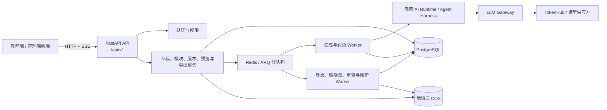
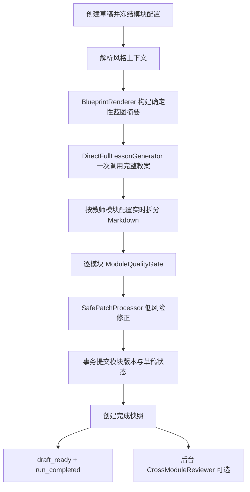
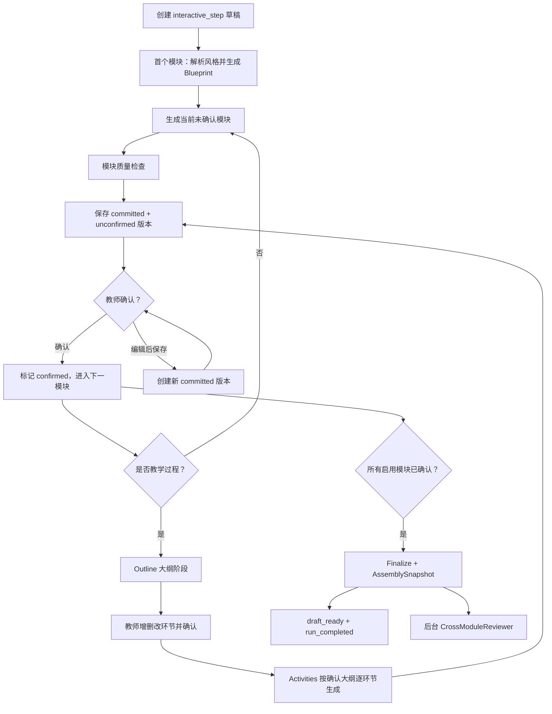

# 教案助手完整技术方案

版本：`v1.1.0`

文档状态：`current`（当前实现对齐稿，尚未冻结）

更新时间：2026-08-28

代码基线：`main@a549003` 与 2026-08-28 当前工作区

数据库基线：Alembic `0031_issue_samples`

适用对象：产品、前端、后端、AI 编排、测试、数据、运维与安全负责人。

## 0. 文档定位

本文是教案助手当前版本的总技术方案，用于统一产品行为、系统架构、AI 工作流、数据事实源、接口事件、质量门、导出、埋点和部署口径。正文以仓库当前实现事实为主体；尚未实现的约束必须显式标记为“目标设计”，外部运行状态必须标记为“未知”，不得把二者当作当前能力。

本文只保留跨团队必须共同理解的契约。字段级、接口级和运维级细节由专项文档承载：

- 教师端 HTTP/SSE：`docs/前端接口对接文档.md`
- 管理端 HTTP：`docs/管理端前端接口对接文档.md`
- 后端领域与流程：`docs/教案生成后端统一设计.md`
- 数据库：`docs/后端数据库契约与实现对照V1.md`
- AI 运行时：`docs/AI算法运行时接入说明.md`
- 状态机：`docs/就绪状态与流转规则.md`
- 并发与队列：`docs/生产并发与队列隔离说明.md`
- 错误处理：`docs/AI教案助手错误处理矩阵.md`
- 埋点指标：`docs/埋点指标字典.md`

### 0.1 事实源优先级

发生冲突时按以下顺序判断：

1. Alembic、ORM、FastAPI router/service、AI runtime 和自动化测试。
2. `schemas/`、`config/`、`policies/`、`prompts/`、`analytics/` 等受控资产。
3. 本文及 `docs/` 下现行专项文档。
4. Git 历史、旧技术方案、评审记录和样例输出。

物理数据库字段以 `migrations/versions/` 和 `app/modules/**/models.py` 为准；接口以 OpenAPI `/docs` 和 router 为准；SSE 事件以 `schemas/stream_event.schema.json` 为准。

### 0.2 已排除的旧口径

当前正式契约不再使用以下旧字段或旧设计：

- `ModuleVersion.content`
- `dependency_version_map`
- `core_learning_points`
- `objective_draft`
- `key_points`
- `difficult_points`
- `assessment_plan`
- `agent_name`
- `llm_call_id`
- `trace_id`
- `student_profile`
- `content_type=table`
- 旧业务路径 `/api/ai` 和 `/lesson-plans`

模块正文统一使用 `canonical_content + teacher_view_content`；依赖统一使用 `actual_dependency_version_map`、`semantic_invalidation_sources` 和 `unresolved_dependency_types`；调用链统一使用 `run_id + span_id + parent_span_id` 的语义。

## 1. 产品目标与范围

### 1.1 产品目标

教案助手面向 K12 教师，提供：

1. 一键生成完整教案。
2. 按模块逐步确认的结构化生成。
3. 模块手动编辑、保存、历史版本恢复和 AI 润色。
4. 完整教案预览、DOCX/PDF 导出和生成历史管理。
5. 个人教案库上传、解析和风格参考。
6. 课后教学反思保存与 AI 润色。
7. 生成过程追踪、质量检查、埋点和审计。

系统的质量目标不是“生成看起来像教案的文本”，而是生成学段、学科和课型边界清楚，课堂动作可执行，教师可快速二次备课的完整教案初稿。

### 1.2 V1 范围

当前 V1 覆盖：

- 小学、初中和高中内置学科及受控课型字典。
- 7 个默认模块、5 个可选预设模块和自定义模块。
- Markdown 教师正文、KaTeX 0.16.22 原生核心公式（含化学式）和英语 IPA。
- PostgreSQL 业务事实源、Redis/ARQ 异步任务、SSE 流式事件。
- TokenHub 兼容的大模型 Gateway，按工作流选择模型。
- 规则质量门、确定性安全修正和后台跨模块审查。

### 1.3 当前非目标

以下能力不属于当前已完成的核心闭环：

- 知识图谱在线推理和知识点干预追踪的正式生产接入。
- 教师反思画像和长期行为画像的生产使用。
- 教师可见的质量评分与审查报告。
- 由前端直接选择底层大模型或质量档位。
- 自动读取未上传的教材原文、页码、课后题或教师用书。
- 把未保存的编辑器工作副本直接作为正式模块版本。

## 2. 系统总体架构

系统采用模块化单体 FastAPI 后端，长耗时任务通过 Redis/ARQ worker 执行。PostgreSQL 保存业务事实，Redis 负责队列、SSE 辅助和短期状态，腾讯云 COS 保存上传文件与导出文件，LLM Gateway 统一模型访问边界。



### 2.1 进程边界

| 进程 | 主要职责 |
| --- | --- |
| API | 鉴权、输入校验、幂等、事务入口、运行创建、入队、查询和 SSE。 |
| one-click worker | 一键生成完整教案。 |
| structured worker | 结构化单步生成和教学过程两阶段生成。 |
| module-polish worker | 模块润色与课后反思润色。 |
| export worker | DOCX/PDF 导出。 |
| thumbnail worker | 个人教案首页缩略图。 |
| internal-review worker | CrossModuleReviewer 后台审查。 |
| maintenance worker | Outbox 发布、补偿和保留策略清理。 |

API 不在请求协程内同步执行真实 LLM 长任务。生产环境必须使用 `TASK_QUEUE_MODE=arq`；`inline` 只用于本地调试和测试。

### 2.2 分层职责

- Router：协议、鉴权依赖、请求/响应 Schema。
- Service：业务状态机、事务和跨仓储编排。
- Repository/ORM：数据库读写，不承载业务流程。
- Task/Worker：可靠调度、超时、取消和运行终态收口。
- AI Provider Adapter：把业务上下文转换为 AI runtime 输入输出。
- AI Runtime：Prompt 装配、模型路由、流式解析、模块质量门和安全修正。
- LLM Gateway：Provider、Secret、超时、流式传输、token 统计和备用模型。

## 3. 核心领域对象与事实源

### 3.1 LessonDraft

`ai_lesson_drafts` 是一份教案的容器，保存教师、创建输入、生成方式、当前模块配置、当前蓝图、当前模块版本映射、完成状态和快照指针。

关键不变量：

1. `current_module_version_map` 是当前模块正文唯一事实源。
2. `content_version` 是草稿级乐观锁版本。
3. `completion_status` 用于历史卡片和页面能力，不替代运行状态。
4. 删除采用软删除；删除时请求取消活跃运行，后续 Worker 不得继续提交业务结果。

### 3.2 DraftModuleConfig

`ai_lesson_module_config_versions` 冻结某次草稿的模块清单。正式字段统一使用：

```json
{
  "module_id": "stable_module_id",
  "client_module_key": "client_m1",
  "module_type": "teaching_process",
  "display_name": "教学过程",
  "display_order": 6,
  "enabled": true,
  "criticality": "core",
  "is_custom": false,
  "module_summary": null
}
```

模块配置偏好只是下一次创建页的初始值；草稿创建后以配置版本为准，不能被后续个人偏好覆盖。

### 3.3 BlueprintVersion

`ai_lesson_blueprint_versions` 保存跨模块教学设计规格、时间规划、风格意向摘要和刷新状态。蓝图不是教师端正文，也不直接作为导出内容。

结构化生成使用持久化蓝图保持模块间一致性；一键直出路径构建确定性蓝图摘要，不额外调用 `BlueprintPlanner` LLM。蓝图内容的正式 payload 由 `schemas/lesson_blueprint.schema.json` 约束。

### 3.4 ModuleVersion

`ai_lesson_module_versions` 保存正式模块版本：

- `canonical_content`：结构化权威内容。
- `teacher_view_content`：教师可见 Markdown 正文。
- `teacher_view_format`：当前为 `markdown`。
- `source`：AI 初稿、手动编辑、教师保存的 AI 润色或系统安全修正。
- `confirmation_status`：`unconfirmed/confirmed`。
- `actual_dependency_version_map`：实际读取的依赖版本。

当前运行时创建的模块版本直接为 `lifecycle_status=committed`。流式临时正文和未保存编辑稿不会创建 provisional 版本；教师点击保存后才创建新 committed 版本。

### 3.5 GenerationRun 与 Event

`ai_generation_runs` 是一次工作流运行的权威对象；`ai_generation_events` 保存可重放事件。ARQ job 只负责调度，不是运行状态事实源。

`request_id` 用于业务请求关联；运行幂等使用 `idempotency_key`。同一 request 可以产生前台生成、后台审查或后续补生成等多个 run。

### 3.6 Snapshot 与 Export

`lesson_assembly_snapshots` 冻结一次完整教案组装结果和模块版本组合。`lesson_export_records` 基于快照生成 DOCX/PDF，并保存格式、状态、文件地址和警告。

历史导出文件是不可信输入，不能回写为当前正文或作为结构化上下文；导出只从数据库中的当前快照生成。

## 4. 模块体系

### 4.1 默认模块

| module_type | 前端名称 | 重要性 |
| --- | --- | --- |
| `textbook_analysis` | 教材分析 | core |
| `teaching_objectives` | 教学目标 | core |
| `key_difficult_points` | 教学重难点 | core |
| `teaching_methods` | 教学方法 | core |
| `teaching_preparation` | 教学准备 | core |
| `teaching_process` | 教学过程 | core |
| `blackboard_design` | 板书设计 | core |

默认模块名称由系统注册表管理，不支持教师改名。教师未选择的默认模块不参与本次生成和 ready 判断。

### 4.2 可选预设模块

| module_type | 前端名称 | 生成来源 |
| --- | --- | --- |
| `student_analysis` | 学情分析 | 蓝图投影 |
| `classroom_practice` | 课堂练习 | `assessment_specs` 派生 |
| `assessment_task` | 评价设计 | `assessment_specs` 派生 |
| `homework_design` | 作业设计 | 规格派生 |
| `design_intent` | 整体设计思路 | 蓝图与模块规格派生 |

教师可在自定义入口使用这些名称。命中预设名称时，后端归一为对应预设 `module_type`；教师填写摘要时以教师摘要为准，否则使用注册表中的模块生成重点。

### 4.3 自定义模块

无法归一到预设模块的自定义模块使用 `module_type=custom_module`。规则如下：

1. 名称最长 20 字。
2. 不得与 7 个默认模块或其别名重名。
3. 草稿内 `module_id` 稳定，显示顺序使用 `display_order`。
4. `module_summary` 是生成约束，不是第二份模块正文。
5. 自定义模块可以命名为“教学反思”，但它仍属于课前教案模块；课后真实教学反思独立存储在 `teacher_reflection_records`，前端需区分入口和语义。

### 4.4 依赖和失效

模块依赖来自 `config/module_registry.json`，不按页面展示顺序临时推断。

- 结构化生成读取相关依赖模块的 `confirmed_version_id`。
- 当前目标模块可以读取自己的当前版本。
- 未确认候选不进入下游稳定上下文。
- 已确认上游模块被再次编辑后，下游模块标记为 `stale/unknown`，系统不会静默重写下游内容。

## 5. AI 组件全景

| 组件 | 类型 | 主要职责 | 是否调用 LLM |
| --- | --- | --- | --- |
| `LessonStyleResolver` | business component | 解析个人教案库和系统风格，冻结 `style_intent`。 | 否/按实现策略 |
| `BlueprintPlanner` | llm_agent | 结构化生成首次建立跨模块蓝图。 | 是 |
| `BlueprintRenderer` | rule component | 一键直出生成确定性蓝图摘要。 | 否 |
| `DirectFullLessonGenerator` | llm_agent | 一次生成本次选择的完整教案并按模块流式拆分。 | 是 |
| `ModuleGenerationAgent` | llm_agent | 根据蓝图生成一个模块或兼容批次模块。 | 是 |
| `ModuleQualityGate` | rule_gate | 模块结构、课题一致性、学段学科和事实风险检查。 | 否 |
| `TopicConsistencyGate` | rule_gate | 检查串课、学段错配、相邻概念污染和核心概念覆盖。 | 否 |
| `SafePatchProcessor` | rule_component | 对白名单问题做确定性低风险修正。 | 否 |
| `CrossModuleReviewer` | llm_agent | 完整教案跨模块一致性与教研质量审查。 | 是 |
| `LLMGateway` | gateway | 模型路由、流式传输、超时、token 和备用模型。 | 是 |
| `ContextBuilder`/业务服务 | business component | 构建最小上下文、依赖版本和运行快照。 | 否 |

Agent Harness 是后端内部编排能力，不拆成独立微服务。Harness 不直接拥有业务表事务，而是通过业务服务和仓储端口保存运行、事件、模块版本与质量结果。

## 6. Prompt 与质量资产装配

Prompt 使用渐进式披露：只装配当前学段、学科、课型、模块和工作流需要的资产，不把所有学科提示词一起发送给模型。

主要层次：

1. `prompts/system_prompt.md`：通用身份、事实边界和输出原则。
2. 工作流 Prompt：一键直出、结构化生成、模块操作和质量审查。
3. 模块片段：教材分析、目标、重难点、方法、准备、过程、板书等。
4. 学科段指南：如小学低段语文、高中数学、初中物理等。
5. 质量模式：`config/lesson_quality_patterns.json` 按学科段、课型和知识形态选择少量正向模式。
6. 风格意向：个人教案库优先，系统风格次之，中性风格兜底。

通用安全、隐私、Schema 和字段命名主要由 Gateway、Gate 和后端校验保证，避免把大量负向限制重复堆入每个生成 Prompt。风格只改变组织和表达，不降低学科准确性、任务具体度与评价闭环。

## 7. 一键生成工作流

### 7.1 当前默认路径

一键生成默认使用 `direct_one_call`：



该路径的前台核心 LLM 调用通常为 1 次，模型默认由 `LESSON_AI_LLM_ONE_CLICK_MODEL` 指定，当前示例配置为 `deepseek-v4-flash-202605`。

### 7.2 流式显示

模型输出 Markdown 模块边界，后端流式解析后按实际配置顺序发送：

```text
module_started(模块 A)
content_delta*(模块 A)
module_done(模块 A, is_temporary=true)
module_started(模块 B)
content_delta*(模块 B)
module_done(模块 B, is_temporary=true)
...
module_progress(quality_check_and_repair_started)
最终模块覆盖流
draft_ready
run_completed
```

模块名称、数量和顺序来自本草稿冻结的模块配置，不允许硬编码 7 个默认模块。Provider token 会在后端按约 48 个字符或约 150ms 聚合为 `content_delta`，兼顾实时性和数据库/SSE 压力。

### 7.3 兜底路径

Markdown 实时流无法稳定收口时，可切换 `dag_batches` 兼容路径。`markdown_stream_fallback_to_json` 或 `direct_generation_fallback_to_batches` 只是过程事件，不是终态。后端必须关闭已开始的临时模块流、继续生成或明确发送 `run_failed`，前端不得停留在“生成中”。

兜底重试必须保留同一风格意向、Prompt 版本和核心上下文，不能把技术失败当作重新随机选择风格。

## 8. 结构化生成工作流

### 8.1 总体流程

结构化生成以教师确认为推进条件：



首次需要蓝图时调用 `BlueprintPlanner`。后续步骤优先复用 `current_blueprint_version_id` 指向的持久化蓝图，并通过 `blueprint_reused` 事件说明；蓝图不存在或需要正式刷新时才重新生成。

结构化模块默认使用 `LESSON_AI_LLM_STRUCTURED_MODEL`，当前示例配置为 `deepseek-v4-pro-202606`。

### 8.2 上下文规则

- 当前目标模块读取已确认的相关依赖模块。
- 未确认模块不会成为后续模块稳定上下文。
- 教师返回上一步修改后，相关下游模块只标记 stale/unknown。
- `previous_confirmed_modules` 由后端根据版本指针构建，不信任前端提交完整正文。

### 8.3 教学过程两阶段

教学过程是唯一强制支持两阶段的默认模块：

1. `outline`：生成环节名称、环节目标和时长。
2. 教师可增加、修改、删除、排序并确认大纲。
3. `activities`：严格以已确认大纲为输入，按 `stage_id` 和顺序逐环节生成正文。

第二阶段不能重新发明一套环节。环节数量、标题和时长以教师确认后的 outline 为准；总和即使与最初 `total_duration_min` 不一致，也以教师确认大纲为本次生成事实，不在第二阶段强制改回。

教师端教学过程正文必须直接从第一个正式课堂环节开始。第一个 Markdown 标题必须是确认大纲第一个环节对应的三级标题，不能在此前新增“问题情境”“课堂活动”“教学流程”等非大纲总标题。若模型仍输出额外标题，后端会确定性删除该标题，并将标题下已有的有效说明并入第一个环节；保存、润色和导出复用同一规范化规则。

事件顺序为：

```text
module_started(教学过程)
stage_started(环节 1)
content_delta*(环节 1)
stage_done(环节 1)
stage_started(环节 2)
...
module_done(教学过程)
```

前端只把已收到 `stage_started` 的当前环节显示为“正在生成”，不能在开始时把全部环节同时标为生成中。

### 8.4 完成条件

结构化单步完成发送 `structured_step_ready`；全部启用模块完成并确认后，Finalize 创建快照并发送 `draft_ready`。每个前台 run 最终必须且只能以 `run_completed`、`run_failed` 或 `run_cancelled` 之一结束。

## 9. 模块编辑、版本与 AI 润色

### 9.1 手动编辑

教师在富文本编辑器中编辑，前端内部可使用 ProseMirror/Tiptap 等文档模型；提交后端时统一转换为受控 Markdown。未保存的撤销/恢复由前端编辑器历史栈负责，保存后的历史恢复由后端模块版本接口负责。

当前后端只提供统一的模块保存接口：保存会创建新的 committed + confirmed 模块版本，更新当前版本映射，并按现有服务规则将草稿保持为 `ready/completed`。后端尚未通过独立请求字段区分前端“保存当前模块”和“一键应用整份教案”两个按钮；如前端保留两种产品语义，应由前端流程或后续独立完成接口明确区分，不能仅根据按钮文案推断后端状态。已经完成并进入历史的教案仍可再次编辑、保存、重新预览和导出。

### 9.2 AI 润色

AI 润色使用会话与消息模型：

1. 创建 polish session，锁定当前已保存模块版本用于并发校验。
2. 教师发送指令和当前工作副本。
3. Worker 调用模块操作模型并实时发送临时正文。
4. 模块自检后发送最终覆盖正文和 `polish_ready`。
5. 教师明确保存后才创建新的 committed 模块版本。

整模块润色返回完整模块候选；选区润色只返回选中文本的替换候选。选区正文的 `content_delta` 必须使用选区范围和选区文本作为上下文，不能在前端先展示整模块生成再突然缩成短文本。

### 9.3 细粒度修改保护

教师只要求修改少量文字时：

- 生成 Prompt 明确只改选区或指定句子。
- 质量门只检查必要的结构、安全和明显事实问题。
- SafePatch 不得以“整体优化”为由恢复旧文本或扩大修改范围。
- 最终响应携带替换范围、候选文本和基于的模块版本，前端按范围应用。

## 10. 质量、安全与修正

### 10.1 前台质量层

每个生成模块至少经过：

1. 输出解析与 Schema 校验。
2. 模块结构和必要字段检查。
3. TopicConsistency：课题、学段、学科、课型和相邻概念边界。
4. 学科事实风险规则：数学、物理、化学、生物、政治、地理、历史、英语等。
5. 教学过程环节与时长解析。
6. XML/Markdown 内部控制标记和畸形闭合标记清理。

质量门应区分明显串课与合理对比。例如《长江的开发与治理》中用于对比的“黄河”不能仅凭关键词判为串课；需要结合篇幅、用途和核心任务判断。

### 10.2 SafePatchProcessor

SafePatch 只处理白名单内的确定性低风险问题，例如：

- 移除后台控制标记、异常 XML 标记和内部风格字段。
- 规范模块标题和重复编号。
- 修复不会改变教学取舍的格式问题。
- 清理无依据的教材页码等明确越界文本。

SafePatch 不负责重写教学方案、替教师选择教学重点或把一个有效表达改成另一种偏好表达。修正后质量下降时必须回退到修正前正文。

### 10.3 CrossModuleReviewer

CrossModuleReviewer 检查完整教案的目标、过程、评价、练习、板书和资源一致性。默认后台异步执行，不阻塞 `ready`、预览和导出，不自动改写结构化生成中已确认模块。

状态通过 `semantic_review_status` 记录：`not_enabled/queued/done/failed/skipped_budget`。后台审查建议供内部评测和后续改进使用，当前不默认展示给教师。

### 10.4 教材和事实边界

未提供教材原文时，系统不得声称已读取页码、课后题、单元编排、具体自然段或生字数量。教材分析只能基于课题、学段、学科常识和教师提供材料保守生成，并提醒具体教材编排需教师核对。

### 10.5 公式和特殊字符

- 数学/物理行内公式：`\\(...\\)`。
- 独立公式：`\\[...\\]`。
- 化学式：使用 KaTeX 核心命令，例如 `\\mathrm{CO_2}`、`\\mathrm{SO_4^{2-}}`；反应条件使用 `\\xrightarrow{\\text{条件}}`。
- 英语音标：保留 IPA Unicode 字符。

后端将可无歧义转换的历史 mhchem/siunitx 写法迁移为 KaTeX 核心写法，并检查公式定界符、命令与环境契约、常见 LaTeX 结构和异常转义。公式检查分为安全校验和渲染诊断：危险命令与不可显示控制字符阻断交付；未知命令、扩展命令、未闭合定界符等普通渲染兼容问题保留原正文，标记 `math_render_state=invalid`，前端静默显示公式源码，不追加可见失败文案；诊断字段仅供日志、埋点和排障使用，不得仅因公式不可渲染而触发模块重生成或 `markdown_stream_fallback_to_json`。浏览器端只负责 KaTeX 0.16.22 原生核心渲染。DOCX/PDF 导出器负责字体和公式转换，并兼容已有历史内容，不能依赖浏览器截图。

## 11. 状态机与版本规则

### 11.1 草稿状态

| `status` | 含义 | 页面能力 |
| --- | --- | --- |
| `creating` | 草稿已创建，尚未进入生成。 | 不可编辑、不可导出。 |
| `generating` | 正在生成或提交当前运行。 | 展示进度和临时正文。 |
| `ready` | 所有已选模块完成，硬门禁通过。 | 可编辑、预览、导出。 |
| `ready_partial` | 已选 core 模块完成，optional/custom 有缺失。 | 可编辑和补生成，不可导出。 |
| `failed_retryable` | Provider、解析、预算等可恢复失败。 | 保留可用内容并允许重试。 |
| `failed` | 输入、权限、硬安全等不可恢复失败。 | 展示失败原因。 |
| `cancelled` | 用户或系统取消。 | 正式已提交内容可保留。 |

`completion_status` 独立用于历史展示。当前代码定义的展示值为 `writing/generating/editing/completed/partial/failed_retryable/cancelled`；当前主流程实际主要写入 `writing/generating/completed/failed_retryable/cancelled`，其中部分结构化结果以 `writing` 表示尚未全部完成。`editing/partial` 已保留展示语义，但业务代码不得在没有实际状态写入路径时依赖它们。

### 11.2 模块状态

`module_state_map` 记录每个模块的生成状态、确认状态、当前版本、确认版本、freshness、工作流阶段和最近错误。系统不能仅通过是否存在 ModuleVersion 推断模块已经完成。

`freshness_status`：

- `fresh`：依赖仍一致。
- `stale`：上游已变化，需要复核或重生成。
- `unknown`：自由编辑后无法可靠判断结构化依赖。

### 11.3 运行状态

`ai_generation_runs.status` 使用 `queued/running/completed/failed/cancelled`。运行结束必须在数据库事务内更新状态并写终态事件，避免“内容已保存但 SSE 永远生成中”。

### 11.4 乐观锁与事务

模块保存和结构化确认校验：

- `expected_content_version`
- `expected_current_module_version_id`
- `expected_module_config_version_id`

模块提交事务同时完成：

1. 插入 ModuleVersion。
2. 更新 `current_module_version_map`。
3. 更新 `module_state_map`。
4. `content_version + 1`。
5. 标记受影响下游 freshness。
6. 写 Outbox 事件。

幂等约束按对象区分：草稿创建使用 `request_id`；运行使用 `idempotency_key`；单模块操作使用自己的 operation/request id。`ai_generation_runs.request_id` 只用于关联和索引，不作为唯一键。

## 12. SSE 实时事件契约

### 12.1 事件全集

当前受控事件为：

```text
run_started
style_context_resolved
structured_step_started
message_started
module_progress
module_started
stage_started
content_delta
stage_done
module_done
polish_ready
structured_step_ready
draft_ready
interrupted
run_completed
run_failed
run_cancelled
heartbeat
```

### 12.2 通用规则

1. 同一 `run_id` 的持久化 `sequence` 单调递增，SSE `id` 等于 sequence。
2. `module_progress` 只表达蓝图、自检、降级和排队阶段，不是正文或完成信号。
3. 正文只由 `content_delta` 传输。
4. `module_started -> content_delta* -> module_done` 必须成对且顺序正确。
5. 临时正文使用 `is_temporary=true`；最终校准使用 `replace_previous=true` 和 `is_temporary=false`。
6. `run_completed/run_failed/run_cancelled` 是唯一运行终态。
7. `draft_ready` 表示草稿已满足完整完成条件，但不能替代 `run_completed`。
8. SSE 空闲期间发送不落库 `heartbeat`。

### 12.3 一键生成标准顺序

```text
run_started
style_context_resolved
module_progress(module_generation_pending)
[
  module_started
  content_delta*
  module_done(is_temporary=true)
] × 实际模块数
module_progress(quality_check_and_repair_started)
module_progress(quality_check_and_repair_done)
[
  content_delta(replace_previous=true)
  content_delta*
  module_done(is_temporary=false)
] × 有最终变化的模块
draft_ready
run_completed
```

只有在全部临时模块已结束后才能显示“教案正在自检并修正”。如果页面显示 5/8 时已经出现自检提示，优先检查前端是否把某个模块级质量事件误当成整课质量阶段。

### 12.4 结构化标准顺序

```text
structured_step_started
style_context_resolved
module_progress(blueprint_generation_started 或 blueprint_reused)
module_progress(structured_module_generation_started)
module_started
content_delta*
module_done(is_temporary=true)
module_progress(quality_check_and_repair_started)
module_progress(quality_check_and_repair_done)
content_delta*(final_module_content)
module_done(is_temporary=false)
structured_step_ready
[draft_ready]
run_completed
```

教学过程 activities 在 `module_started/module_done` 之间插入逐环节 `stage_started/content_delta/stage_done`。

### 12.5 AI 润色标准顺序

```text
message_started
module_started
content_delta*(temporary)
module_done(is_temporary=true)
module_progress(quality_check_and_repair_started)
module_progress(quality_check_and_repair_done)
content_delta*(final replacement)
module_done(is_temporary=false)
polish_ready
run_completed
```

### 12.6 断线恢复

前端连续 45～60 秒没有事件时：

1. 使用 `Last-Event-ID` 重连同一 stream URL。
2. 同时查询 `GET /api/v1/generation-runs/{run_id}`。
3. 按 event id 去重，不按事件内容猜测。
4. 权威状态已终结时立即结束加载态并刷新草稿详情。

服务端必须支持从 `ai_generation_events` 重放。旧运行缺失终态时可返回 `recovered_terminal=true` 的兼容终态；新运行不得依赖前端刷新才显示完成。

## 13. HTTP API 边界

业务 API 统一使用 `/api/v1`。核心资源分为：

| 领域 | 主要资源 |
| --- | --- |
| 认证与档案 | `/auth/*`、`/me`、`/profile-options` |
| 字典与模块配置 | `/lesson-dictionaries`、`/me/lesson-module-config` |
| 草稿 | `/lesson-drafts`、`/lesson-drafts/{draft_id}` |
| 一键生成 | `/lesson-drafts/generations/one-click` |
| 结构化生成 | `/lesson-drafts/generations/interactive`、`interactive/step`、`interactive/confirm`、`interactive/finalize` |
| 运行 | `/generation-runs/{run_id}`、`events`、`cancel` |
| 模块与版本 | `/lesson-drafts/{draft_id}/modules/{module_id}`、`versions`、`restore` |
| AI 润色 | `/module-polish-sessions/*` |
| 预览与导出 | `/lesson-drafts/{draft_id}/preview`、`exports`、`/lesson-exports/*` |
| 课后反思 | `/lesson-drafts/{draft_id}/post-lesson-reflection/*` |
| 个人教案库 | `/personal-lessons/*` |
| 埋点 | `/analytics/events` |
| 管理端 | `/admin/*` |

前端不得直接调用 AI runtime 内部函数或虚构 `/api/ai` 路径。所有业务鉴权、幂等、版本冲突和运行状态由 `/api/v1` 服务处理。

### 13.1 统一响应和错误

HTTP 成功响应使用统一 `DataResponse`；输入错误、权限、冲突和服务失败使用受控错误码。前端不应直接显示 Provider exception、Prompt、堆栈或内部类名，应根据错误码展示用户可理解的信息，并把 `request_id/run_id` 保留给排障。

## 14. 数据库与持久化

### 14.1 技术选型

- PostgreSQL：业务唯一事实源。
- SQLModel/SQLAlchemy async：运行时 ORM。
- Alembic：物理 DDL 唯一变更入口。
- JSON/JSONB：蓝图、canonical content、模块状态、质量 findings 和运行快照。

### 14.2 当前物理表

| 领域 | 表 |
| --- | --- |
| 用户与配置 | `users`、`user_profiles`、`auth_token_revocations`、`config_*`、`user_lesson_preferences`、管理审计表 |
| 草稿与生成 | `ai_lesson_drafts`、`ai_lesson_module_config_versions`、`ai_lesson_blueprint_versions`、`ai_lesson_module_versions`、`ai_generation_runs`、`ai_generation_events` |
| AI、质量与运行问题 | `ai_call_logs`、`system_issue_records`、`quality_check_results`、`domain_outbox_events` |
| 润色 | `ai_module_polish_sessions`、`ai_module_polish_messages`、`ai_reflection_polish_sessions`、`ai_reflection_polish_messages` |
| 交付 | `lesson_assembly_snapshots`、`lesson_export_records`、`teacher_reflection_records` |
| 个人教案库 | `personal_lesson_documents`、上传任务、文档分块、风格摘要 |
| 埋点 | `analytics_events` |

当前没有独立 `quality_check_findings`、`teacher_reflection_profiles` 或 `teacher_style_behavior_signals` 表。Finding 保存在 `quality_check_results.findings` JSON；未建表对象不能被业务查询代码假设存在。

### 14.3 内容保存口径

- AI 给教师显示过但教师未保存的润色候选：保存在 polish session/message 和前端工作副本，不进入当前 ModuleVersion。
- 一键/结构化生成提交的初稿：进入 committed ModuleVersion。
- 教师手动保存或保存 AI 候选：创建新的 committed ModuleVersion，并记录 `source` 与 `teacher_instruction`。
- 初稿与终稿差异：通过初始版本、当前版本和 parent/version_no 比较，不另建重复“终稿内容”字段。

## 15. 个人教案库与风格解析

### 15.1 上传处理

教师可上传受支持的 Word/PDF 教案。文件经 COS 直传或兼容后端中转后：

1. 建立上传任务和文档记录。
2. 解析正文并分块。
3. 自动识别年级、学科和课型。
4. 课型无法可靠确定时默认 `new_lesson`；年级或学科证据不足时保持为空，不编造。
5. 生成风格摘要和缩略图。

当前不提供教师确认或修改自动识别结果的入口。

### 15.2 风格选择优先级

生成时按以下顺序解析：

1. 同教师、同学段/年级、同学科、同课型的个人教案。
2. 同教师个人教案中的近邻匹配，按年级、学科、课型相似度降级。
3. 系统风格注册表中适配当前学段、学科和课型的风格。
4. 中性风格兜底。

个人教案没有完全匹配时不能立即跳过教师全部个人风格；是否采用个人来源以解析器评分和阈值决定。

SSE `style_context_resolved` 用于联调验证：只有 `status=used`、`effective=true` 且 `reference_count>0` 才表示本次实际使用了个人教案参考。该事件只提供来源、匹配摘要和数量，不暴露他人文档正文或敏感路径。

### 15.3 风格冻结

解析后的完整 `style_intent_snapshot`、hash 和 version 保存在草稿中。后续模块复用草稿冻结风格，不因个人教案库新增或删除而静默改变同一草稿风格。

## 16. 教师正文、编辑器与导出

### 16.1 Markdown 与富文本编辑

后端保存 Markdown，前端向教师提供富文本编辑体验：

- SSE 阶段可增量解析 Markdown，或先按安全文本追加后按块渲染。
- 进入编辑态时转换为编辑器文档模型，教师不直接编辑 Markdown 标记。
- 保存时转换回受控 Markdown，保留标题、列表、表格、公式和段落。
- HTML 输入必须经过白名单清洗，不能保存任意脚本和样式。

### 16.2 预览快照

预览不是简单拼接当前页面字符串。后端按冻结模块配置和 `current_module_version_map` 组装 `LessonAssemblySnapshot`，记录模块版本组合、freshness、warning 和内容 hash。

### 16.3 导出

DOCX/PDF 导出走异步 export queue。导出器需支持：

- Markdown 标题、段落、列表和表格。
- LaTeX 数学/物理公式。
- 使用 KaTeX 核心命令表达的化学式，并兼容迁移前已保存的历史化学公式。
- IPA 和常用数学/逻辑符号。
- 中文字体回退。

PDF 当前嵌入 Noto Sans Math、Noto Sans Symbols 2、STIX Two Text 等字体资源。网页正常但导出缺字时，应优先检查导出字体覆盖和公式转换，而不是修改 AI 正文。

### 16.4 导出条件

草稿必须满足：

- `status=ready`
- `completion_status=completed`
- `hard_gate_status=passed`
- 所有已启用模块已完成

`ready_partial` 不可导出。stale/unknown 可以按策略提示教师确认并把警告写入导出记录，但不能被静默忽略。

## 17. 课后教学反思

课后反思是授课后的教师记录，不属于课前教案默认模块。它独立绑定草稿，可关联快照或导出记录。

当前支持：

- 获取和保存反思。
- 基于教师原文生成或润色候选。
- 流式反思润色会话。
- 教师明确保存后更新正式反思。

当前未启用反思画像聚合和长期个性化使用。反思候选不能直接覆盖已保存反思，也不能反向改写历史教案模块。

## 18. 埋点、日志与可观测性

### 18.1 三类数据不可混用

| 数据 | 用途 | 事实源 |
| --- | --- | --- |
| 业务记录 | 草稿、版本、导出、反思和个人教案。 | PostgreSQL 业务表 |
| 运行/调用日志 | 模型耗时、token、fallback、错误和组件阶段。 | `ai_generation_runs`、`ai_call_logs`、事件表 |
| 产品埋点 | 用户行为与产品漏斗。 | `analytics_events` |

埋点不能替代业务表，业务表也不应为了统计点击次数而重复保存产品事件。

### 18.2 当前重点埋点

P0/P1 重点覆盖：

- 发起一键生成和结构化生成。
- 模块生成、确认和结构化会话完成。
- AI 润色发起、候选生成和一键应用。
- 模块保存和版本恢复。
- 教案预览、导出和二次编辑。
- 课后反思保存。

已明确暂不采集的事件不应继续由前端发送，例如仅凭停留时间推断教师满意度、普通输入字段交互、区分反思点击保存与保存成功的重复事件，以及尚未开放前端反馈入口的结果反馈事件。详细事件、关键属性和指标计算见 `analytics/event_catalog.yaml` 与 `docs/埋点指标字典.md`。

### 18.3 AI 调用日志

`ai_call_logs` 记录：

- `component_name/component_kind`
- `llm_provider/model_name/prompt_version`
- `elapsed_ms`
- prompt/completion/total tokens
- fallback 和失败信息
- 受控 metadata

日志不能存 API Key、Secret 或完整未脱敏隐私上下文。错误响应对教师只返回受控消息，详细诊断通过 `run_id` 查询日志。

### 18.4 系统问题统计

`system_issue_records` 是面向工程排障和结项统计的统一问题与可靠性样本表。
`record_kind='issue'` 记录追加式问题事实，`record_kind='sample'` 按小时聚合
各类操作的总样本、成功、失败、降级、取消、慢操作和耗时分母。问题事实既包括
生成失败、用户重试、LLM 重试、模型或工作流 fallback、模块重生成、
公式渲染告警和质量降级，也记录 API 429/5xx、队列积压、Worker 心跳缺失与
任务超时、数据库/Redis/存储/短信异常、Outbox 重试、导出、文档处理以及前端
SSE/渲染失败。
即使最终业务成功，中途发生且已恢复的问题也保留。fallback 采用
“`issue_type` 问题类别 + `phase` 降级路径 + `issue_code` 根因”的口径；
其他问题按 `subsystem + issue_type + issue_code` 统计具体原因。

当前不提供管理端接口，工程师直接查询 PostgreSQL。`COUNT(*)` 表示独立问题事实
或持续事故数，`SUM(occurrence_count)` 表示实际问题或重试次数，
`SUM(observation_count)` 表示持续事故被巡检观察的次数，
`COUNT(DISTINCT run_id)` 表示受影响生成运行数。指定时间窗内的问题经验概率
按同一 `sample_space` 的去重受影响样本数除以 `SUM(sample_count)` 计算；
实际重试或降级频次按 `SUM(occurrence_count) / SUM(sample_count)` 计算，
两者不能混用。PostgreSQL 自身完全不可用或
进程被 OOMKilled 时，死亡进程不能把事故写回同一数据库，必须由外部容器监控和
日志采集补齐。查询示例见 `docs/系统问题统计表使用说明.md`。

### 18.5 关键运行指标

- 入队延迟与队列深度。
- 首个可见正文时间。
- 各模块完成时间和整条工作流耗时。
- Provider 超时、空响应、fallback 和失败率。
- token 与成本。
- SSE 断连、重连和终态恢复率。
- ModuleQualityGate、SafePatch 和后台 Review 结果。

## 19. 并发、队列与韧性

### 19.1 队列隔离

| 队列 | 默认单 Worker 并发 | 任务特征 |
| --- | ---: | --- |
| one-click | 8 | 等待敏感、Flash 模型优先 |
| structured | 3 | 质量优先、Pro 模型、单步耗时较长 |
| module-polish | 6 | 编辑交互敏感 |
| export | 4 | CPU/文件生成，无 LLM |
| thumbnail | 4 | 文件与图片处理 |
| internal-review | 2 | 后台质量增强 |
| maintenance | 2 | Outbox 和清理 |

实际并发为 worker 实例数乘以 `max_jobs`，必须受 Provider RPM、TPM、并发额度、数据库连接和 CPU/内存共同约束。

### 19.2 超时层级

| 层级 | 当前示例 |
| --- | ---: |
| 一键单次 LLM | 120s |
| 结构化/润色单次 LLM | 180s |
| Review 单次 LLM | 240s |
| 一键/结构化/润色 ARQ job | 300s |
| 结构化业务预算 | 240s，其中 30s 留给质量与提交 |

单次 Provider 超时、工作流 deadline 和 Worker job timeout 是不同层级。错误事件必须记录真实 `elapsed_ms` 和 `interruption_reason`；不能因为配置上限为 300s，就把运行 5 秒后因发布中断的任务描述为“已超时 300s”。

### 19.3 失败保留

生成失败前已有临时正文时，`run_failed` 可携带 `state_preserved`、`temporary_content_available` 和 `failure_display_mode=content_with_warning`。前端保留正文并叠加错误提示，不把整页替换为空错误页。

### 19.4 发布与优雅退出

Worker 停止领取新任务后等待当前任务结束。容器和 Kubernetes 的终止宽限建议至少 330s，与 300s job 上限配套，降低滚动发布打断教师生成的概率。

## 20. 安全与隐私

### 20.1 认证与授权

- 教师只能访问自己的草稿、模块、导出和个人教案。
- 管理端访问他人数据必须通过管理员权限并写审计日志。
- JWT 登出进入 PostgreSQL 黑名单，确保旧 token 立即失效。
- 租户级业务表显式保存 `tenant_id`。

### 20.2 AI 上下文最小化

- ContextBuilder 只传当前任务需要的字段和相关依赖模块。
- 个人教案只选取必要风格摘要或最小片段，不默认发送整个个人库。
- API Key 和 Provider Secret 只存在服务端环境变量。
- LLM Gateway 负责传输边界和 Provider 配置。

### 20.3 输出安全

- Structural/ModuleQuality/Policy 类规则检查结构、事实越界和不安全内容。
- SafePatch 只做白名单确定性修改。
- 历史导出文件、用户粘贴 HTML 和模型控制标记均按不可信输入处理。

## 21. 配置与部署

### 21.1 关键依赖

- Python + uv
- FastAPI/Uvicorn
- PostgreSQL
- Redis + ARQ
- 腾讯云 COS/STS
- OpenAI-compatible LLM Provider（当前环境示例为 TokenHub）

### 21.2 模型路由

环境示例：

```env
LESSON_AI_LLM_BASE_URL=https://tokenhub.tencentmaas.com/v1
LESSON_AI_LLM_ONE_CLICK_MODEL=deepseek-v4-flash-202605
LESSON_AI_LLM_STRUCTURED_MODEL=deepseek-v4-pro-202606
LESSON_AI_LLM_MODULE_OPERATION_MODEL=deepseek-v4-pro-202606
LESSON_AI_LLM_REVIEW_MODEL=deepseek-v4-pro-202606
```

教师端不提供模型选择入口。模型切换由后端配置和灰度策略控制，不改变业务接口。

### 21.3 环境与部署 Profile

- Local Compose：容器 PostgreSQL/Redis、API 和 5 类前台 Worker；migration/seed 手工执行。
- Test Compose：外部 PostgreSQL、容器 Redis、migrate、API 和 5 类 Worker；用于共享联调，不是 pytest 可销毁环境。
- Dev K8s：集群内 PostgreSQL/Redis、1 个 API、7 类 Worker和 LoadBalancer。
- Prod Compose：外部 PostgreSQL、单实例 Redis、migrate、API 和 7 类 Worker；当前没有受版本控制的 `.env.prod` 模板或完整 seed 闭环。
- Online K8s：外部 PostgreSQL/Redis、2 个 API、7 类单副本 Worker和 ClusterIP；若已有 Ingress/DNS/TLS，则位于本仓库之外，其实现与 owner 当前未知。

仓库根目录只跟踪 `.env.example`。`.env.local/.env.test/.env.prod` 必须由开发、CI 或 Secret 管理生成，不得提交真实值。Online K8s 通过 Secret `envFrom` 注入；Secret 更新必须触发 Pod 重建并回读 config revision，不能假设环境变量热更新。

### 21.4 目标部署不变量

1. 同一候选发布必须冻结代码 SHA、application/base image digest、Alembic head、Runtime/Prompt/Schema/Config/Policy/Asset hash和测试/Eval报告。
2. 镜像 build once 后在环境间提升同一 digest，生产禁止 mutable `latest`。
3. migration/seed 由 singleton Job 或全局发布锁执行；多副本 Pod initContainer 并发不是目标架构。
4. Schema 使用 expand → backfill → contract，并验证 old/new API、Worker、job 和 Event 兼容。
5. Worker 发布先停止取新任务并安全排空；termination grace 必须大于目标环境实际 job timeout。
6. PostgreSQL 是事实源，Redis 丢失后必须对账 Run/job/Outbox，不能只恢复 Redis 服务。
7. 生产发布必须取得真实 imageID/config revision、七 Worker heartbeat、数据库 readback、SSE replay、Provider canary和实际 Artifact/客户端证据。

### 21.5 发布验收目标与证明边界

| 检查 | 当前含义 | 不能替代 |
| --- | --- | --- |
| `/live` | API 进程存活 | 依赖、Worker、LLM、业务成功 |
| `/ready` | PostgreSQL + Redis 可连接 | 7 Worker、真实 Provider和队列消费 |
| `/health` | DB/Redis、ARQ heartbeat/TTL/queue depth和运行指标 | LLM/COS、release正确性、业务E2E |
| Provider capability | 目标 route 的最小非破坏调用 | Run持久化、质量、SSE和Artifact |
| 业务 canary + 独立回读 | 指定 Bundle 在目标环境完成闭环 | 未观测容量和全部用户流量 |

生产 rollout 前必须完成配置 fail-fast、受控 Alembic/Seed、资产校验以及 D0-D4；资源创建后完成 D5 的镜像/配置指纹和依赖回读，灰度阶段执行 D6-D7，最后以 D8 关闭发布。完整拓扑、迁移、灰度、回滚、灾备和当前缺口以《教案助手 AI Agent 项目开发指南》第 15 章为准；队列数值以《生产并发与队列隔离说明》为准。这些是目标 Gate，不表示当前流水线已经实现。

### 21.6 当前发布阻断

- 部署凭据形态的配置文件被 Git 跟踪，必须先轮换、撤销、清理历史并启用扫描。
- 当前 checkout 缺少文档所称 `.cnb.yml`，Online 清单仍有镜像占位符，也没有可执行 Online apply 入口。
- Dev 手工脚本可能因同 tag/Secret 更新不重建 Pod而报告假成功，镜像变化时又会 delete/apply 绕过 RollingUpdate。
- Online 多副本仍以 Pod initContainer 并发执行 migrate/seed；Worker 无 K8s probe且各类单副本。
- 外部 PostgreSQL/Redis、COS、Ingress/DNS/TLS 的 RPO/RTO、备份、恢复和运行 owner 尚无仓库内证据。

## 22. 测试与验收

### 22.1 自动化测试层次

1. 单元测试：解析器、质量门、格式清洗、公式和状态计算。
2. Service/Repository 测试：事务、幂等、乐观锁、删除取消和版本恢复。
3. API 测试：认证、请求响应、错误码和权限。
4. SSE 测试：事件顺序、临时/最终覆盖、断点重连和唯一终态。
5. Worker 测试：ARQ 入队、超时、取消、优雅退出和终态收口。
6. 真实 LLM 小流量测试：耗时、token、空响应、fallback 和内容质量。
7. 导出回归：DOCX/PDF、公式、化学式、IPA、表格和字体。
8. 容量测试：并发入队、Provider 限流、数据库连接和 SSE 连接数。

### 22.2 核心验收场景

- 默认、预设、自定义模块的任意组合、数量和顺序。
- 一键生成实时逐模块展示，自检只在全部模块初次完成后出现。
- 结构化首次蓝图等待、后续蓝图复用和逐模块确认。
- 教学过程大纲增删改后，Activities 与确认大纲完全一致并逐环节流式输出。
- 模块整段润色和短选区润色。
- 运行中删除草稿、取消、SSE 断线和页面刷新恢复。
- Provider 超时、空响应、Markdown 解析失败和 JSON/DAG 兜底。
- 历史已完成教案再次编辑、保存、预览和导出。
- 个人教案匹配与 `style_context_resolved` 证据。
- 数学/物理公式、化学式、英语 IPA 的网页与导出一致性。

### 22.3 质量验收

自动分数不能只代表格式完整度。质量评测至少分开观察：

- 学科准确性。
- 课题与学段一致性。
- 目标、活动、练习和评价闭环。
- 活动可实施性与时长匹配。
- 语言自然度与模板化程度。
- 练习、错例、答案和判断标准的具体度。
- 教材事实、实验安全和制度流程风险。

## 23. 当前限制与后续演进

### 23.1 当前限制

- 未接入真实教材内容服务时，教材分析和具体课文事实仍需教师核对。
- 自动质量门覆盖常见风险，不能替代所有学科专家终审。
- CrossModuleReviewer 默认后台运行，教师看到 ready 时后台审查可能尚未完成。
- 前端富文本编辑、公式渲染和 SSE 状态机必须按契约实现，后端无法单独保证页面实时效果。
- 个人教案自动识别结果暂不支持教师校正。

### 23.2 知识图谱接入原则

未来接入 K12 知识图谱时，应通过可信知识上下文服务统一访问，而不是让每个 Agent 直接查询图数据库。知识图谱可增强知识点解析、前置关系、易错点、题目应用和干预追踪，但不得替代教案版本、模块正文和教师确认事实源。

知识点干预记录应独立关联 `kp_id + intervention_code + module_id/stage_id/activity_id`，由生成结构和后端事件共同产生；不能只靠页面点击埋点推断教学干预。

## 24. 受控资产与文档治理

### 24.1 受控资产

| 目录 | 内容 |
| --- | --- |
| `schemas/` | 输入输出、事件、快照、审查和错误 Schema |
| `prompts/` | 系统、工作流、模块和学科段 Prompt |
| `config/` | 模块、风格、质量、错误、警告、运行与保留策略 |
| `policies/` | 一键和结构化工作流策略 |
| `analytics/` | 事件目录 |
| `assets/manifest.json` | 受控资产清单和状态 |

新增、删除或修改受控资产时必须更新 Manifest，并运行：

```bash
python scripts/validate_assets.py
```

### 24.2 文档同步矩阵

| 变更 | 必须同步 |
| --- | --- |
| 业务流程、组件或跨域边界 | 本文、`教案生成后端统一设计.md` |
| 教师端 HTTP/SSE | `前端接口对接文档.md`、OpenAPI、Schema、测试 |
| 管理端接口 | `管理端前端接口对接文档.md` |
| 数据表、索引或枚举 | Alembic、ORM、`后端数据库契约与实现对照V1.md` |
| 状态、完成条件和失败策略 | `就绪状态与流转规则.md`、错误矩阵 |
| 模型路由、Prompt 或质量门 | `AI算法运行时接入说明.md`、受控资产 |
| 队列、超时和并发 | `生产并发与队列隔离说明.md`、部署配置 |
| 埋点 | event catalog、Schema、`埋点指标字典.md` |

### 24.3 冻结条件

本文只有在以下条件全部满足时才可从 `current` 改为 `frozen`：

1. 正式 PRD 或产品版本已关联。
2. Git commit/tag 已填写。
3. Alembic head、OpenAPI 和受控资产校验通过。
4. 一键、结构化、润色、导出和个人教案库的关键回归通过。
5. 真实联调环境的 SSE、并发与超时验证完成。
6. 校验报告纳入发布证据。

## 附录 A：关键 workflow_type

| workflow_type | 说明 |
| --- | --- |
| `one_click` | 一键生成完整教案 |
| `interactive_step` | 结构化单步生成 |
| `module_polish_message` | 模块 AI 润色消息 |
| `reflection_polish_message` | 课后反思 AI 润色消息 |
| `module_operation` | 旧同步模块操作兼容入口 |
| `lesson_internal_review` | 后台完整教案审查 |
| `export` | 异步导出 |

## 附录 B：关键配置基线

| 配置 | 当前值/语义 |
| --- | --- |
| `config/module_registry.json` | 13 种模块类型，7 默认 + 5 预设 + custom |
| `config/agent_runtime_policy.json` | one-click、structured、internal review 三类运行策略 |
| `config/feature_flags.json` | 核心生成开启，长期画像类能力关闭 |
| `schemas/stream_event.schema.json` | 18 个当前 SSE 事件 |
| `config/lesson_style_registry.json` | 受控教案风格注册表 |
| `config/lesson_quality_patterns.json` | 跨学段学科质量模式 |
| `config/safe_patch_policy.json` | 确定性补丁白名单 |
| `config/data_retention_policy.json` | 运行与审计数据保留策略 |

## 附录 C：发布前最低检查清单

- [ ] Alembic head 与部署数据库一致。
- [ ] `/live`、`/ready`、`/health` 正常。
- [ ] 七类 ARQ worker 心跳正常。
- [ ] 一键、结构化和润色 SSE 均有唯一终态。
- [ ] 自定义模块组合不会卡在固定默认模块进度。
- [ ] 教学过程两阶段与确认大纲一致。
- [ ] DOCX/PDF 公式、化学式、IPA 和符号回归通过。
- [ ] Provider Key、模型路由、超时和配额已核对。
- [ ] `python scripts/validate_assets.py` 通过。
- [ ] 生产日志不输出 Secret、完整隐私上下文或内部堆栈给教师端。
